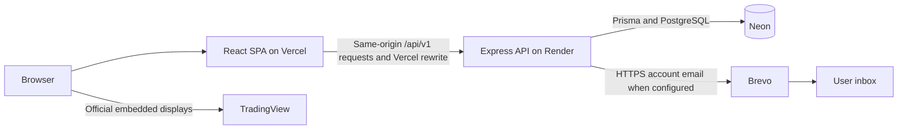

# MarketPulse

A public stock and cryptocurrency tracker with genuine TradingView market displays,
private watchlists, account activity notifications, and secure account management.
Built with React, TypeScript, Express, Prisma, and PostgreSQL.

**Live application:** [market-pulse-five-sand.vercel.app](https://market-pulse-five-sand.vercel.app/)

The live site and this repository may be on different commits: releases are deployed
manually. This README describes the current code, not a fresh production audit.

## Features

- **Market dashboard:** a curated catalog of 10 cryptocurrencies and 5 stocks,
  responsive asset cards, search, asset-type filters, alphabetical sorting, and
  browser-local favorites.
- **Genuine market displays:** official TradingView overview and interactive asset
  charts, verified symbol mappings, source attribution, and delay/privacy disclosures.
  No widget data is scraped or used for backend calculations.
- **Private watchlists:** up to five account-owned lists and 20 assets per list;
  create, rename, delete, add/remove assets, and open their market charts.
- **Portfolio tracker:** private portfolios with user-entered buy/sell records,
  holdings, and fee-inclusive cost basis. Market value and returns are shown only
  for real-mode holdings when every open asset has a fresh, genuine quote. Demo-only
  catalog assets use a separate ledger mode with no market valuation; no
  simulated-price fallback is used.
- **Notifications:** genuine account/watchlist activity, cursor-paginated history,
  unread counts, read/unread controls, mark-all-as-read, and preferences. APIs and
  producers are controlled by a server-side flag that defaults off.
- **Accounts:** registration, sign-in/out, email verification, password reset, and
  session revocation. All five authentication pages use dashboard styling, inline
  validation, accessible feedback, and dark/light themes. Password forms support
  show/hide controls, password managers, and client-only confirmation fields.
- **Account email:** Brevo HTTPS delivery is implemented for verification/recovery;
  Mailpit remains a local-only inbox. Production delivery requires verified sender
  setup, transactional sending approval, and private backend credentials.
- **Responsive interface:** desktop/mobile navigation, profile dropdown, persisted
  theme preference, keyboard focus indicators, loading/retry and unavailable states.

**Native prices, native historical observations, and price alerts are unavailable
in production until suitable data permissions are confirmed.** Existing alert
records remain manageable; creation, rearming, and evaluation are blocked. Charts
never trigger alerts, and provider failures never fall back to invented prices.

## Architecture



Vercel serves the SPA and proxies `/api/*` to Render. The API owns authentication,
validation, authorization, portfolios, watchlists, notifications, and database access. Shared
Zod schemas define frontend/backend contracts. Notification producers write in the
same transaction as successful account/watchlist operations, with deduplication
and preference checks. Private responses are not cached by the frontend/proxy.

TradingView runs directly in the browser, separately from the API. Production
native market ingestion and alert evaluation remain disabled. Historical provider,
worker, and simulated fixtures exist only for isolated development/testing; their
presence does not authorize production data use.

Portfolio trade prices are the values users enter for their own execution records;
they are not provider prices and MarketPulse does not verify those fills. Holdings
and invested cost are calculated from the ledger. Production market value and
returns remain unavailable while no authorized native market quote source is enabled.

| Path                       | Purpose                                                                     |
| -------------------------- | --------------------------------------------------------------------------- |
| `apps/web/src`             | React pages, routing, themed components and API client                      |
| `apps/api/src`             | Express routes, services, repositories, authentication and mailer           |
| `apps/api/prisma`          | Database schema, additive migrations and idempotent catalog seed            |
| `packages/contracts`       | Shared Zod validation and TypeScript contracts                              |
| `scripts`                  | Development processes and isolated test/browser runners                     |
| `docs`                     | Architecture, provider-rights research, feature guides and release runbooks |
| `.github/workflows/ci.yml` | Checks and disposable database integration tests; no deployment             |

## Local setup

Use Node **22.12+ within Node 22**, npm **9+**, and Docker with Compose. `.nvmrc`
selects Node 22. The committed Compose environment uses PostgreSQL 17; production
Neon has been operated with PostgreSQL 18. Use matching/newer compatible PostgreSQL
client tools for backups and restore testing.

From the repository root:

```sh
nvm use # if Node is managed with nvm
npm ci
cp -n .env.example .env
cp -n apps/api/.env.example apps/api/.env
```

Preserve existing environment files. Root `.env` configures Compose; API `.env`
configures the backend and Prisma. Match their local database credentials/port.
**Before the database commands below, confirm that both API database URLs point
only to your local development database, never Neon or another production host.**

```sh
npm run db:up
npm run db:generate
npm run db:validate
npm run db:deploy
npm run db:status
npm run db:seed
npm run dev
```

`db:deploy` applies committed migrations. The seed atomically upserts catalog
metadata without creating users, observations, or notifications. Re-running it
does not duplicate assets. Legacy stock seed flags do not mean public charts use
simulated prices. Never seed, reset, or migrate production without explicit
approval and a verified backup.

| Local service          | Address                                     |
| ---------------------- | ------------------------------------------- |
| Frontend               | <http://127.0.0.1:5173>                     |
| API liveness           | <http://127.0.0.1:3001/api/v1/health/live>  |
| API database readiness | <http://127.0.0.1:3001/api/v1/health/ready> |
| Mailpit inbox          | <http://127.0.0.1:8025>                     |

Vite proxies relative `/api/v1` requests to the local API. Keep `127.0.0.1` and
`APP_ORIGIN` consistent; `localhost` is a different browser origin. Public charts
need network access to TradingView. Local Mailpit captures messages without sending
real email. The verification action starts from Account after registration.

## Configuration and deployment

Use [`apps/api/.env.example`](apps/api/.env.example) as the configuration reference.
Important backend settings:

| Variable                | Purpose                                                                 |
| ----------------------- | ----------------------------------------------------------------------- |
| `DATABASE_URL`          | Application PostgreSQL connection; keep server-only                     |
| `DIRECT_DATABASE_URL`   | Optional separate migration connection; otherwise database URL fallback |
| `APP_ORIGIN`            | Exact frontend origin; production requires HTTPS with no trailing slash |
| `CSRF_SECRET`           | Stable secret of at least 64 characters in production                   |
| `HOST` / `PORT`         | Bind address/port; Render needs `0.0.0.0` and its assigned port         |
| `TRUSTED_PROXIES`       | Explicit trusted proxy IPs/CIDRs; never blanket trust                   |
| `NOTIFICATIONS_ENABLED` | Exact `true`/`false`, defaults `false`; gates APIs and event producers  |
| `EMAIL_MODE`            | `disabled` by default; `mailpit` locally or `brevo` for real delivery   |
| `BREVO_API_KEY`         | Private API key required only in Brevo mode                             |
| `EMAIL_FROM`            | Verified sender address required in Brevo mode                          |
| `MAILPIT_URL`           | Local loopback Mailpit HTTP URL; production rejects Mailpit mode        |

Store production secrets only in Render's backend environment. Never commit keys,
DSNs, passwords or tokens, and never expose them as `VITE_*` variables. Keep the
production origin restricted to the intended Vercel domain. Both notification
and email configuration changes require a backend restart/deployment.

The existing deployment is Vercel + Render + Neon. Vercel's committed configuration
disables automatic Git deployments; keep Render Auto-Deploy disabled for the
manual release workflow. GitHub pushes still run CI. Do not infer deployed commit
identity from the latest GitHub commit.

Build with `npm run build`. The backend's `npm start` runs configuration preflight
before starting Express; it does not apply migrations. Vercel builds the frontend
using the existing project configuration. For release, backup, migration, feature
flag enablement, verification and rollback, use the existing
[notification production runbook](docs/releases/notifications-production.md) and
[deployment guide](docs/deployment.md). Do not rerun migrations or seeding simply
because a new frontend release is ready.

## Security and performance

- Server-side validation and ownership checks remain authoritative; frontend
  validation is for feedback, not access control.
- Passwords use salted scrypt with bounded hashing concurrency. Production sessions
  use secure, HttpOnly, SameSite cookies with the `__Host-` prefix.
- Writes use session-bound signed CSRF tokens, strict origin checks and persistent
  rate limits. The client serializes CSRF issuance and writes, including cross-tab
  coordination where browser support exists.
- Verification/reset tokens are hashed in the database, expire, and are single-use.
  Email links use fragments, removed from the address bar and retained in memory.
  Successful password reset revokes sessions. Recovery responses do not disclose
  account existence; confirmation passwords never reach the API.
- Forms block duplicate in-flight submissions and never automatically replay
  credential/recovery writes. Validation does not make per-keystroke API requests;
  untouched typing avoids unnecessary whole-form validation/rerenders.
- Catalog requests support bounded retries; quota responses respect server cooldowns.
  Visible-tab refreshes, request cancellation, shared backend caches for permitted
  development data, and lightweight components keep unnecessary work bounded.

These controls and regression tests do not constitute a penetration test or a
high-traffic capacity guarantee. No production credentials or user records are
needed for the local checks below.

## Checks

Run the standard checks once after final edits:

```sh
npm run db:validate
npm run lint
npm run format:check
npm run typecheck
npm test
npm run build
```

They do not apply production migrations or send real emails. Tests mock external
providers. Builds/type checks regenerate the Prisma client without changing the
schema or database. CI additionally exercises migrations, seeding and integration
flows against disposable local databases.

After building, Chrome-based visual/flow checks are available:

```sh
npm run test:auth:browser
npm run test:navbar:browser
npm run test:workspace:browser
```

These serve the compiled frontend on loopback with synthetic API fixtures, check
actual visibility/contrast and responsive layouts, and save screenshots in the
printed temporary directory. They do not verify real provider feeds, email inbox
delivery, or production database behavior. Disposable browser profiles are cleaned
up; screenshots remain available.

Database tests are separate. Use the
[isolated local runner](docs/notifications-e1.md) and set `MP_TEST_PG_BIN` to reviewed
local PostgreSQL binaries before `npm run test:integration:local`. The runner
creates a temporary cluster; never point test settings at production. See
[database testing](docs/database.md#database-tests). The complete notification
browser suite is `npm run test:notifications:browser` using that isolated runner.
For dependency review, run `npm audit --omit=dev` and assess findings before changing
versions; do not use forced dependency upgrades.

## Current limitations

- Native quotes, native price-history APIs and price alerts remain unavailable in
  production pending confirmed free public-display/caching/alert rights. No
  unauthorized APIs, widget extraction or simulated fallback is used.
- TradingView availability, delays, sessions and instruments depend on its feeds
  and terms; privacy tools or blocked scripts can prevent embedded charts loading.
- Free Render/Neon resources can sleep or cold-start. No always-on uptime, instant
  notification delivery, or missed-crossing recovery is promised. Notifications
  refresh through the API rather than a realtime push connection.
- Brevo delivery requires approved transactional sending and a verified sender.
  A free Gmail sender may be rewritten; custom sender-domain authentication is
  unavailable without control of a domain. Provider quotas, spam filtering and
  account restrictions apply. API acceptance does not guarantee Gmail delivery.
  Email support is implemented; this README does not assert it is enabled or
  verified on the currently deployed backend. See [email setup](docs/authentication.md).
- There is no email notification channel for watchlist activity, portfolio
  accounting, trading, paid market feed, or multi-factor authentication.
- Public-chart data is not stored as native API observations. Browser favorites
  are device/browser-local; watchlists and notification preferences belong to the
  signed-in account. A database backup/restore process remains an operator duty.

## Further documentation

[Documentation index](docs/README.md) · [Authentication](docs/authentication.md) ·
[Current market UI](docs/market-ui.md) · [Provider-rights research](docs/provider-permissions-a2.md) ·
[Portfolio tracker](docs/portfolio-tracker.md) ·
[Implementation and data safeguards](docs/implementation-bcd.md) ·
[Notification release runbook](docs/releases/notifications-production.md)

Akanksha Sharma — [GitHub](https://github.com/akanksha15sharma).

MarketPulse is informational research software. Data may be delayed or unavailable;
it is not investment advice and does not execute trades.
