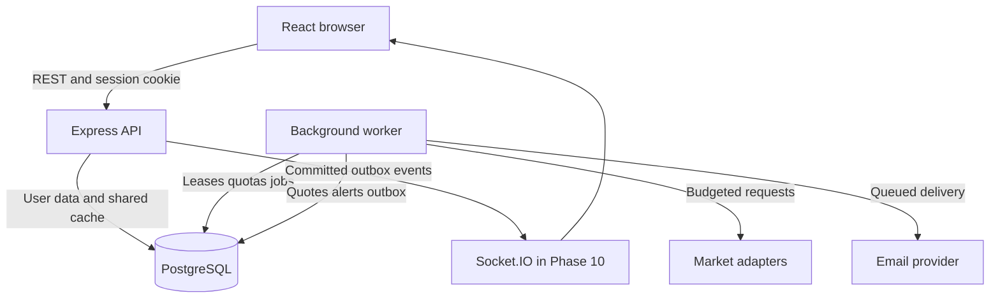

# Architecture overview

Decision date: 2026-11-22. Planned architecture only.

## Stack and boundaries

Frontend: React, TypeScript, Vite, Tailwind, React Router, TanStack Query, React Hook
Form, Zod and Recharts. Backend: Node.js, Express, TypeScript, PostgreSQL, Prisma,
Argon2id passwords, opaque cookie sessions and Pino logging. PostgreSQL-backed jobs
(pg-boss candidate) avoid adding Redis. Tests: Vitest, Testing Library, Supertest,
Playwright. Validate queue compatibility with hosting/pooling before adoption.

Keep the agreed npm workspace layout: `apps/web`, `apps/api`, `packages/contracts`,
`docs`. Phase 1 creates scaffolding; Phase 0 contains documentation only.
Use a modular monolith with distinct API and worker entry points. Controllers handle
HTTP, services own business rules, repositories own persistence, adapters normalize
provider capabilities. Contracts contain public DTOs/validation, not secret models.

Free deployment may run API and bounded worker in one Node process. Always-on mode
separates worker compute. One API instance initially; shared broker is required
before horizontal socket scaling. REST remains authoritative after missed events.

## Data flows

1. Market reads: browser -> API -> persisted shared cache. A history miss schedules
   one deduplicated budgeted fetch; return pending/cached state instead of holding
   unlimited connections. Browser refresh never bypasses provider caps.
2. Ingestion: worker reserves quota/lease -> provider -> validates price, source,
   mode/currency/time -> writes only a newer observation -> evaluates alerts.
3. Alert: atomic activation transition plus unique event, inbox notification and
   email/outbox records in one transaction. Delivery happens after commit.
4. Realtime: API relays committed outbox events to authorized rooms. Socket reconnect
   refetches REST snapshots. Polling fallback remains available.
5. Portfolio: authenticated owner-scoped write -> serialize portfolio mutations ->
   chronological ledger validation -> persist -> derive holdings and P&L.

## Persistence

Users own sessions, auth tokens, watchlists, portfolios, alerts and notifications.
Watchlist items join lists/assets; provider mappings separate provider IDs from asset
identity. Quote/history keys include asset, currency, provider and real/synthetic mode.
Transactions derive holdings; weighted-average cost includes buy fees; sale proceeds
exclude sell fees. Reject overselling and revalidate historical edits/deletions.
PostgreSQL numeric values use decimal arithmetic and JSON strings for financial data.

Alert activations have unique trigger keys. Email delivery, outbox and job records
persist retry/recovery status. Provider counters and scheduler leases survive deploys.
Use UTC timestamptz, exchange timezones for calendars, foreign keys and scoped indexes.
Hash session/reset tokens; expiry and single-use semantics apply. Bound operational
history/queue storage and expire provider caches separately from user ledgers.

## Security and reliability

- Secrets remain server-side; no provider key in browser bundles or logs.
- Same-origin HTTPS; Secure/HttpOnly/SameSite session cookies, CSRF and origin checks.
- Argon2id hashes, session rotation/revocation, expiring single-use recovery tokens.
- Validate inputs, scope every private query by owner, throttle authentication/resends.
- Socket identity comes from authenticated sessions; clients cannot select other users'
  rooms. Bound subscriptions/payloads. Separate demo and real event namespaces.
- Job handlers are idempotent and reclaimable after crash. Email processing is
  at-least-once; use provider idempotency where available, record IDs and do not
  promise exactly-once inbox delivery.
- Separate liveness/database readiness from degraded upstream status.

## Performance and future checks

Batch catalog quotes, coalesce cache misses, paginate, debounce search, lazy-load
charts, bound history ranges and use small database pools. Queue and Prisma combined
must respect connection limits. Test queue locking, pooling and wake-up behavior.
CI uses synthetic fixtures, never ordinary live calls. Verify quota persistence,
source-time rejection, duplicate triggers, account isolation, concurrent sales and
socket recovery in the roadmap's respective phases. Measure performance before
publishing resume metrics; no unmeasured scale claim.
