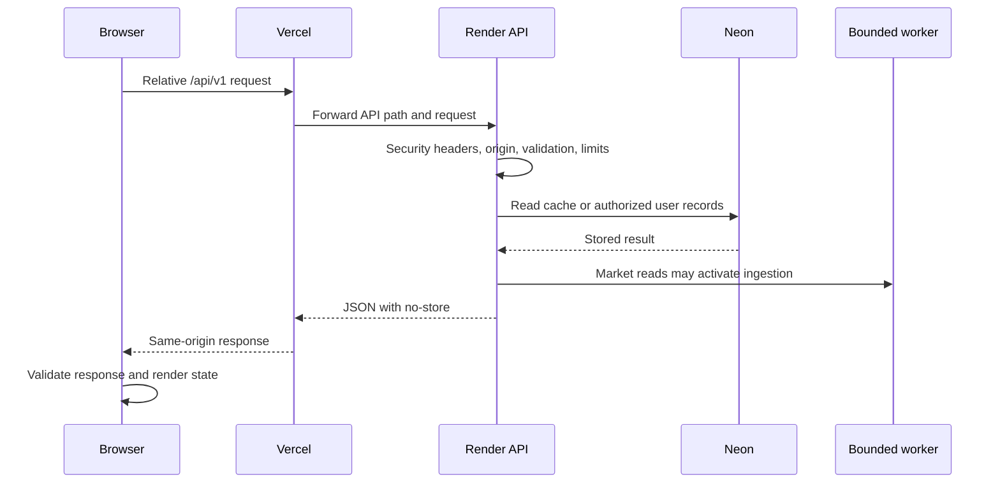
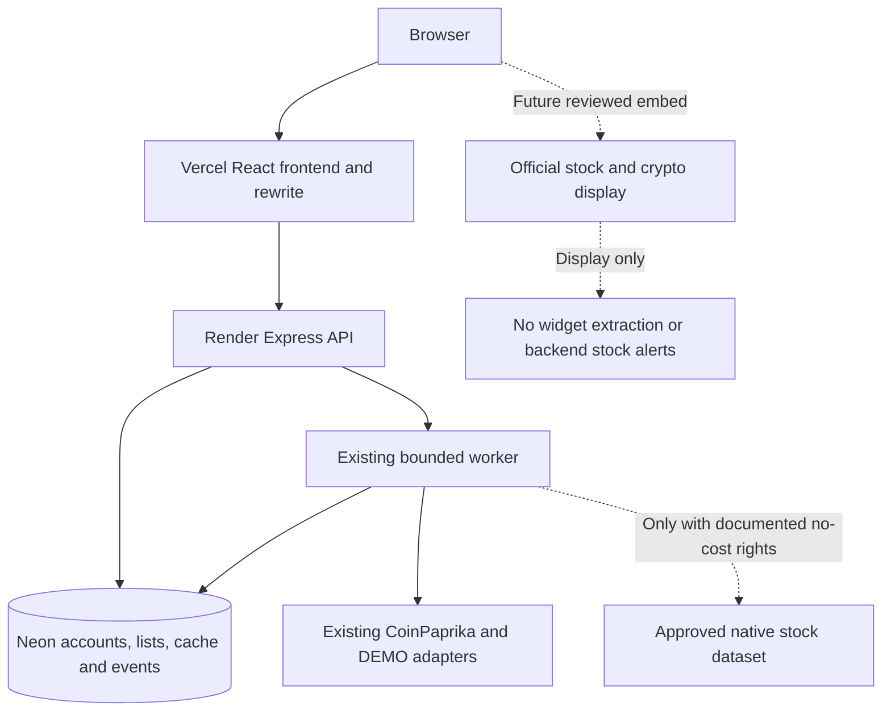

# MarketPulse architecture and public-product direction

Reviewed 2026-11-25 for Step A1. This replaces the original architecture proposal
with an implemented inventory and separately labeled future paths. See
[public scope](scope.md) and [ADR 0005](decisions/0005-public-product-scope-and-data-rights.md).
No application, infrastructure, or database change is authorized by this document.

## A2 permission research extension

The [A2 report](provider-permissions-a2.md) recommends official stock and crypto
embeds for a limited free display release; it does not enable them. The
[proposed implementation plan](free-data-implementation-plan.md) separates private
watchlist identity storage from provider-owned displays and gated native feeds.
The user redefined A2 as research; baseline verification remains a separate pending
approval. Current adapters, frontend behavior, schema, and deployment are unchanged.

## Existing stack

MarketPulse is a modular monolith: one backend application organized into separate
business modules. A monorepo keeps three npm workspaces in one Git repository.

| Location                          | Implemented responsibility                                                                                                                |
| --------------------------------- | ----------------------------------------------------------------------------------------------------------------------------------------- |
| `apps/web`                        | React 19, TypeScript, Vite 8, React Router 7, Tailwind 4, project CSS, custom fetch/polling hooks, and SVG charts                         |
| `apps/api`                        | Node 22, Express 5, Zod, Prisma 7 with adapter-pg, PostgreSQL, scrypt password hashes, opaque cookie sessions, and bounded market workers |
| `packages/contracts`              | Shared Zod input/response validation and TypeScript types                                                                                 |
| `apps/api/prisma`                 | Schema, six existing migrations, stable catalog identities, and transactional seed                                                        |
| `scripts` and `.github/workflows` | Node test runner orchestration, CI, and an optional guarded background batch                                                              |
| `vercel.json`                     | Active API rewrite and frontend build configuration                                                                                       |
| `deploy`                          | Generic hosting examples; these are not evidence of live account settings                                                                 |

The current app does not use the original proposal's TanStack Query, React Hook
Form, Recharts, Argon2id, Pino, pg-boss, or Socket.IO. Playwright is proposed later;
current tests use the Node runner, tsx, an HTTP harness, and rendered React tests.
Adding libraries requires a later justified implementation step.

## Current request flow

The rewrite lets the browser use its own site origin for API requests. It does not
require permissive CORS or weaker cookies. Market reads can activate a worker;
therefore even a seemingly read-only live check can cause cache ingestion. A1 does
not perform live application requests or production database inspection.

## Responsibilities and boundaries

A route parses HTTP input. A service decides business rules. A repository accesses
the database. A provider adapter translates external data into our internal shape.
Contracts define the public JSON shapes shared with the browser.

Important entry points:

- `apps/web/src/app/router.tsx`: screens, loaders, and actions.
- `apps/web/src/lib/api-client.ts`: private calls and CSRF preparation.
- `apps/web/src/features/markets/api.ts`: validated market requests.
- `apps/web/src/features/markets/poll-market.ts`: visible-tab, non-overlapping polling.
- `apps/api/src/app.ts`: security middleware and route composition.
- `apps/api/src/server.ts`: listening and graceful shutdown.
- `apps/api/src/modules/markets/runtime.ts`: activity-window worker lifecycle.
- `apps/api/src/modules/markets/engine.ts`: leases, budgets, retries, and ingestion.
- `apps/api/src/modules/alerts/evaluation.ts`: real-only target evaluation.
- `apps/api/prisma/seed-runner.ts`: read-only warm-up and one atomic seed transaction.

## Implemented data and user safety

Keep credentials in backend secret stores. The browser receives public asset/user
fields, never database URLs, password hashes, provider secrets, or session hashes.
Session cookies are opaque, Secure/HttpOnly/SameSite=Strict in production, with
__Host- names. Write requests require the exact configured Origin and signed,
session-bound CSRF tokens. Ownership comes from sessions, not caller-supplied IDs.
Keep explicit proxy trust; forwarded headers cannot establish a trusted Origin.

Quote/cache identities include source and real/demo mode. Persisted leases avoid
duplicate ingestion, and counters reserve quota before provider calls. Source time
is separate from fetched time. Accepted newer quotes and eligible alert events
commit atomically; repeated ingestion cannot create a second activation event.

Currently stocks select DEMO, while genuine alert evaluation and the event SQL
constraint are CoinPaprika-specific. The database also forces stocks to demo-only.
Native real stocks therefore require coordinated contracts, configuration, source
selection, migrations, evaluator, and UI changes, each separately approved.

## Proposed public data paths

Dashed edges below are future candidates, not deployed features or approved rights.

The official-embed path can show genuine observations without putting those values
into our cache. A native dataset can supply backend quotes, charts, and alerts only
when the permissions cover each use. Both preserve existing watchlist asset IDs.
Unknown permissions produce unavailable capabilities rather than a synthetic fallback.

## Implemented versus schema-only features

Watchlists, accounts, native charts, crypto event history, and quota-aware ingestion
have implementation code. Notification, email-delivery, outbox, and portfolio tables
exist, but complete inbox, delivery, portfolio, and socket workflows do not.
Production recovery email is unavailable because the only mail adapter is local
Mailpit. A table or planned diagram is not proof that a feature works for users.

## Deployment boundary

Preserve Vercel frontend, Render API, Neon PostgreSQL, relative API requests, and
current secrets. Do not provision a paid worker or change scheduler activation.
Free hosts can sleep or suspend at usage limits; durable state remains in PostgreSQL.
See [free deployment constraints](free-deployment.md). A2 records permission
research only; baseline verification and implementation still need explicit approval.
