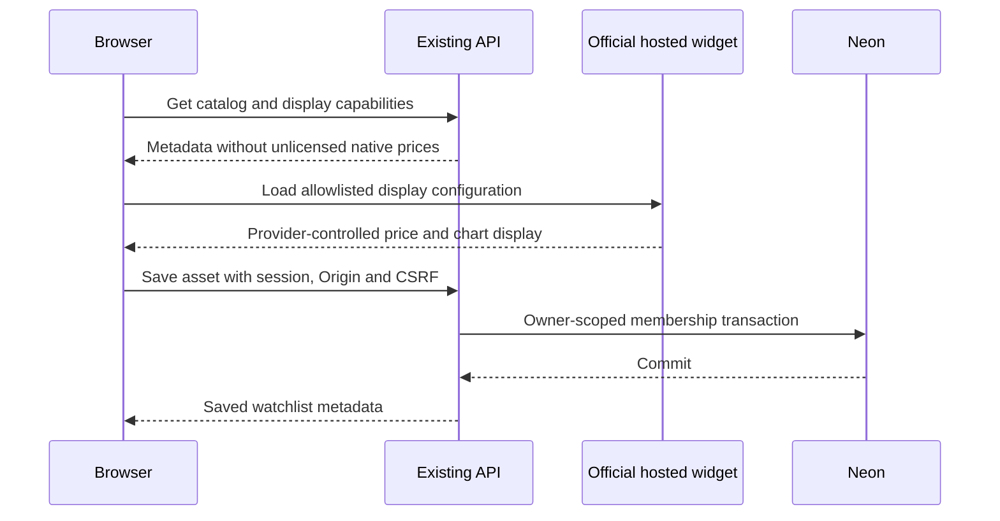
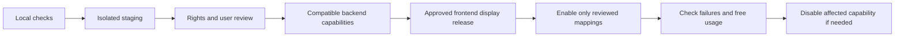

# Proposed free data implementation after A2

Date: 2026-11-25. This plan accompanies the
[A2 permission research](provider-permissions-a2.md). Every step below needs new
user approval. No code examples or proposed environment names here are active
settings. The original A2 baseline work was not executed under this research task.

## Outcome and non-negotiable boundaries

Recommend genuine official embedded displays for stocks and crypto, private
watchlists, and honest source/unavailable labels first. Investigate CoinMarketCap
Basic for a possible native crypto path after its unresolved terms are clarified.
Do not scrape, extract widget data, buy services, or introduce simulated prices.

Preserve production Vercel routing to Render, Neon records, asset UUIDs, session
cookies, exact APP_ORIGIN, CSRF, explicit proxy trust, and no-store on private APIs.
A provider's display offering does not grant backend alert-processing rights.
No implementation step is allowed to silently retarget or delete existing alerts.

## Step 1 — baseline and capability contract

Why: distinguish an asset's identity from permission to display, store, or process
its price. Current stocks select DEMO, and current alerts are crypto-specific.

Proposed files to review or change in a separately approved task:

- `packages/contracts/src/markets.ts` and `alerts.ts`.
- `apps/api/src/config/markets.ts` and proposed `data-entitlements.ts`.
- `apps/api/src/modules/markets/service.ts`, `engine.ts`, and `engine-factory.ts`.
- `apps/web/src/features/markets/api.ts`, `presentation.ts`, `MarketComponents.tsx`.
- `apps/web/src/pages/AlertsPage.tsx`.

First verify existing local tests and deployment configuration without touching
production data. Add optional capability fields, teach readers to accept them,
then change source selection only after compatible readers are deployed.

Illustrative future metadata, not an observed quote or current API response:

```json
{
  "delivery": "embedded",
  "nativeQuotes": false,
  "nativeHistory": false,
  "priceAlerts": false,
  "reason": "display_only_source"
}
```

`delivery` says where the user sees the display. The three booleans independently
control our backend capabilities. `reason` explains a restriction. A false quote
capability never produces a generated number.

Keep `/api/v1/assets` and `/api/v1/quotes` backward compatible. Do not turn on a
new mode by typing an unsupported setting into Render. Existing demo rows remain
stored but are excluded from the intended public real-data presentation through
later approved code changes. No initial data migration should be needed solely
to report capabilities.

Tests: route/query handling, optional metadata, absence of synthetic public prices,
retained user records, and denied capabilities never reaching a provider/evaluator.
Rollback: revert compatible presentation code or disable the new capability; do
not restore public fake observations as a fallback. Done: identities remain useful
and unavailable native functionality is accurately represented.

## Step 2 — per-symbol display review

Why: a market-level directory does not prove that a particular instrument works.
Keep review notes in `docs/widget-symbol-review.md` if this step is approved.

For AAPL, MSFT, AMZN, GOOGL, and NVDA, record provider symbol, venue, delay shown,
regular/extended sessions, supported widget, history ranges, branding, and fallback.
For all ten crypto assets, record the specific spot venue/pair and quote currency.
A USD pair is not the same instrument as USDT or an aggregate index. Do not select
CFDs, leveraged instruments, or an unrelated symbol because the name looks similar.

Use official widget constructors or a local/staging proof only under the approved
step. No scraping or production ingestion. Keep unsupported symbols unavailable.
Done: every enabled mapping has evidence; unverified entries remain disabled.
Rollback: remove an unverified mapping, not the stable catalog asset or watchlist.
No schema migration, API key, or production environment edit is authorized here.

## Step 3 — isolate and integrate the official display

Proposed files:

- Create `apps/web/src/features/markets/MarketDataWidget.tsx`.
- Create `apps/web/src/features/markets/widget-symbols.ts`.
- Modify `AssetDetailPage.tsx`, `MarketDashboardPage.tsx`, and
  `features/watchlists/WatchlistAssets.tsx` as approved.
- Add `apps/web/tests/market-widget.test.tsx` and local browser coverage.

Use the official generated integration and allowlisted symbols. Avoid arbitrary
script URLs, `innerHTML` from user input, or untrusted widget messages. Mount once,
clean up on symbol changes/unmount, and handle React development remounting. Keep
branding, explicit dimensions, a meaningful title, lazy loading, and a blocked
third-party fallback. Do not add hidden data extraction or backend synchronization.



No provider key is needed for the recommended embed path. Do not attach account
identifiers, CSRF values, or tokens to widget URLs. Rendering a widget does not
permit relaxing API CORS, session cookie flags, or Origin checking.

Test valid/unknown symbols, delayed and unavailable presentation, mobile sizing,
keyboard access, script-blocked/offline behavior, remount cleanup, and source labels.
Use controlled test doubles; no tests should extract live widget prices.
No database migration. Rollback by disabling display and retaining asset metadata.
Done: genuine displays operate within the reviewed scope and fail honestly.

## Step 4 — privacy, CSP, and staged display release

Review `vercel.json` and `docs/deployment.md` in a later approved step. Add only the
specific frontend script/frame/connect domains the official integration requires;
prefer a report-only CSP evaluation before enforcement. Do not add wildcard CORS,
blanket script allowances, proxy trust, or weaken the API's JSON policy.

Explain third-party processing and offer an appropriate load/fallback experience.
Do not put credentials in page paths or query strings, since an embed provider can
receive its containing page URL. Confirm accessibility and account workflows with
two isolated staging accounts. A widget does not inherit the user's MarketPulse
session or provide that session to the third party.



Preserve deployment auto-deploy preferences. Obtain separate approval before any
production setting/deployment operation; pushing a commit is not proof it is live.
Disable the affected display on rollback; retain user data. Done: the production
feature claim matches what was verified, without an unexpected cost.

## Step 5 — optional native crypto clarification, then adapter

Only if separately approved: confirm the operative CoinMarketCap Basic agreement,
no-payment enrollment, public app-to-browser delivery, attribution, retention and
backup deletion, account endpoint weights/history ranges, and alert-derived output.
Its advertised commercial-use rights are promising evidence, not a completed grant
for every one of our uses. No provider communication or registration is authorized
by A2. If clarification fails or costs arise, remain on the embedded/unavailable path.

If all required permissions are established, a later adapter task would cover:

- Proposed `apps/api/src/providers/coinmarketcap-provider.ts`.
- `apps/api/src/providers/market-provider.ts`, `config/markets.ts`, and
  `modules/markets/{types,engine,engine-factory,service,repository}.ts`.
- `packages/contracts/src/markets.ts`, Prisma schema, new migrations and mappings.
- Provider-specific unit fixtures and isolated integration tests.

Existing source unions, schemas, selector logic, and alert constraints do not
support a provider change just by adding an API key. Add provider identity first,
separate enum addition/use where necessary, preserve asset IDs, and use distinct
source/cache keys. Keep the adapter disabled until a reviewed staged rollout.

Proposed server-only key name: `CMC_API_KEY`, not a `VITE_` variable. Do not configure
it now. Reconfirm the current official endpoint/version rather than coding against
an indexed example; candidates are latest quotes and permitted historical quotes.
Keep fixed hosts, redirect rejection, timeouts, response-size bounds, positive
prices, correct IDs/currency, and trustworthy source times. Count actual credits,
including retry and symbol weights. A provider refresh frequency is not our required
poll rate. Start conservative and never call once per browser visitor.

Example capacity estimate, not an entitlement: one batch every ten minutes for a
31-day month is 4,464 requests. Multiply by verified endpoint credit weights and
add chart/retry/metadata use before comparing with the actual account allowance.
Do not assume this arithmetic proves that a particular historical plan is included.

Done: rights, no-cost account conditions, verified limits, and normalized payloads
are all established. Rollback disables the new source without relabeling caches or
silently moving old alert activations to a different dataset.

## Step 6 — native charts and alerts only after separate rights gates

A native-feed branch needs independent retention, history, and non-display permission.
Do not create a year's history by retaining snapshots before storage rights exist.
Do not use a request timestamp as a missing source timestamp. A provider lacking
suitable source time cannot satisfy the current post-arm alert safety rules.

For charts, update contracts, provider normalization, market service, and
`HistoryChart.tsx` only for supported intervals and adjustment bases. Keep unsupported
ranges unavailable. Provider-owned charts can remain displayed alongside unavailable
native history, with distinct labels.

For alerts, review `modules/alerts/{evaluation,repository,service}.ts`, shared alert
contracts, UI, and a new SQL provenance migration together. Current code and the
check constraint specifically accept CoinPaprika real crypto events. Preserve
atomic quote/event/state writes, exact decimals, post-arm eligibility, one event
per activation, ownership, and event evidence. Require explicit source-change/rearm
semantics. A delayed feed needs delayed-condition wording; EOD supports only a
closing-price condition when allowed. No widget-derived stock or crypto alerts.

Test old/future/duplicate data, missing timestamps, concurrent pause/evaluation,
quota exhaustion, rejected sources, and rollback. Do not run production seed or
migrations as a side effect. Done: each event has a permitted, accurately timed
observation. If rights never clear, alerts for that dataset stay unavailable.

## Checks, commands, and approval boundaries

In an approved code step, use existing commands as appropriate:

```sh
npm run lint
npm run format:check
npm run typecheck
npm run build
npm test
```

Run integration suites only against the explicitly named local test database.
Production credentials never belong in fixtures. Review migrations on isolated
staging first; production migration, seeding, cleanup, and deployment remain separate
approved operations. The documented display path needs no price database import.

A2 itself validates Markdown formatting, local links, diagram structure, evidence
labels, and a documentation-only diff. It does not run live MarketPulse endpoints:
market reads can activate ingestion. No code-step commands above were executed as
part of permission research. Wait for the next explicit user approval.
