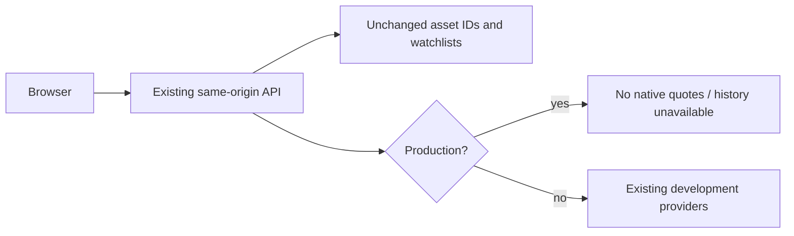
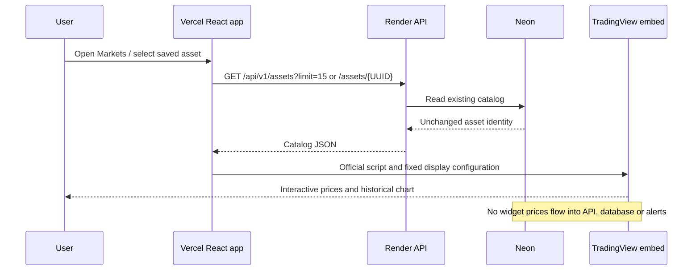
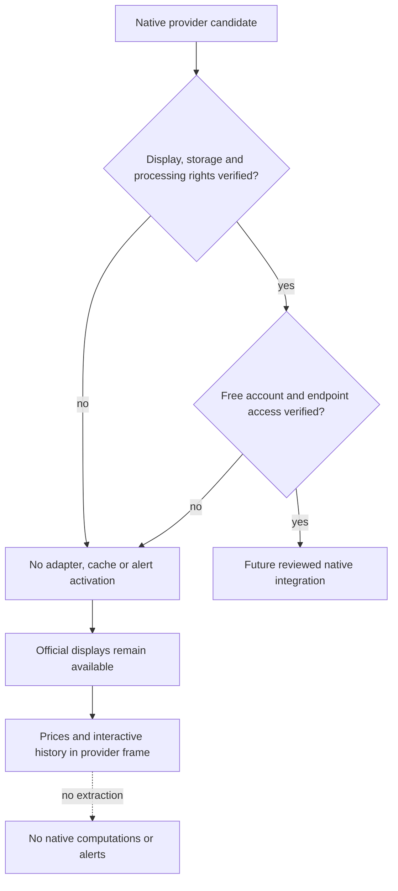
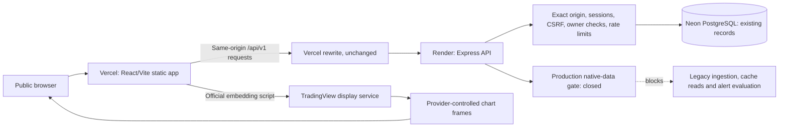
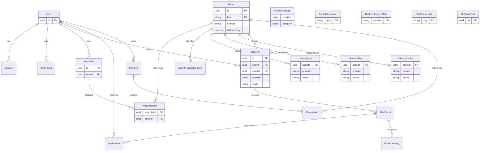
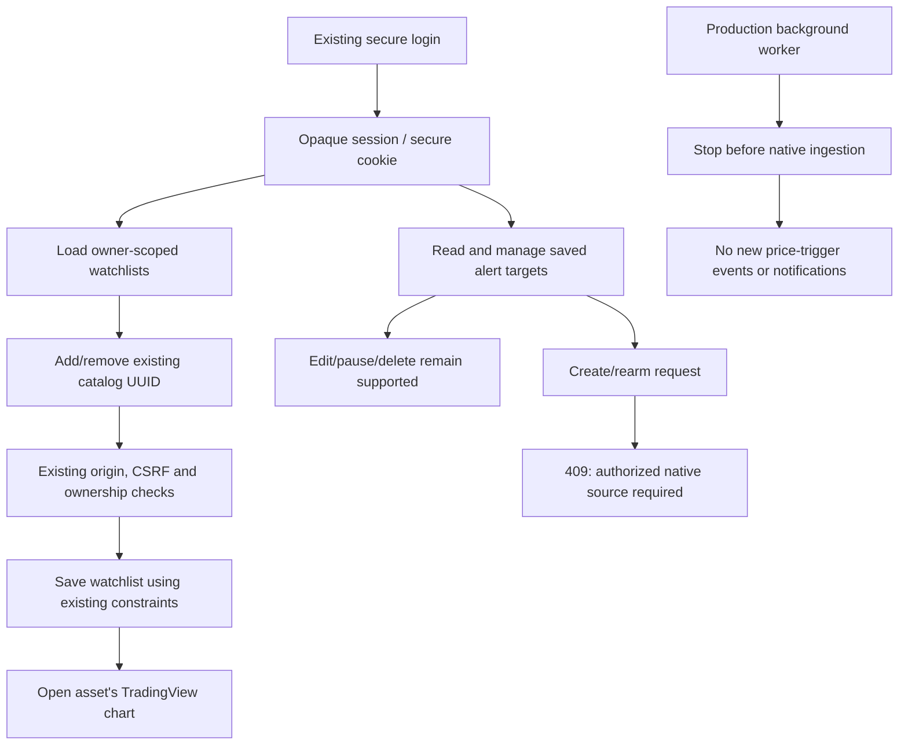

# Public market upgrade — implementation record

## B: prevent invented public prices

Production now stops native ingestion before reading the catalog, even if legacy
`CRYPTO_DATA_MODE=demo` or `coinpaprika` settings remain. Neither provider has an
approved native public-production role. The public quote response is
`{"quotes":[]}`; native history returns 503 with an explanation rather than reading
old observations or queuing work. The production frontend also discards native
quote payloads, protecting users during a staggered deployment.

An observation is a price recorded at a particular time. Old observations stay in
the database; hiding them does not delete accounts, catalog IDs, watchlists or
alert targets. No migration, seed or production write is required.

Production cannot create/rearm price alerts or evaluate incoming observations.
Existing targets can still be read, edited, paused or deleted through the same
authenticated, owner-scoped routes. Development/test providers remain isolated.
The public policy explains unavailable native features without publishing budgets,
worker settings or configuration modes.



`NODE_ENV=production` is essential on Render (already present in the deployment
template). No new secret or environment variable is needed. Existing authentication,
origin checks, CSRF validation and rate limits are unchanged. Run `npm test`,
`npm run typecheck`, `npm run lint`, `npm run format:check`, and `npm run build`.
Database integration commands require a separate local test database; never point
them at Neon production.

Further milestone details and final verification results follow in this report.

## C: genuine, isolated market displays

`apps/web/src/features/markets/tradingview.ts` contains an explicit allowlist:
Nasdaq AAPL, MSFT, AMZN, GOOGL and NVDA; Coinbase BTCUSD, ETHUSD, SOLUSD,
XRPUSD, ADAUSD, DOGEUSD, AVAXUSD, LINKUSD, LTCUSD and DOTUSD. A mapping connects
an existing catalog instrument to the same instrument in the provider's naming
system. It does not change the asset's database UUID, currency or watchlist.
Unknown symbols and mismatched stock exchanges return unavailable, not a guess.

`TradingViewWidget.tsx` loads only the official, fixed-host embedding scripts.
`widgetConfig` produces the provider's settings: daily candles initially, pinned
symbol, UTC time, and the selected light/dark theme. JSON serialization avoids
injecting user-supplied HTML. A chart lets users choose historical ranges and
interact with TradingView's own tools; MarketPulse does not calculate or store
those prices. Overview tabs cover all fifteen mapped instruments.



The overview appears independently of catalog success, so a Render cold start
cannot hide it. Asset details still require the real catalog UUID; failed catalog
requests show retry controls. `api.ts` uses catalog-only reads in the production
build, leaving existing native chart components isolated for development/tests.
No new backend price API, external API key, subscription or migration is required.

`theme.ts` uses the browser's color preference initially and saves an explicit
user choice locally. `AppLayout.tsx` offers an accessible theme button. Styling
supports small screens and light/dark colors without changing authentication
forms' behavior. Display containers have headings, status/error announcements,
titled iframes, keyboard-accessible retries and always-visible provider links.
Cross-origin chart accessibility depends on TradingView; full accessibility of
its controls cannot be guaranteed by MarketPulse.

Script errors and a 20-second timeout offer a retry. An iframe load means the
embedding shell loaded, not that a particular symbol has data. Symbol errors and
feed delays remain visible inside the provider UI. MarketPulse never reads the
frame DOM, messages or prices to infer financial data. Required attribution stays
visible; no CSS covers branding. A disclosure explains direct third-party loading.

### Permission evidence, checked 2026-11-25

- [Official free widgets](https://www.tradingview.com/widget/) offer free default
  branding; [general FAQ](https://www.tradingview.com/widget-docs/faq/general/)
  explains attribution, embedding and usage restrictions.
- [Data FAQ](https://www.tradingview.com/widget-docs/faq/data/) distinguishes widgets
  from an API. [Policies](https://www.tradingview.com/policies/) restrict scraping,
  redistribution and non-display processing. Only official display embeds are used.
- [North American feed directory](https://www.tradingview.com/widget-docs/markets/north-america/)
  explains exchange/feed availability. Do not promise consolidated real-time
  Nasdaq prices or an exact universal delay. Read each widget's indicator.
- Stock symbol pages: [AAPL](https://www.tradingview.com/symbols/NASDAQ-AAPL/),
  [MSFT](https://www.tradingview.com/symbols/NASDAQ-MSFT/),
  [AMZN](https://www.tradingview.com/symbols/NASDAQ-AMZN/),
  [GOOGL](https://www.tradingview.com/symbols/NASDAQ-GOOGL/),
  [NVDA](https://www.tradingview.com/symbols/NASDAQ-NVDA/).
- Crypto symbol pages: [BTC](https://www.tradingview.com/symbols/BTCUSD/?exchange=COINBASE),
  [ETH](https://www.tradingview.com/symbols/ETHUSD/?exchange=COINBASE),
  [SOL](https://www.tradingview.com/symbols/SOLUSD/?exchange=COINBASE),
  [XRP](https://www.tradingview.com/symbols/XRPUSD/?exchange=COINBASE),
  [ADA](https://www.tradingview.com/symbols/ADAUSD/?exchange=COINBASE),
  [DOGE](https://www.tradingview.com/symbols/DOGEUSD/?exchange=COINBASE),
  [AVAX](https://www.tradingview.com/symbols/AVAXUSD/markets/),
  [LINK](https://www.tradingview.com/symbols/LINKUSD/?exchange=COINBASE),
  [LTC](https://www.tradingview.com/symbols/LTCUSD/?exchange=COINBASE),
  [DOT](https://www.tradingview.com/symbols/DOTUSD/markets/).
  These verify instrument/exchange identity, not guaranteed embedded availability
  everywhere. No paid exchange subscriptions are requested.

### Repeatable verification

`npm test` includes allowlist, exchange validation, unsafe-symbol rejection,
configuration, attribution and loading tests. Existing native chart tests still
cover stale/missing observations, errors and quotas in isolation.

After a production build, run `node scripts/test-market-browser.mjs`. It serves
local catalog fixtures, blocks then mocks only the provider's embedding shell,
and checks failure/retry, asset navigation, theme switching and no horizontal
overflow at 1280×900 and 390×844. It asserts no native quote/history/status requests
and no uncaught exceptions. No fake market prices are supplied to the widget.
Screenshots are saved to the temporary directory printed by the command. This
verifies our UI integration, not actual provider ticks or cross-origin controls.

## D: native-provider decision and implemented safeguards

### Research outcome

| Source                         | Verified evidence                                                                                                                                                              | Missing or restrictive evidence                                                                                                                      | Result                                                                   |
| ------------------------------ | ------------------------------------------------------------------------------------------------------------------------------------------------------------------------------ | ---------------------------------------------------------------------------------------------------------------------------------------------------- | ------------------------------------------------------------------------ |
| TradingView official widgets   | Free branded embeds, with instrument/feed restrictions                                                                                                                         | Not an API; no permission to extract widget data for alerts or native caches                                                                         | Implemented for display only                                             |
| CoinMarketCap Basic            | Current pricing advertises free commercial use, 15,000 credits/month, 50 requests/minute, one integrated product and up to 100,000 users; standalone redistribution prohibited | Operative agreement, exact caching/retention, alert-processing rights and account-specific historical endpoint access not verified; key not supplied | Best candidate for further clearance; no adapter or requests implemented |
| CoinPaprika Free               | Free API exists; current page lists 20,000 calls/month                                                                                                                         | Public redistribution/commercial scope not established for Free; earlier A2 pricing analysis records restrictions                                    | Existing adapter retained for isolated development; disabled publicly    |
| CoinLore                       | Accessible free endpoints                                                                                                                                                      | Terms restrict commercial use/redistribution without permission                                                                                      | Not integrated                                                           |
| Coinbase direct market API     | Publicly accessible market endpoints                                                                                                                                           | Market-data terms restrict external end-user distribution                                                                                            | Not integrated; TradingView's own licensed display is a separate channel |
| Free stock APIs reviewed in A2 | Providers offer limited free access                                                                                                                                            | Free access does not establish public-display licensing; no cleared free native stock feed                                                           | Official stock widgets only                                              |

Primary sources checked again:
[CMC pricing](https://coinmarketcap.com/api/pricing/),
[CMC FAQ](https://coinmarketcap.com/api/faq/),
[CMC commercial-agreement URL](https://pro.coinmarketcap.com/user-agreement-commercial/),
[CoinPaprika](https://coinpaprika.com/api/),
[CoinLore terms](https://www.coinlore.com/terms-of-use),
[Coinbase terms](https://www.coinbase.com/legal/market_data).
See [A2](provider-permissions-a2.md) for the individual stock-provider comparison.

The CMC agreement URL returned a generic API landing page during this review,
not the operative agreement. Marketing pages also differ about historical access.
These are **unverified details**, not proof that Basic lacks commercial rights or
requires payment. We must inspect the actual free account agreement and endpoint
entitlements before deciding what storage and automated processing it permits.
No account was created, provider contacted, key requested or paid service used.

### What was implemented

`packages/contracts/src/market-capabilities.ts` adds a shared, validated public
feature description. A contract is the agreed JSON shape between browser and API.
Literal `false` fields prevent this contract from silently claiming approved native
functionality. Production `GET /api/v1/market-status` includes:

```json
{
  "capabilities": {
    "displayProvider": "TRADINGVIEW",
    "nativePrices": false,
    "nativeHistory": false,
    "nativePriceAlerts": false,
    "reason": "authorized_native_source_required"
  }
}
```

This is a fragment of the response; existing mode/refresh fields remain for older
clients and describe legacy configuration, not public permission. Production
returns `providers: []` and `workerEnabled: false` without reading provider counters.
The production frontend does not request this diagnostic endpoint.

Production worker startup, one-shot ingestion and alert evaluation cannot bypass
the gate. One-shot ingestion stops **before** opening a database connection. Saved
alert eligibility uses the existing `unsupported_source` value, preserving older
client schema compatibility; updated UI explains why targets stay saved but cannot
trigger. Creation/rearming return 409, while existing ownership, session and CSRF
checks still apply. Rearm buttons are disabled for ineligible targets.

```ts
export const nativeMarketsAllowed = (settings: MarketSettings) =>
  settings.NODE_ENV !== 'production';
```

The function accepts the server's validated configuration. The comparison permits
existing development/test mechanisms and rejects production ingestion. It is used
at provider construction, execution, public cache reads, worker startup and alert
mutation/evaluation boundaries. Setting an old provider mode cannot grant rights.
This intentionally does not offer an environment switch that pretends to be a license.



No new native adapter, market-cap/volume/change API, historical database capture,
quota reservation system or retry loop was added. Such work would cross the
unverified-rights/credential boundary. Existing isolated development adapters retain
their persistent leases, shared cache, deduplication, bounded retries and quota
checks; none is advertised as authorized public production functionality.

### Exact next native step after clearance

1. Review the operative Basic agreement and free endpoint entitlements. Confirm
   integrated public display, cache TTL/retention, derived historical observations,
   alerts and limits in writing. Record evidence before implementation.
2. Obtain the user's free key securely. Never put it in `VITE_*`, browser code,
   source control, screenshots or URLs. Production environment changes need approval.
3. Add a reviewed server adapter with explicit CMC IDs. Reuse canonical asset IDs;
   never identify coins solely by ticker. Add provider enum/mappings only if needed,
   with a reviewed local migration and separately approved production migration.
4. Define credit accounting from the actual endpoint rules: credits are not always
   equivalent to requests. Reserve a conservative shared monthly/daily budget before
   requests, using database leases to prevent multiple hosts spending it twice.
5. Use validated HTTPS requests, bounded timeouts, a shared cache, deduplicated
   refreshes, bounded jittered retries, Retry-After and persistent circuit breaking.
   Expose observation time and freshness; missing/expired data stays unavailable.
6. Store historical observations only if retention/derivation rights permit it.
   Do not reconstruct market history from widget pixels or claim full historical
   coverage from a few collected samples.
7. Enable alerts only for the cleared source and valid fresh observations after
   arming. Test duplicate delivery, quota exhaustion, stale/missing observations,
   provider rejection and restart recovery before rollout.

These are conditional future instructions, not completed native integration.
The application remains free and useful for market research through official
widgets plus private saved watchlists; native data/alert limitations are explicit.

## Updated system, database and execution flows



The browser is the user interface. Render owns account and saved-list logic. Neon
stores records. Vercel forwards API requests to Render without changing routing or
security. TradingView delivers the financial display directly; there is no backend
route that relays its data. Provider scripting adds a third-party trust dependency;
only fixed official script hosts and allowlisted symbols are used. No production
CORS, CSRF, authentication, trusted-proxy or security-header setting was relaxed.



This ER diagram shows how tables relate, not a new migration. Existing portfolio,
notification/outbox and provider operational tables are retained; their presence
does not mean new public trading or email delivery is implemented. Legacy quote
and history rows are preserved but bypassed by production reads. `isDemoOnly`
remains unchanged for compatibility; it is no longer interpreted as a restriction
on external display widgets. Widget mappings live in code and do not alter rows.



The login/session lifecycle is unchanged. Widget data never enters the watchlist
save request or the alert comparison. No simulated fallback runs after provider
failures; the fallback is an honest error message and provider link.

## Endpoint and file reference

| Endpoint                                                    | Production behavior after rollout                                                     |
| ----------------------------------------------------------- | ------------------------------------------------------------------------------------- |
| `GET /api/v1/assets?limit=15`                               | Existing catalog, UUIDs and metadata; no ingestion activation                         |
| `GET /api/v1/assets/{UUID}`                                 | Existing asset metadata; unknown UUID remains 404                                     |
| `GET /api/v1/quotes`                                        | `{"quotes":[]}`; no legacy cache observations exposed                                 |
| `GET /api/v1/assets/{UUID}/history?range=1D`                | 503 JSON error explaining unavailable native history; no queue write                  |
| `GET /api/v1/market-status`                                 | Backward-compatible metadata plus public capabilities, no production provider budgets |
| `POST /api/v1/alerts`                                       | Auth/CSRF still required; 409 while native rights unavailable                         |
| Existing rearm endpoint                                     | Same security; 409 while unavailable                                                  |
| Existing auth/watchlist/alert read/edit/pause/delete routes | Existing validation and ownership retained                                            |

For example, history responds `{"error":"Native price history is unavailable; use the market chart."}`.
Invalid parameters still pass through existing route/schema validation, rather than
being treated as valid unavailable assets.

| Files                                                                                                                               | Purpose                                                                                           |
| ----------------------------------------------------------------------------------------------------------------------------------- | ------------------------------------------------------------------------------------------------- |
| `apps/api/src/config/markets.ts`                                                                                                    | Validated deployment mode and production gate                                                     |
| `apps/api/src/modules/markets/{engine-factory,engine,service,runtime,run-once}.ts`                                                  | Block production provider construction, execution, cache reads, scheduling and one-shot ingestion |
| `apps/api/src/worker.ts`                                                                                                            | Reject unsupported standalone production ingestion                                                |
| `apps/api/src/modules/alerts/{service,evaluation}.ts`                                                                               | Preserve targets; prevent production creation/rearm/triggering                                    |
| `packages/contracts/src/{market-capabilities,markets,index}.ts`                                                                     | Explicit shared public availability contract                                                      |
| `apps/web/src/features/markets/{tradingview,theme,api}.ts`                                                                          | Fixed mappings, theme preference and production catalog-only API reads                            |
| `apps/web/src/features/markets/TradingViewWidget.tsx`                                                                               | Official embedding, attribution, lifecycle, retry and timeout                                     |
| `apps/web/src/pages/{MarketDashboardPage,AssetDetailPage,AlertsPage,WatchlistsPage}.tsx`                                            | Genuine displays, saved lists, accurate unavailable states                                        |
| `apps/web/src/features/{markets/MarketComponents,markets/AssetInformation,alerts/AlertPresentation,watchlists/WatchlistAssets}.tsx` | Public disclosures without internal budgets/modes                                                 |
| `apps/web/src/layouts/AppLayout.tsx`, `apps/web/src/styles/index.css`                                                               | Theme control, responsive display layout and colors                                               |
| `apps/api/tests/unit/{markets,alerts}.test.ts`, `apps/web/tests/*.test.tsx`                                                         | Production gate, capabilities, mappings and UI regression checks                                  |
| `scripts/test-market-browser.mjs`, `scripts/test-web.mjs`                                                                           | Repeatable browser checks and expanded web test registration                                      |

## Verification results and limits

The starting A1/A2 decisions and A3 report were reviewed before implementation.
A3's missing local PostgreSQL baseline was retried: ordinary Docker access is
unavailable and `sudo -n docker ps` requires interactive authentication. All five
integration suites were run with explicitly local `marketpulse_test` URLs; none
was redirected to Neon.

| Check                                  | Result / scope                                                                                                                                                          |
| -------------------------------------- | ----------------------------------------------------------------------------------------------------------------------------------------------------------------------- |
| `npm test`                             | 127 unit, schema, component and HTTP-level tests pass; includes existing authentication, market failure/quota/staleness, watchlist and alert regression suites          |
| `npm run typecheck`                    | All workspaces plus API tooling/test types pass                                                                                                                         |
| `npm run lint`                         | Pass, zero warnings                                                                                                                                                     |
| `npm run format:check`                 | Pass                                                                                                                                                                    |
| `NODE_ENV=production npm run build`    | Contracts, API and frontend production build pass                                                                                                                       |
| `npm run production:check`             | Pass with synthetic production configuration; no connection or deployment                                                                                               |
| `npm run db:validate`                  | Schema validation; no database query                                                                                                                                    |
| `node scripts/test-market-browser.mjs` | Isolated production UI: desktop/mobile, failure/retry, theme, asset navigation, no overflow/native requests or uncaught exceptions; also silent-script timeout fallback |
| `npm run test:db`                      | BLOCKED: 4 cases cannot reach local PostgreSQL                                                                                                                          |
| `npm run test:auth:db`                 | BLOCKED: 5 cases cannot reach local PostgreSQL                                                                                                                          |
| `npm run test:markets:db`              | BLOCKED: 6 cases cannot reach local PostgreSQL                                                                                                                          |
| `npm run test:watchlists:db`           | BLOCKED: 6 cases cannot reach local PostgreSQL                                                                                                                          |
| `npm run test:alerts:db`               | BLOCKED: 7 cases cannot reach local PostgreSQL                                                                                                                          |

Database suites exit 1; their 28 cases are not passes. No production data was used
to make them green. Live authenticated registration/login, watchlist mutations,
alert management and actual database-backed lifecycle behavior remain unverified
in this task; existing non-database regression checks do not replace them.

Read-only live baseline checks on the existing deployment:

- Frontend root, Markets deep link and login deep link: 200.
- Render and Vercel `/api/v1/health/live` and `/health/ready`: 200. Readiness uses
  the existing read-only database probe; liveness does not require Neon.
- Anonymous `/auth/me`, `/watchlists`, `/alerts`: 401.
- Untrusted Origin: 403; exact production Origin passes origin validation and
  reaches the expected anonymous 401.
- Anonymous CSRF issuance: 200, token present; `__Host-`, Secure, HttpOnly,
  SameSite=Strict and Path=/ flags retained. Token/cookie values were not recorded.

No live market ingestion routes, account creation, production seed/migration or
business-record mutations were invoked. Read-only requests can wake free hosting
and produce ordinary access logs. These checks verify the **existing deployment**;
the new code has not been deployed. Cross-origin provider tick accuracy, all
fifteen embedded symbol entitlements, keyboard/screen-reader behavior inside the
provider frame and full WCAG compliance remain outside the isolated checks.
Free Render cold starts and third-party/network failures remain possible; no free
service SLA or unlimited scale is promised. No email-delivery upgrade is included.

To repeat safely, use synthetic database URLs for unit/build checks and an
explicit localhost `marketpulse_test` database for integration checks. Example:

```bash
DATABASE_URL=postgresql://example.invalid/marketpulse \
DIRECT_DATABASE_URL=postgresql://example.invalid/marketpulse \
NODE_ENV=test MARKET_WORKER_ENABLED=false EMAIL_MODE=disabled npm test

NODE_ENV=production npm run build
node scripts/test-market-browser.mjs
```

For real provider-shell verification against the local frontend fixtures only:
`MARKET_BROWSER_LIVE_WIDGETS=1 node scripts/test-market-browser.mjs`.
This allows official external widget requests; no financial values are extracted
from the frame. Inspect the printed temporary screenshot directory. Successful
iframe loading alone is not proof of data delivery.

## Deployment steps — require separate production approval

No deployment settings, database records or migrations were changed during this
implementation. No production deployment was triggered.

1. **Before pushing:** inspect the actual Render service's Settings → Build & Deploy
   → Auto-Deploy setting. It must be off to push without triggering production.
   The repository template says `autoDeployTrigger: off`, but that does not verify
   the existing service. Vercel's checked-in `git.deploymentEnabled` is false.
   Do not assume that a documentation commit or a code push is deployment-free.
   If the live setting is unknown/enabled, stop the push until the user verifies
   it or approves the resulting deployment. Changing that setting also requires
   user approval. This task asked for confirmation and keeps pushes pending it.
2. After safe push authorization, push the existing branch without force:
   `git push origin main`. Local milestones are B `f008f6c` and C `db4509e`, followed
   by the D safeguards/report milestone. Do not rebase or overwrite remote history.
3. **After separate deployment approval**, deploy the reviewed revision to Render
   manually. Preserve the existing service and Neon URLs. Existing build command:
   `npm ci --include=dev && npm run build -w @marketpulse/contracts && npm run build -w @marketpulse/api`.
   Start command: `npm start`. Do not add `db:deploy`, `db:seed`, `worker:once` or
   a paid background worker to startup.
4. Confirm existing server settings: `NODE_ENV=production`, `HOST=0.0.0.0`, Render's
   injected `PORT`, exact `APP_ORIGIN=https://market-pulse-five-sand.vercel.app`,
   stable `CSRF_SECRET`, existing secure Neon URLs and existing explicit proxy
   configuration. Do not copy secrets into commands or this report. Legacy data
   modes cannot override the production safety gate. No new key is needed.
5. Verify Render liveness/readiness, anonymous 401, bad-Origin 403 and valid-Origin
   handling. After this upgraded backend is deployed, confirm `/api/v1/quotes`
   returns an empty array, history returns the documented 503 and capabilities
   declare native features unavailable. Do not seed or migrate: none is required.
6. Manually deploy the same revision to Vercel. Keep the current install command,
   `npm ci --include=dev`, build command
   `npm run build -w @marketpulse/contracts && npm run build -w @marketpulse/web`,
   and output `apps/web/dist`. Ensure a production build (`NODE_ENV=production`),
   not a test-mode build. Keep `/api/:path*` → Render `/api/:path*` before the SPA
   fallback; no new frontend API base URL or public credential is needed.
7. Open Markets on desktop/mobile, switch theme, filter/star assets and open stock
   and crypto charts. Check provider branding, source/delay indicators, historical
   controls and source links. Block the widget host in browser devtools and confirm
   the retry/link fallback. Inspect Network: production should fetch catalog
   metadata, not native quotes/history/provider diagnostics.
8. With a test account and separately approved production business-record tests,
   verify sign-in, private watchlist ownership, saved target management and disabled
   alert creation/rearm. Do not run destructive integration suites against Neon.
   Completion means genuine display or an honest unavailable state, secure private
   records, no synthetic observations, and no unsupported alert promises.

### Rollback

Keep the existing database and settings unchanged. If the D release has a defect,
manual deployment of C `db4509e` retains the production safety gate and official
widgets. If the widget UI itself must be withdrawn, B `f008f6c` keeps native
production observations blocked and the saved database intact, while displays
remain unavailable. Obtain deployment approval before either action. Do not roll
back to the old public simulation-enabled backend as an automatic recovery, and
do not reset Git history. No down migration, truncation or reseed is needed.

Saved watchlist rows show an explicit unavailable price plus a chart link, rather than a simulated-stock label. Unverified legacy alert observations remain stored but their prices are hidden from event displays; verified historical snapshots keep their recorded source/timestamp.

### Repository automation inspection

The remote `main` reference was checked read-only and remained at A3 `fc7e583`.
`.github/workflows/ci.yml` runs on pushes and pull requests; it checks code and
uses disposable local PostgreSQL, not a production deployment. Its database
seed/migration commands target the runner's local database. GitHub's remote CI
results are not available before a push and must not be reported as passing.

`.github/workflows/free-alerts.yml` is schedule/manual only, gated by
`ENABLE_FREE_ALERTS`, public-repository checks and the default branch. Its actual
repository variable was not accessible. No workflow or variable was changed or
invoked. Do not enable it for this release: production native ingestion is blocked,
and a scheduled one-shot run on the new code will fail safely before opening a
database. No connected Render/Vercel management tool was available to verify the
actual Render auto-deploy setting, so a main-branch push remains withheld pending
that verification. No Git history was rewritten.

### Final browser and API evidence

The optional real-provider browser run completed successfully against the local
production frontend and two local catalog fixtures. Official market overview,
Nasdaq Apple chart and Coinbase Bitcoin chart frames loaded without fallback or
uncaught exceptions. Screenshots were visually reviewed: the overview and both
candlestick charts rendered genuine provider displays, including the stock delay
indicator. This verifies those display examples at that moment, not price accuracy,
future uptime or all fifteen individual embed entitlements. No financial values
were extracted into code, stored, calculated or used for alerts.

The same run passed blocked-script retries and the 20-second silent-script timeout,
theme switching, asset navigation and horizontal-overflow checks on desktop/mobile.
Only catalog/list/detail API routes were requested. Browser evidence is temporary
at `/tmp/marketpulse-browser-FChhN0`; the repeatable harness is committed.

The final compiled API was also started locally using synthetic production settings
and no accessible database. It bound to `0.0.0.0`, passed liveness, anonymous
401 protection, untrusted-origin 403 and CSRF issuance checks, then was stopped.
The full non-database suite passed 127 cases; after the last watchlist presentation
correction all 62 web cases were rerun and passed. No remote CI result is claimed.
