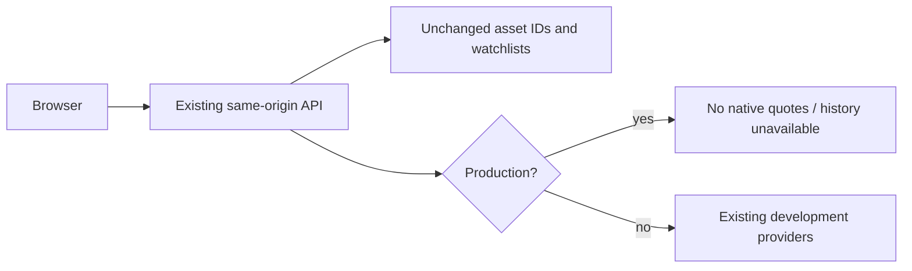
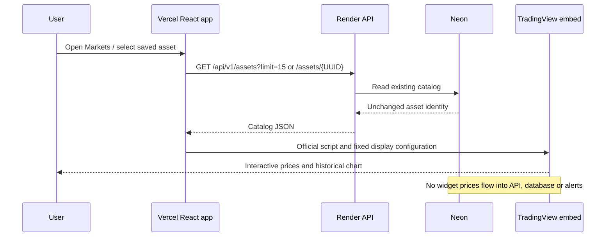

# Public market upgrade — implementation record

## B: prevent invented public prices

Production now stops native ingestion before reading the catalog, even if legacy
`CRYPTO_DATA_MODE=demo` or `coinpaprika` settings remain. Neither provider has an
approved native public-production role. The public quote response is
`{"quotes":[]}`; native history returns 503 with an explanation rather than reading
old observations or queuing work. The production frontend also discards native
quote payloads, protecting users during a staggered deployment.

An observation is a price recorded at a particular time. Old observations stay in
the database; hiding them does not delete accounts, catalog IDs, watchlists or
alert targets. No migration, seed or production write is required.

Production cannot create/rearm price alerts or evaluate incoming observations.
Existing targets can still be read, edited, paused or deleted through the same
authenticated, owner-scoped routes. Development/test providers remain isolated.
The public policy explains unavailable native features without publishing budgets,
worker settings or configuration modes.

`NODE_ENV=production` is essential on Render (already present in the deployment
template). No new secret or environment variable is needed. Existing authentication,
origin checks, CSRF validation and rate limits are unchanged. Run `npm test`,
`npm run typecheck`, `npm run lint`, `npm run format:check`, and `npm run build`.
Database integration commands require a separate local test database; never point
them at Neon production.

Further milestone details and final verification results follow in this report.

## C: genuine, isolated market displays

`apps/web/src/features/markets/tradingview.ts` contains an explicit allowlist:
Nasdaq AAPL, MSFT, AMZN, GOOGL and NVDA; Coinbase BTCUSD, ETHUSD, SOLUSD,
XRPUSD, ADAUSD, DOGEUSD, AVAXUSD, LINKUSD, LTCUSD and DOTUSD. A mapping connects
an existing catalog instrument to the same instrument in the provider's naming
system. It does not change the asset's database UUID, currency or watchlist.
Unknown symbols and mismatched stock exchanges return unavailable, not a guess.

`TradingViewWidget.tsx` loads only the official, fixed-host embedding scripts.
`widgetConfig` produces the provider's settings: daily candles initially, pinned
symbol, UTC time, and the selected light/dark theme. JSON serialization avoids
injecting user-supplied HTML. A chart lets users choose historical ranges and
interact with TradingView's own tools; MarketPulse does not calculate or store
those prices. Overview tabs cover all fifteen mapped instruments.

The overview appears independently of catalog success, so a Render cold start
cannot hide it. Asset details still require the real catalog UUID; failed catalog
requests show retry controls. `api.ts` uses catalog-only reads in the production
build, leaving existing native chart components isolated for development/tests.
No new backend price API, external API key, subscription or migration is required.

`theme.ts` uses the browser's color preference initially and saves an explicit
user choice locally. `AppLayout.tsx` offers an accessible theme button. Styling
supports small screens and light/dark colors without changing authentication
forms' behavior. Display containers have headings, status/error announcements,
titled iframes, keyboard-accessible retries and always-visible provider links.
Cross-origin chart accessibility depends on TradingView; full accessibility of
its controls cannot be guaranteed by MarketPulse.

Script errors and a 20-second timeout offer a retry. An iframe load means the
embedding shell loaded, not that a particular symbol has data. Symbol errors and
feed delays remain visible inside the provider UI. MarketPulse never reads the
frame DOM, messages or prices to infer financial data. Required attribution stays
visible; no CSS covers branding. A disclosure explains direct third-party loading.

### Permission evidence, checked 2026-11-25

- [Official free widgets](https://www.tradingview.com/widget/) offer free default
  branding; [general FAQ](https://www.tradingview.com/widget-docs/faq/general/)
  explains attribution, embedding and usage restrictions.
- [Data FAQ](https://www.tradingview.com/widget-docs/faq/data/) distinguishes widgets
  from an API. [Policies](https://www.tradingview.com/policies/) restrict scraping,
  redistribution and non-display processing. Only official display embeds are used.
- [North American feed directory](https://www.tradingview.com/widget-docs/markets/north-america/)
  explains exchange/feed availability. Do not promise consolidated real-time
  Nasdaq prices or an exact universal delay. Read each widget's indicator.
- Stock symbol pages: [AAPL](https://www.tradingview.com/symbols/NASDAQ-AAPL/),
  [MSFT](https://www.tradingview.com/symbols/NASDAQ-MSFT/),
  [AMZN](https://www.tradingview.com/symbols/NASDAQ-AMZN/),
  [GOOGL](https://www.tradingview.com/symbols/NASDAQ-GOOGL/),
  [NVDA](https://www.tradingview.com/symbols/NASDAQ-NVDA/).
- Crypto symbol pages: [BTC](https://www.tradingview.com/symbols/BTCUSD/?exchange=COINBASE),
  [ETH](https://www.tradingview.com/symbols/ETHUSD/?exchange=COINBASE),
  [SOL](https://www.tradingview.com/symbols/SOLUSD/?exchange=COINBASE),
  [XRP](https://www.tradingview.com/symbols/XRPUSD/?exchange=COINBASE),
  [ADA](https://www.tradingview.com/symbols/ADAUSD/?exchange=COINBASE),
  [DOGE](https://www.tradingview.com/symbols/DOGEUSD/?exchange=COINBASE),
  [AVAX](https://www.tradingview.com/symbols/AVAXUSD/markets/),
  [LINK](https://www.tradingview.com/symbols/LINKUSD/?exchange=COINBASE),
  [LTC](https://www.tradingview.com/symbols/LTCUSD/?exchange=COINBASE),
  [DOT](https://www.tradingview.com/symbols/DOTUSD/markets/).
  These verify instrument/exchange identity, not guaranteed embedded availability
  everywhere. No paid exchange subscriptions are requested.

### Repeatable verification

`npm test` includes allowlist, exchange validation, unsafe-symbol rejection,
configuration, attribution and loading tests. Existing native chart tests still
cover stale/missing observations, errors and quotas in isolation.

After a production build, run `node scripts/test-market-browser.mjs`. It serves
local catalog fixtures, blocks then mocks only the provider's embedding shell,
and checks failure/retry, asset navigation, theme switching and no horizontal
overflow at 1280×900 and 390×844. It asserts no native quote/history/status requests
and no uncaught exceptions. No fake market prices are supplied to the widget.
Screenshots are saved to the temporary directory printed by the command. This
verifies our UI integration, not actual provider ticks or cross-origin controls.
