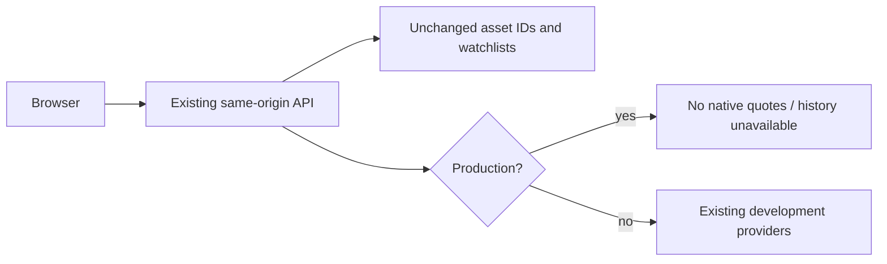

# Public market upgrade — implementation record

## B: prevent invented public prices

Production now stops native ingestion before reading the catalog, even if legacy
`CRYPTO_DATA_MODE=demo` or `coinpaprika` settings remain. Neither provider has an
approved native public-production role. The public quote response is
`{"quotes":[]}`; native history returns 503 with an explanation rather than reading
old observations or queuing work. The production frontend also discards native
quote payloads, protecting users during a staggered deployment.

An observation is a price recorded at a particular time. Old observations stay in
the database; hiding them does not delete accounts, catalog IDs, watchlists or
alert targets. No migration, seed or production write is required.

Production cannot create/rearm price alerts or evaluate incoming observations.
Existing targets can still be read, edited, paused or deleted through the same
authenticated, owner-scoped routes. Development/test providers remain isolated.
The public policy explains unavailable native features without publishing budgets,
worker settings or configuration modes.

`NODE_ENV=production` is essential on Render (already present in the deployment
template). No new secret or environment variable is needed. Existing authentication,
origin checks, CSRF validation and rate limits are unchanged. Run `npm test`,
`npm run typecheck`, `npm run lint`, `npm run format:check`, and `npm run build`.
Database integration commands require a separate local test database; never point
them at Neon production.

Further milestone details and final verification results follow in this report.
