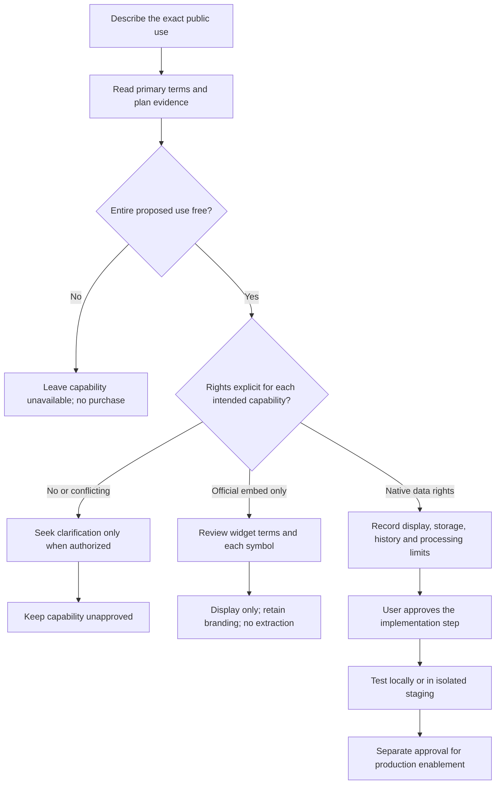
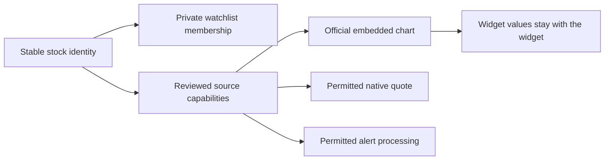

# Market-data rights acceptance checklist

Created 2026-11-25 under Step A1. This is a decision process, not a provider license
or authorization to enable ingestion. Use it with [scope](scope.md),
[provider findings](data-providers.md), and
[ADR 0005](decisions/0005-public-product-scope-and-data-rights.md).

## Plain-language terms

- **Access:** permission to call an endpoint; it may cover only your personal use.
- **Public display:** showing observations to people outside your own account/team.
- **Redistribution:** supplying data onward. Whether our backend-to-browser JSON is
  permitted depends on the agreement; do not assume it is exempt.
- **Non-display use:** a machine processes data, such as comparing a price with an
  alert target. Display permission alone does not establish this right.
- **Retention:** how long data may remain in a cache, database, backup, or log.
- **Attribution:** required source credit; it does not replace a license.
- **Dataset entitlement:** the particular symbols, venues, intervals, delay, and
  uses that the selected account/plan may access.
- **Derived result:** an output calculated from observations, such as an alert.
  Calling it derived does not automatically remove the underlying restrictions.

Example: a provider lets you view its free API for personal research. That does
not establish that MarketPulse may show the results to everyone, save a year's
history, or send target alerts to registered users.

## Acceptance record template

Complete one record for each provider, dataset, and intended use. Unknown means
not approved, not implicitly allowed. Evidence must describe our use case rather
than merely advertise a free API.

| Required field          | What to record                                                                                                          |
| ----------------------- | ----------------------------------------------------------------------------------------------------------------------- |
| Provider, dataset, plan | Exact product, source venue, and free plan/grant                                                                        |
| Audience                | Public/noncommercial users; any geography, user-count, or professional-user restrictions                                |
| Public display          | Permission for pages, cards, charts, and embedded components                                                            |
| Backend delivery        | Permission for our authenticated/anonymous frontend requests and whether raw export is prohibited                       |
| History                 | Allowed ranges, interval/resolution, adjustment basis, and whether a native chart is permitted                          |
| Alert processing        | Explicit permission for server-side comparisons and delivery of derived conditions                                      |
| Retention               | Cache/database duration, refresh duties, backup treatment, and deletion on termination                                  |
| Attribution             | Required wording, links, placement, branding, and delay notices                                                         |
| Quotas                  | Calls versus weighted credits, symbol costs, minute/day/month windows, timezone, retries, and shared-account/IP effects |
| Zero-cost conditions    | No subscription, overage, paid add-on, required purchase, or automatically billed trial                                 |
| Source evidence         | Primary URL and review date, or an appropriately stored written permission reference                                    |
| Review outcome          | Approved capabilities, unresolved questions, reviewer, review date, and next review trigger                             |

Do not put keys, credentials, user information, private agreement contents, or
account identifiers in a public repository. A public record can reference a
private permission document without publishing it.

## Decision flow

Passing the rights check does not itself authorize code changes or a deployment.
The user still approves each implementation step and any production data operation.

## A1 baseline record and A2 update

| Use                                                    | A1 status                         | What remains required                                                                               |
| ------------------------------------------------------ | --------------------------------- | --------------------------------------------------------------------------------------------------- |
| Existing CoinPaprika public crypto API/chart/alert use | Not cleared by this documentation | Resolve public distribution and processing rights for this audience, plus retention and attribution |
| CoinGecko replacement                                  | Not selected                      | Establish relevant free rights; do not infer them from historical plans                             |
| Native stock API                                       | No provider approved              | A no-cost grant covering our exact display, backend delivery, history, and processing               |
| Official stock widget                                  | Candidate for later review        | Applicable site/widget terms, all five symbols, delay, privacy, attribution, and accessibility      |
| Widget-derived backend cache or alerts                 | Excluded                          | Widgets provide no approval to extract observations                                                 |
| Isolated test fixtures                                 | Allowed for software tests        | Never present them as production observations                                                       |

A2 extends this baseline with [dated evidence](provider-permissions-a2.md). Official
stock/crypto embeds are recommended for display only, pending site/symbol checks.
CoinMarketCap Basic now has verified advertised free commercial-use rights, but the
operative agreement, retention, historical endpoint scope, and alerts are unconfirmed.
CoinLore and Coinbase were reviewed without clearing a public native grant. No
provider has been enabled or granted MarketPulse-specific permission by this research.
The user redefined A2 as documentation-only permission research, not baseline execution.

See dated primary evidence in [provider findings](data-providers.md). A1/A2 change no
current deployment: an unresolved licensing gate is documented for a future approved
release decision, not treated as permission to switch off a live integration now.

## Storage, charts, and alerts need separate answers

Caching reduces requests, not legal obligations. If a source permits one hour of
retention, our existing 48-hour history expiry cannot override it. If caching is not
allowed, do not persist the observations. If terms change or access ends, determine
whether stored market data and backups need deletion; preserve user records and
obtain a separately reviewed production operation before any cleanup.

Historical chart permission must cover intervals and adjustments actually shown.
A daily close is a real observation, but it is not an intraday candle. Do not invent
bars for closed markets or claim that a smooth line is continuous measurement.

A permitted delayed dataset still needs truthful timing. For example, a target
observed using delayed prices must be described as a delayed condition. End-of-day
observations support closing-price conditions only if processing is permitted.
Keep the user-defined threshold separate from a provider observation.

The arrows from capabilities are independent possibilities, not automatic grants.
Saving Apple to a watchlist does not make a widget value available to our evaluator.

## Questions for an authorized provider conversation

Use this description only after the user authorizes contacting a provider:

> MarketPulse is a free, noncommercial public application for a curated set of
> ten cryptocurrencies and five US stocks. We want to display observations and
> historical charts, serve our frontend through a backend cache, and optionally
> evaluate user-defined price conditions without trading. Please confirm the
> permitted datasets, public audience, processing/alert rights, cache and backup
> retention, attribution, quotas, and whether this complete use is available at
> no cost. If only embedding is allowed, please identify those limitations.

An open-source or educational exception must be confirmed for this actual use.
Multiple free accounts, rotating keys, changing egress addresses, or scraping
around limits are not acceptable ways to expand a quota or bypass restrictions.

## Handling a denied, expired, or unclear permission

Plan an explicit unavailable state, stop selecting that dataset for the affected
capability in a later approved change, and keep users informed. Do not replace it
with synthetic prices, silently change an alert's dataset, or buy an upgrade.
Preserve existing user identities, watchlists, targets, and event evidence.
If data-retention obligations conflict with immutable provider-derived event
snapshots, resolve the retention design before accepting that source.

Recheck evidence before first enablement, provider/plan changes, monetization,
new exchanges, new export or alert features, and after a published terms change.

## Evidence quality after A2

Label each source fact V (verified), R (restricted), or U (unconfirmed) as defined
in the [A2 report](provider-permissions-a2.md). A marketing permission statement
can be verified while an account-specific grant remains unresolved. An inaccessible
terms URL or indexed excerpt is not a substitute for the operative agreement.
Do not read an internal non-display grant as permission for our public display.

When sources conflict, record both and keep the affected capability unavailable
for release until resolved. Do not label a provider permanently prohibited merely
because our research cannot confirm a grant. No provider contact is authorized by
this checklist. Implementation and production enablement remain separate approvals.
