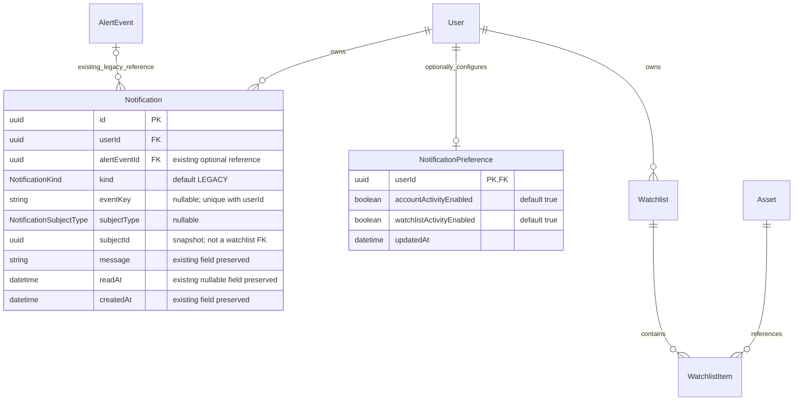

# Phase E1 — notification database and contract foundation

E1 adds database structure and shared validation contracts only. It does **not** add
notification routes, producers, an inbox, preferences UI, polling or delivery workers.
It does not enable native prices, price alerts, email or TradingView data processing.
No production migration, deployment, seed or record change was performed.

## What changed and why

| File                                                                              | Change and purpose                                                                                                                                        |
| --------------------------------------------------------------------------------- | --------------------------------------------------------------------------------------------------------------------------------------------------------- |
| `apps/api/prisma/schema.prisma`                                                   | Adds notification kinds/subjects, optional metadata, lazy per-user preferences and query indexes                                                          |
| `apps/api/prisma/migrations/20261125000100_notification_foundation/migration.sql` | Additive, transactional PostgreSQL migration with deduplication and integrity constraints                                                                 |
| `packages/contracts/src/notifications.ts`                                         | Shared TypeScript types and Zod validation for event metadata, preferences, history and future read operations                                            |
| `packages/contracts/src/index.ts`                                                 | Exports the new contracts; no runtime feature is enabled                                                                                                  |
| `apps/api/tests/unit/notifications.test.ts`                                       | Six tests covering enum parity, event keys, subjects, defaults, legacy display and bounded inputs                                                         |
| `apps/api/tests/integration/notifications.test.ts`                                | Seven PostgreSQL tests for installation, upgrade preservation, interrupted-migration rollback, concurrency, constraints, defaults and ownership lifecycle |
| `scripts/test-local-db.mjs`                                                       | Optional, repeatable rootless PostgreSQL test runner that forces local test URLs and stops its own cluster                                                |
| Root/API `package.json` scripts                                                   | Registers contract tests and local database verification commands                                                                                         |
| `.github/workflows/ci.yml`                                                        | Runs the new database suite against the existing disposable CI PostgreSQL database; no production deployment job is added                                 |

A **contract** defines which JSON/data shapes code can accept. A database
**constraint** enforces a rule even when code writes directly to PostgreSQL. E1
uses both, without implementing the future notification API.

## Updated database relationships



`NotificationPreference` is optional: there is no migration that inserts a row for
every user. An absent row will mean the shared defaults when E2 implements reads.
GET operations must not create preference records. Essential security notifications
are not represented by an editable database flag; the read contract requires
`securityNotificationsRequired: true`. These defaults do not activate delivery.

Existing email preference fields retain their values and meaning. They are not
repurposed for in-app activity, and no existing account preferences are reset.

## Event vocabulary and deduplication

Only these new event kinds are defined:

- Optional account activity: `ACCOUNT_CREATED`, `SIGNED_IN`.
- Essential security activity: `SESSION_REVOKED`, `PASSWORD_RESET`, `EMAIL_VERIFIED`.
- Optional watchlist activity: `WATCHLIST_CREATED`, `WATCHLIST_RENAMED`,
  `WATCHLIST_DELETED`, `WATCHLIST_ASSET_ADDED`, `WATCHLIST_ASSET_REMOVED`.

`LEGACY` identifies records without new provenance. It is excluded from the normal
new-event contract. There is no new native-price or TradingView-price event kind.

The pure `notificationEventKey(kind, operationId)` helper creates a key such as
`SIGNED_IN:<operation-UUID>`. It accepts a version-4 operation UUID and normalizes
it to lowercase. The future business operation must generate that UUID once and
reuse it across its internal transaction retries. The database unique index on
`(userId, eventKey)` prevents two notifications for the same recipient, kind and
operation. Another recipient or a different event kind can use its own record.

This is **not** a promise that arbitrary repeated HTTP requests become idempotent.
E3 must detect actual no-op changes, derive recipients from authenticated business
operations, and reuse stable operation keys. No emitter is implemented in E1.

Additional SQL checks require:

1. Legacy rows have null event/subject metadata. New rows have a key matching their
   kind and the canonical operation UUID format.
2. Account events refer to the recipient's own account. Watchlist events use a
   watchlist snapshot ID. Ownership of that list must still be verified by the
   future business operation; the snapshot deliberately is not a foreign key.
3. New account/watchlist events cannot attach an `alertEventId` and masquerade as
   price notifications. Existing legacy references remain unchanged.
4. New messages cannot consist solely of ordinary whitespace.

Deleting a watchlist therefore will not remove its future activity history. The
existing user-deletion cascades are retained, including deletion of that user's
preference row. The existing legacy alert-event cascade is also retained; E1 does
not silently change older foreign-key behavior.

The original notification indexes are retained. Added indexes cover deterministic
history ordering `(userId, createdAt, id)`, unread/history queries
`(userId, readAt, createdAt, id)`, and unique event keys. No account or asset IDs
are regenerated, and no alert status or existing notification timestamp is changed.

## Legacy handling and compatibility

The migration adds `kind` with a `LEGACY` default and nullable metadata. It does not
rewrite stored messages, `readAt`, creation time, alert references or identity.
Multiple old rows with null event keys remain valid. Old code can still insert
notifications using only the original columns, which is important for rollback.

The future public history contract requires a neutral legacy message:

> Legacy notification retained; details are unavailable because its source is unverified.

Legacy DTOs must have no subject or action URL. E2 must map stored legacy rows to
this display before returning them; the original message remains stored unchanged.
This prevents unknown historic price text being presented as a newly verified alert.
No welcome-message backfill, fabricated activity or production notification seed
is included.

The migration uses `BEGIN`/`COMMIT`. A test deliberately injects a failure before
commit and proves that the added columns/tables disappear while baseline records
remain unchanged. PostgreSQL indexes are built normally inside that transaction;
production row counts and the maintenance window must be reviewed before separately
approving a production migration.

## Shared contracts prepared for E2

Schemas cover typed internal events, history items, read/unread bodies, empty
read-all bodies, preference patches, bounded pagination and summary responses.
These are data definitions, **not mounted routes**.

- Event data rejects mismatched kind/key/subject combinations and extra fields.
- Preference patches must contain at least one supported boolean. They cannot
  enable email, native prices or disable essential security activity.
- History links may target only `/account`, `/watchlists`, or the exact subject's
  `/watchlists?list=UUID`. Arbitrary external or script URLs are rejected.
- Pagination defaults to 20, caps at 50, and bounds the opaque cursor. Cursor
  decoding and owner filtering remain E2 responsibilities.
- A disabled summary uses `{ enabled: false, unreadCount: null }`, rather than
  claiming that an unavailable count is zero.
- Internal event keys and recipient IDs are not included in the public history
  item contract. Future APIs must still enforce session ownership and CSRF.

## Local PostgreSQL blocker and repeatable verification

Docker access was unavailable and no PostgreSQL executable was installed. The
blocker was resolved without sudo, system packages, Docker-group changes, system
users, system services, persistent environment changes or production credentials.

The verification used user-space PostgreSQL **17.12** binaries from the pinned
`@embedded-postgres/linux-x64@17.12.0-beta.19` package. The `beta` suffix belongs to
the package version; the executable reports PostgreSQL 17.12. This is a test-only
download, not an application dependency or a production database replacement.
The package is based on the maintainer's documented binary distribution:
[embedded-postgres repository](https://github.com/leinelissen/embedded-postgres).

Download scripts were disabled. Archive extraction used Python's safe data filter;
package symlink paths were checked to remain inside the extracted directory before
running the reviewed package-local hydration helper. No `createPostgresUser` or
system installation option was used. The downloaded manifest recorded this SRI:

```text
sha512-8N6O9R9fadbb8Fnab2DUwhjVr4zKck8+Z1kTuEKiMdPvlzySv1vVNZLCttsv3ErkIkDwvHq0eWBNi9kAmfrPcw==
```

For a Linux/x64 machine with the reviewed binaries already extracted:

```bash
MP_TEST_PG_BIN=/path/to/package/native/bin npm run test:integration:local
```

The runner performs the following steps automatically:

1. Require PostgreSQL 17 and a non-root user; never create a system account.
2. Make a private temporary cluster and random password file (mode 0600).
3. Bind a dynamically selected port only on `127.0.0.1`, with socket connections
   disabled and password authentication required.
4. Use UTC **inside this temporary cluster**. The first non-UTC run exposed a
   timestamp mismatch in clock-sensitive alert fixtures; UTC makes these tests
   reproducible without weakening application time/provenance checks or changing
   the system/production timezone.
5. Override `DATABASE_URL`, `DIRECT_DATABASE_URL`, `TEST_DATABASE_URL`, test mode,
   mail/worker settings and dotenv location only in child processes. Existing
   application or production URLs cannot be inherited by these test commands.
6. Generate Prisma types, rebuild contracts, migrate `marketpulse_test`, and run
   all six database integration suites.
7. Stop its own cluster even after a test failure. Logs and test-only data stay in
   the printed private temporary directory; no global PostgreSQL service is left.

The runner performs no download. To obtain the pinned binaries manually:

```bash
MP_PG_WORK=$(mktemp -d /tmp/marketpulse-pg17.XXXXXX)
npm --cache "$MP_PG_WORK/npm-cache" pack \
  @embedded-postgres/linux-x64@17.12.0-beta.19 --ignore-scripts \
  --pack-destination "$MP_PG_WORK"
```

Review the archive and package-local hydration helper before execution. Extract
with a path-safe archive tool, verify symlink source/target paths stay beneath the
package directory, then run the reviewed helper and use its `native/bin` path.
Alternatively use an existing trusted PostgreSQL 17 installation. The runner does
not alter its supplied binaries or require package install scripts to run itself.

## Checks and boundaries

Run the new unit contract suite with `npm run test:notifications`; run only the new
database suite with `npm run test:notifications:db` against an explicit local
`marketpulse_test`. The full isolated database runner is recommended because it
also tests the existing authentication, markets, watchlists and alerts.

The upgrade tests create separate randomly named schemas within the guarded local
test database, load all prior migrations, create isolated legacy fixtures, then
apply E1. They compare existing users, sessions, assets, watchlists/items, alerts,
events and notification columns before and after. Temporary schemas and fixtures
are removed only inside the local test database.

Production native alert creation/rearming/evaluation guards are unchanged. No
notification API, producer, UI, feature flag, email delivery or E2 work is included.
A Prisma schema diff confirms the migrated local database matches the schema;
custom SQL checks are additionally verified by actual database inserts.

## Production and rollback

Do not apply this migration to Neon without separate approval. No migration/seed
was added to application startup, Vercel configuration or Render deployment.
The CI change targets only its existing disposable local PostgreSQL database.

A later approved production rollout must apply this additive migration before
E2 code queries the new fields/table. Existing application code remains usable
with the extended schema. If application rollback is needed, keep the additive
migration and all stored records in place; do not drop tables/columns, rewrite
messages, remove migrations from history or re-enable native price processing.

## E1 verification results

All checks below passed locally for this change:

| Check                                                                         | Result                                                                                         |
| ----------------------------------------------------------------------------- | ---------------------------------------------------------------------------------------------- |
| `npm test`                                                                    | 135 passing tests, including six new notification contract tests                               |
| `MP_TEST_PG_BIN=... npm run test:integration:local`                           | 33 passing database tests across six suites, including seven new E1 tests                      |
| `npm run db:validate`                                                         | Prisma schema valid                                                                            |
| Prisma migrate diff (migrated isolated database versus schema, `--exit-code`) | No structural drift                                                                            |
| `npm run lint`                                                                | No errors or warnings                                                                          |
| `npm run typecheck`                                                           | All workspaces pass                                                                            |
| `npm run format:check`                                                        | All files pass                                                                                 |
| `NODE_ENV=production npm run build`                                           | Contracts, API and frontend builds pass; dummy local datasource values, no database connection |

Both empty-database migration and an upgrade with legacy fixtures were tested.
The forced-interruption test verified transactional rollback. Concurrent duplicate
writes produced one notification for the recipient, while distinct recipients and
multiple legacy records remained valid. The temporary PostgreSQL instances were
stopped after verification.

These are local results, not a production migration or a claim about remote CI.
Production records were not inspected or changed. No new inbox/API/browser flow
exists in E1 to test; existing frontend tests are included in `npm test`. Existing
production native-data and alert safeguards were covered by the regression suites
and were not modified. E2 implementation and production migration remain pending
separate approval.
