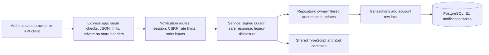
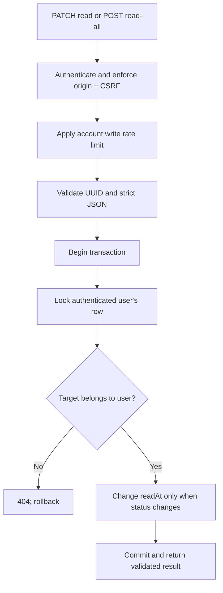
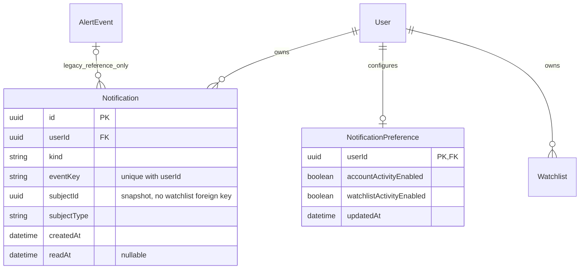

# Phase E2 — private notification backend APIs

E2 makes the E1 inbox records readable and manageable through authenticated APIs.
It does not create activity notifications, implement an inbox UI, send email, run
workers, extract TradingView data or enable native price alerts. Event producers
are a later phase. An empty inbox is an honest empty result, not an error or a
reason to invent notifications.

No production migration, deployment or database change was performed. E2 requires
the existing E1 migration before these routes can run against a database. It adds
no new migration, environment variable, dependency or paid service.

## Architecture: separate responsibilities



A **route** connects an HTTP address to an operation. The **service** applies the
inbox rules and decides what is safe to return. The **repository** contains the
SQL-facing Prisma calls. A **transaction** groups database operations so they
complete together or roll back together. Keeping these jobs separate makes the
security rules easier to review and test.

| File                                                  | Responsibility                                                                                                                                |
| ----------------------------------------------------- | --------------------------------------------------------------------------------------------------------------------------------------------- |
| `apps/api/src/app.ts`                                 | Mounts `/api/v1/notifications`; lazy initialization preserves database-independent liveness; injectable service keeps existing tests isolated |
| `apps/api/src/modules/notifications/routes.ts`        | Six endpoints, authentication, CSRF, rate limits, strict body/query validation                                                                |
| `apps/api/src/modules/notifications/service.ts`       | Public response mapping, cursor usage, preference defaults and response validation                                                            |
| `apps/api/src/modules/notifications/repository.ts`    | All notification queries include session-derived `userId`; pagination, counts, read updates and preferences                                   |
| `apps/api/src/modules/notifications/cursor.ts`        | Versioned, HMAC-signed, account/filter-bound pagination cursor                                                                                |
| `apps/api/src/modules/notifications/transaction.ts`   | Shared account-lock transaction helper, including a lock function usable inside future producer transactions                                  |
| `packages/contracts/src/notifications.ts`             | Existing E1 contracts plus strict individual-read and read-all response schemas/types                                                         |
| `apps/api/tests/unit/notification-api.test.ts`        | HTTP middleware, strict input, cursor integrity, rate-limit and sanitized-error tests                                                         |
| `apps/api/tests/integration/notification-api.test.ts` | Real local PostgreSQL and session tests for privacy, pagination, concurrency, preferences and rollback                                        |
| `apps/api/package.json`                               | Includes E2 suites in the existing notification test commands; root runner and CI already call those commands                                 |

## API reference

All addresses below start with `/api/v1/notifications`. Every endpoint requires a
valid session cookie. Responses use `Cache-Control: no-store`; private results must
not be cached by the browser, Vercel or a shared proxy.

| Method/path          | Input                                                                     | Successful response                                                                                |
| -------------------- | ------------------------------------------------------------------------- | -------------------------------------------------------------------------------------------------- |
| `GET /`              | Optional `filter=all\|read\|unread`, `limit=1..50` (default 20), `cursor` | `{notifications, unreadCount, nextCursor}`                                                         |
| `GET /summary`       | No query                                                                  | `{enabled:true, unreadCount:3}`                                                                    |
| `PATCH /:id/read`    | JSON `{read:true}` or `{read:false}`                                      | `{notification: ...}`                                                                              |
| `POST /read-all`     | JSON `{}`                                                                 | `{updatedCount:3}`; a repeat returns 0 when nothing else is unread                                 |
| `GET /preferences`   | No query                                                                  | `{accountActivityEnabled:true, watchlistActivityEnabled:true, securityNotificationsRequired:true}` |
| `PATCH /preferences` | One or both editable booleans                                             | Same preferences response                                                                          |

All successes return HTTP 200. The summary's `enabled:true` means this private inbox
API is available; it does not claim that price alerts, email or event producers are
enabled. No public create/delete notification route exists.

Example history response (illustrative shape only; not a seeded event):

```json
{
  "notifications": [
    {
      "id": "550e8400-e29b-41d4-a716-446655440000",
      "kind": "SIGNED_IN",
      "message": "Signed in to your account.",
      "createdAt": "2026-01-01T12:00:00.000Z",
      "readAt": null,
      "subjectType": "ACCOUNT",
      "subjectId": "550e8400-e29b-41d4-a716-446655440001",
      "actionUrl": "/account"
    }
  ],
  "unreadCount": 1,
  "nextCursor": null
}
```

`unreadCount` always counts the account's entire unread inbox, even on a read-only
filtered page. A future UI can use it for a badge without downloading every page.
`nextCursor:null` means no further page was found at query time.

## Complete request/response flow

```mermaid
sequenceDiagram
    actor User
    participant Browser
    participant Express
    participant Auth as Existing authentication
    participant API as Notification service
    participant DB as PostgreSQL
    User->>Browser: Open inbox
    Browser->>Express: GET /api/v1/notifications?limit=20 + session cookie
    Express->>Express: Validate origin and request limits
    Express->>Auth: Resolve valid session; apply per-account read limit
    Auth-->>Express: Authenticated userId
    Express->>API: history(userId, validated query)
    API->>API: Verify cursor signature, owner and filter if supplied
    API->>DB: Repeatable-read transaction: page + unread count + owned list IDs
    DB-->>API: One consistent database snapshot
    API->>API: Neutralize legacy content; construct internal links; sign next cursor
    API-->>Browser: Validated JSON, no-store
```

**Repeatable read** means the page, its unread count and watchlist ownership lookup
use the same database snapshot. Concurrent commits cannot make those three queries
see different versions during one response. Separate page requests are not one
long-lived snapshot: read/unread changes can change filtered membership between
pages. Newer events appear on a fresh first page.

## Pagination explained with an example

The repository sorts newest first by `(createdAt DESC, id DESC)`. The ID is a
**tie-breaker**: two events created in the same millisecond still have a stable
order. For a cursor at `(T, I)`, the next page includes rows where:

```text
createdAt < T OR (createdAt = T AND id < I)
```

It fetches `limit + 1` rows. The extra row answers “is another page available?”;
only `limit` rows are returned. Unlike skipping the first 20 rows, inserting a newer
notification does not shift older page boundaries. Deleting the cursor's row does
not invalidate its stored ordering values. Backdated inserts and read-status
changes are not a frozen export: refresh to see the latest inbox.

The cursor payload contains version, account ID, filter, timestamp and notification
ID. HMAC-SHA256 signs it using the existing server secret with a notification-only
namespace. The signature prevents clients from editing the boundary or reusing
another account/filter's cursor. The token is **signed, not encrypted**: it contains
no secret message or session token. Keep it private like other inbox responses.
It is bounded to 256 characters. Rotating the existing secret invalidates old
cursors; start again without a cursor after HTTP 400. Cursors are not authorization:
every query still filters by the authenticated account.

## Read/unread controls and concurrency



An account row lock makes inbox writes for that account run one at a time, even
through different API processes. Different users have different locks. It also
serializes concurrent preference creation. The helper uses `ReadCommitted`, a
10-second maximum wait to acquire a transaction and a 20-second transaction timeout.
A failure rolls back; no automatic retry can unexpectedly replay a user's later
read/unread intent.

Repeated `{read:true}` preserves the first `readAt` timestamp. Repeated
`{read:false}` stays unread. Mark-all updates only unread rows in one statement;
existing read timestamps remain intact. Its repeat may have `updatedCount:0` even
though the end state is identical: **idempotent** means repeated requests preserve
the intended state, not that every response must have identical counters.

Read-all affects the rows visible to its update statement, not events created
later. A future producer must take `lockNotificationUser(tx, userId)` inside the
same transaction as the genuine activity and deduplicated event write. E2 does not
add or wire any producer. If opposite read/unread requests race, the last operation
to obtain the lock determines final state; no stronger client ordering is claimed.

## Preferences and data protection

An absent preference row returns E1's shared defaults without inserting anything.
The only editable fields are `accountActivityEnabled` and
`watchlistActivityEnabled`. A PATCH creates a row lazily or updates only supplied
fields, so simultaneous changes to different fields survive. Repeating a PATCH
keeps the same preference values; the internal `updatedAt` may advance.

Essential security notifications remain mandatory in the response contract. Email
preferences are separate and untouched. Preferences do not delete or hide existing
history, stop essential security events, enable email or generate notifications.
Future producers will consult these preferences; E2 stores them only.

Every query/update includes the session's `userId`. Missing and foreign notification
IDs return the same 404, preventing existence disclosure. Mutation requests cannot
supply `userId`, `message`, `eventKey`, read timestamps or arbitrary links. Unknown
query/body keys, malformed UUIDs, invalid filters and excessive page sizes return 400. Writes require the existing session-bound CSRF token as well as the allowed
Origin. The existing authentication, CORS/origin, proxy and native-alert safeguards
are unchanged.

Read and write requests each share a database-backed rate bucket of 60 per minute
per account. HTTP 429 includes `Retry-After`. This is a free resource safeguard;
it also limits future polling. No polling loop is introduced here.

Links are built by the server, never copied from notification text: account events
go to `/account`; a surviving owned watchlist goes to `/watchlists?list=<id>`;
deleted or foreign watchlist snapshots go to `/watchlists`. Those destination APIs
must continue to enforce ownership themselves. Legacy content is stored unchanged
but returned with E1's neutral disclosure, null subject and null link. Messages are
plain text, not HTML; a future frontend must render them as text, never raw HTML.
Private storage fields such as event keys and alert references are not returned.

Errors retain the existing sanitized API handler: 400 invalid input/cursor, 401
invalid/expired/revoked session, 403 origin/CSRF, 404 missing/foreign target, 429 rate
limit, and generic 500 with request ID for unexpected database/service errors.
Database URLs, raw exception messages and credentials never appear in responses.
An unavailable database is an error, never an invented empty inbox or zero count.

## Database relationships: unchanged from E1



No E2 schema migration is required. E1's composite indexes support stable history
ordering and owner/read-status queries. Existing cascade rules, legacy content,
notification IDs, accounts, watchlists and alert records remain unchanged.

## Test commands and manual verification

Use the isolated PostgreSQL setup documented in [E1](notifications-e1.md). The
runner overrides all database URLs, creates a password-protected loopback-only
PostgreSQL 17 cluster in a private temporary directory, uses UTC inside that cluster
and stops it afterward. It neither installs a system service nor contacts Neon.

```bash
npm run db:validate
npm run lint
npm run typecheck
npm run format:check
npm test
MP_TEST_PG_BIN=/path/to/reviewed/postgres17/bin npm run test:integration:local
npm run build
```

Do not point integration tests at production. E2 test fixtures are created only in
explicitly guarded local `marketpulse_test`, then cleaned up. They are not production
seeds or user-visible simulated market data.

For manual testing, use an existing isolated development database migrated through
E1, start with `npm run dev`, and sign in to a local test account. Using browser
DevTools from the local frontend origin:

```js
// Browser supplies the existing session cookie. Reads do not change inbox data.
await fetch('/api/v1/notifications?limit=2').then((r) => r.json());
await fetch('/api/v1/notifications/summary').then((r) => r.json());
await fetch('/api/v1/notifications/preferences').then((r) => r.json());
```

Expected for a new account without future producers: empty history, count 0 and
both optional defaults true. Never manufacture a welcome notification to fill it.
On local test records only, obtain a fresh CSRF token, then update status:

```js
const { csrfToken } = await fetch('/api/v1/auth/csrf').then((r) => r.json());
await fetch('/api/v1/notifications/REPLACE_WITH_LOCAL_RECORD_UUID/read', {
  method: 'PATCH',
  headers: { 'Content-Type': 'application/json', 'X-CSRF-Token': csrfToken },
  body: JSON.stringify({ read: true }),
}).then((r) => r.json());
```

Use the same protected JSON pattern for `POST /read-all` with `{}` and
`PATCH /preferences` with `{watchlistActivityEnabled:false}`. Test another account's
UUID and expect 404; omit the CSRF header and expect 403. Follow the returned cursor
using `URLSearchParams` with the same filter; never build a cursor yourself.

## Deployment and rollback boundary

No deployment or production migration is authorized for this task. A later approved
rollout must first verify/apply E1 on Neon, then deploy backend code. Do not add
migration commands to application startup. Vercel needs no change for E2. Existing
Render/Vercel deployment controls remain unchanged.

Rollback application code to the previous approved build if needed. Keep E1's
additive schema, preference values and history; do not drop columns, reset the
database, reverse migrations or re-enable native price alerts. Client requests can
be retried after checking their results; failed cursors should restart on page one.
E3 (real event generation) and the frontend inbox are not implemented or deployed.

## E2 verification results

| Check                                  | Local result                                                                                                 |
| -------------------------------------- | ------------------------------------------------------------------------------------------------------------ |
| `npm test`                             | 139 passing tests; includes four new E2 unit/HTTP/cursor tests and all existing frontend/backend regressions |
| Isolated PostgreSQL integration runner | 41 passing tests across six suites; includes eight new E2 tests and all seven E1 migration tests             |
| Prisma schema validation               | Pass; no schema or migration changes in E2                                                                   |
| Lint                                   | Pass with zero warnings                                                                                      |
| Type checks                            | Pass for all workspaces, API tools and tests                                                                 |
| Formatting                             | Pass                                                                                                         |
| Production build                       | Contracts, API and frontend pass using dummy local database URLs; build does not connect to a database       |

The E2 database cases verify owner isolation, legacy redaction, tied-timestamp
pagination, insert/delete boundaries, signed cursor scope, read-status and read-all
idempotency across two connections, concurrent preference merging, unchanged email
preferences, safe links, transaction rollback and real session/CSRF/rate-limit HTTP
flows. The HTTP unit cases also verify invalid bodies/queries, cross-site requests,
missing authentication, sanitized unexpected errors and cursor secret rotation.

During development, type checking caught a test fixture that incorrectly treated
the existing rate-limit key as individually unique; the fixture now updates the
existing composite-key rows correctly. An intermediate regression run also hit
stale compiled contract exports while contract changes were still being made.
After rebuilding contracts, the full non-database and isolated database suites
were rerun successfully. No production settings or application security checks
were changed to make tests pass.

No final checks failed or were skipped in these suites. GitHub CI, production
migration, deployed API behavior and a browser inbox were not verified by these
local results. The production deployment is unchanged, and no frontend inbox or
real event producer is included in E2. The temporary PostgreSQL test cluster was
stopped automatically after testing.
