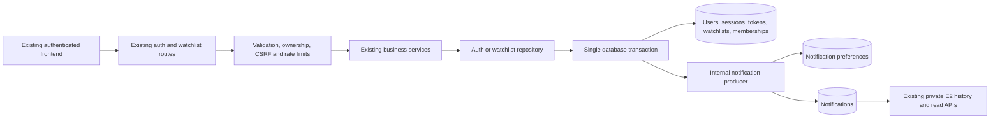
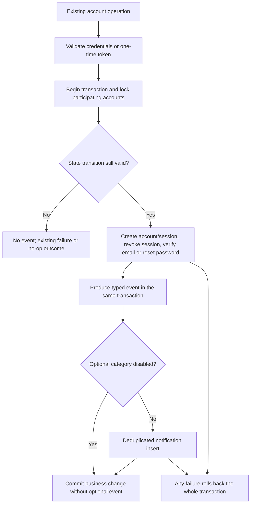
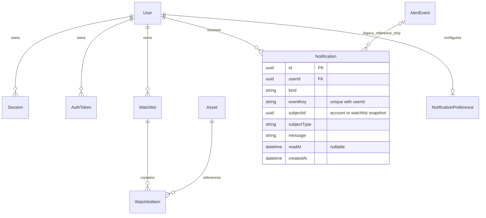

# Phase E3 — genuine transactional activity notifications

E3 connects real account and watchlist operations to the E1 notification table and
E2 private inbox API. It creates no welcome backfill, timer-based activity, fake
market event or price alert. Notifications are produced only by successful business
operations occurring after this code is deployed. No production migration,
deployment or production data change was performed during implementation.

A **producer** is a server function that records a notification because something
actually happened. A **transaction** means the business change and its notification
commit together or roll back together. A **commit** makes both permanent; a
**rollback** undoes both when an operation fails.

## Changed files and their responsibilities

| File                                                         | What changed and why                                                                                                                                    |
| ------------------------------------------------------------ | ------------------------------------------------------------------------------------------------------------------------------------------------------- |
| `apps/api/src/modules/notifications/producer.ts`             | New internal producer; validates E1 event metadata, chooses server-owned text, reads preferences under the account lock and deduplicates the insert     |
| `apps/api/src/modules/notifications/transaction.ts`          | Shares transaction options and account locking between E2 inbox/preferences and E3 business operations                                                  |
| `apps/api/src/modules/auth/repository.ts`                    | Produces account creation, login, real session revocation, completed password reset and completed email verification inside their business transactions |
| `apps/api/src/modules/watchlists/repository.ts`              | Produces creation, changed-name rename, deletion and actual membership addition/removal; skips no-ops                                                   |
| `apps/api/tests/integration/notification-producers.test.ts`  | Isolated PostgreSQL tests for all event kinds, failures, unchanged actions, preferences, concurrency, deduplication, ownership and rollback             |
| `apps/api/package.json`                                      | Adds producer tests to the existing notification database test command; local runner and CI already call it                                             |
| `docs/README.md`, this guide and the E2 guide's version note | Documents actual behavior, interview diagrams, commands and rollout boundaries                                                                          |

Authentication routes, password hashing, CSRF validation, origin restrictions,
rate limits, session cookies, market providers and alert guards are unchanged.
Services still validate requests and authorize operations; repositories now add
transactional event writes. No new API endpoint, environment variable, dependency,
Prisma field, index or migration is needed beyond E1. No email is sent by producers.

## What produces an event

| Kind                      | Genuine trigger                                                                                                 | Cases that do not produce it                                                         | Preference                                 |
| ------------------------- | --------------------------------------------------------------------------------------------------------------- | ------------------------------------------------------------------------------------ | ------------------------------------------ |
| `ACCOUNT_CREATED`         | New account and signup session committed                                                                        | Existing email, failed registration or rolled-back insert                            | Account activity; new users use default on |
| `SIGNED_IN`               | Password verified, password snapshot rechecked under lock, new login session committed                          | Wrong credentials, changed password snapshot, failed login, signup's initial session | Account activity                           |
| `SESSION_REVOKED`         | At least one still-active session revoked by explicit revocation, logout, cookie rotation, session cap or reset | Unknown, foreign or already-revoked target; no active session; expiry alone          | Mandatory security                         |
| `PASSWORD_RESET`          | Valid unconsumed reset token consumed, credential replacement and session revocation committed                  | Reset request/email alone, expired/wrong/reused token, failed reset                  | Mandatory security                         |
| `EMAIL_VERIFIED`          | Valid token consumed and account changes from unverified to verified                                            | Resend request/email alone, invalid/expired/reused token, already-verified account   | Mandatory security                         |
| `WATCHLIST_CREATED`       | New list committed                                                                                              | Capacity failure, invalid input or rollback                                          | Watchlist activity                         |
| `WATCHLIST_RENAMED`       | Stored name actually changes after existing input normalization                                                 | Same normalized name, missing/foreign list                                           | Watchlist activity                         |
| `WATCHLIST_DELETED`       | Owned list actually deleted                                                                                     | Missing/foreign/already-deleted list                                                 | Watchlist activity                         |
| `WATCHLIST_ASSET_ADDED`   | Owned list gets a new active catalog membership                                                                 | Duplicate membership, inactive/missing asset, capacity failure, foreign list         | Watchlist activity                         |
| `WATCHLIST_ASSET_REMOVED` | Owned list's existing membership actually deleted                                                               | Absent membership, missing/foreign list                                              | Watchlist activity                         |

A completed password-reset workflow is a security event even if the user chooses
the same password text: a valid reset token is consumed, a newly salted credential
hash is saved and existing sessions are invalidated. Merely requesting a reset is
not that event. Natural session expiration is not a producer; an expired session
can retain the old bookkeeping behavior on logout without generating a misleading
active-session-revoked notice.

Session revocation is aggregated to **one notice per affected account per business
operation**, even when reset or session-cap enforcement revokes multiple sessions.
A login that rotates a session can therefore create both a sign-in event and a
session-revoked event. If the old cookie belonged to another account, only that
account receives its revocation notice; the destination account receives its own
login event. No other account's email, session ID or private details are included.

## System and data flow



The frontend does not request “create a notification.” It requests a real action,
like adding an asset. The server derives the recipient from the authorized action,
checks whether anything changed and then calls the producer. There is still no
public notification creation endpoint or E4 inbox UI.

## Watchlist example, step by step

```mermaid
sequenceDiagram
    actor User
    participant API as Existing watchlist API
    participant TX as PostgreSQL transaction
    participant Producer
    User->>API: POST /api/v1/watchlists/:id/items {assetId}
    API->>API: Session + CSRF + rate limit + strict validation
    API->>TX: Begin; lock authenticated account
    TX->>TX: Check owned list and active asset
    alt Asset already belongs to list
        TX-->>API: Existing list; no event
    else New allowed membership
        TX->>TX: Insert membership
        TX->>Producer: WATCHLIST_ASSET_ADDED + stable operation UUID
        Producer->>TX: Read preference under the same account lock
        alt Optional notification disabled
            Producer-->>TX: Skip notification; keep genuine membership change
        else Allowed
            Producer->>TX: Insert notification; ignore duplicate event key
        end
        alt Any database operation fails
            TX-->>API: Roll back membership and notification; existing error response
        else All operations succeed
            TX-->>API: Commit together; return existing list response
        end
    end
```

Creation uses the new list ID as its notification subject. Rename first reads the
owned list, compares the normalized name and returns unchanged if it is already
identical. Add retains its existing duplicate/capacity checks. Remove checks the
deleted row count before producing an event. Delete produces only after a positive
owned-delete count; its notification subject is a snapshot, so deleting the list
does not erase the activity record. E2 will link deleted subjects to `/watchlists`.

## Account operations and token safety



Registration produces `ACCOUNT_CREATED` after user/session creation, not an
additional `SIGNED_IN` for the signup session. Login still performs expensive
password verification outside the transaction. Under the account lock it rereads
the password hash, rejecting a stale verification if a reset changed credentials
in the meantime. Only a committed new session produces `SIGNED_IN`.

Verification checks the account under lock before consuming a valid token. If
already verified, it returns the existing invalid/expired-style error without
changing verification time or producing a second event. The first successful
verification still consumes other verification tokens as before.

Password reset consumes the valid token under the account lock, updates the hash,
revokes sessions, consumes remaining reset tokens and records the security event.
If two reset requests race for the same token, only one consumes it and produces
an event. Notification messages never contain passwords, raw/hashed session tokens,
reset links, verification links, email addresses, IP addresses or arbitrary URLs.

Logout and explicit revocation now use the account transaction helper instead of
a standalone update. This is necessary so a revocation and its security notice
cannot commit separately. If a required notification write fails, the business
operation fails and rolls back; the API does not falsely claim the action succeeded.
Optional notifications disabled by preference are intentionally skipped rather
than treated as failures. Database/preference read failures are not ignored.

## Shared transaction and locking rules

E2's `notificationTransaction` and all E3 writers use the same user-row lock:

```sql
SELECT id FROM users WHERE id = $1::uuid FOR UPDATE;
```

The ID is a bound query parameter, not user text inserted into SQL. The lock makes
one account's business/inbox/preference operations wait for that account's previous
writer to commit. It works across API processes and separate connection pools;
there is no in-memory lock that disappears when Render restarts.

Single-account operations use `notificationTransaction`. Registration, login and
verification need custom transactions because the account is created or discovered
inside the transaction. They use the same options: read committed isolation,
10-second transaction acquisition wait and 20-second transaction timeout. No
transaction performs network/email calls or password hashing while holding locks.

Login can replace an old cookie owned by another account. `lockSessionOwners`
looks up that owner and locks the distinct participating account IDs in sorted
order **before** changing sessions. Opposite cross-account logins therefore request
the same locks in the same order, avoiding circular waits. Registration's new
uncommitted account is not yet visible to another transaction. Each affected
account is locked before checking its preferences or inserting its notice.

The producer also calls the shared lock helper defensively; reacquiring a lock
already held in the same transaction is safe. The producer accepts a transaction
client only and never opens a second transaction or uses the global database
client. A future caller must follow the sorted multi-account rule before writing.

## Duplicate prevention and no-op behavior

Each repository operation allocates a server-generated UUID once **outside** its
transaction callback. The producer builds E1's key:

```text
<KIND>:<operation UUID>
```

The existing unique index on `(userId, eventKey)` enforces at most one event for
that recipient, kind and operation. Prisma `createMany({skipDuplicates:true})`
uses PostgreSQL conflict handling: a duplicate does not poison the surrounding
transaction. Other database failures are allowed to propagate and roll back.
There is no retry worker and no external message broker.

The same operation ID is reused for multiple revocations within one operation,
which gives one aggregate notice per recipient. Different kinds and recipients
can share the operation UUID safely. An aborted transaction leaves no dedup key;
a retry with that UUID can then insert exactly one committed event.

A new HTTP request normally gets a new operation UUID. This is **not** a general
HTTP idempotency-key system. State checks prevent duplicate events for repeated
adds, removes, same-name renames, token consumption and session revocation. Two
successful logins are two real sessions and two sign-in events. Creating two lists
is two genuine operations. Removing then re-adding an asset should create a second
addition event. No business operation is suppressed just because its text matches
an earlier message.

## Preferences, privacy and the database

- Missing preference rows use E1's defaults; producing events does not create a
  preference row or reset email preferences.
- Account activity controls account-created/sign-in events. Watchlist activity
  controls all five watchlist event kinds. Security kinds ignore these optional
  flags, as promised by E1/E2.
- Preference writes and producers share the account lock. If an opt-out commits
  before a waiting action, that action sees the opt-out. A notification already
  committed before the opt-out remains in history.
- Disabling an optional event does not cancel the real business operation.
- Message text comes from a fixed, exhaustive server-owned map, not request bodies.
  E2 continues to construct and validate safe internal links and enforce ownership.
- Existing notification records, legacy messages, account IDs, watchlist IDs and
  market/alert records are not backfilled, rewritten or removed by this upgrade.



The ER diagram is unchanged structurally from E1: E3 adds behavior, not tables.
Native price alerts and unauthorized market data stay disabled in production.
There are no new price event kinds and no TradingView extraction or scraping.

## Verification and local manual testing

Run these commands using the isolated PostgreSQL setup from
[E1](notifications-e1.md):

```bash
npm run db:validate
npm run lint
npm run typecheck
npm run format:check
npm test
MP_TEST_PG_BIN=/path/to/reviewed/postgres17/bin npm run test:integration:local
npm run build
```

The rootless runner forces all database URLs to a new password-protected loopback
`marketpulse_test`, applies existing migrations there, runs all six database suites
and stops its own PostgreSQL cluster. It does not read production records, contact
Neon, install a system service or change host settings.

The producer suite uses local-only fixture accounts/assets and temporary check
constraints to force actual notification insert failures. Those checks are removed
in `finally` blocks. They are test instrumentation, not migrations; the suite refuses
non-local URLs and any database name other than `marketpulse_test`.

For manual testing, start a separately configured local development database
migrated through E1, then use `npm run dev`. Do not use production credentials.

1. Register a local test account normally. Read `GET /api/v1/notifications` using
   its session: expect one `ACCOUNT_CREATED` event, no extra signup login event.
2. Log in successfully: expect `SIGNED_IN`; if a live cookie was rotated, also
   expect a session-revoked notice. Wrong credentials create no event.
3. Create/rename a list, add/remove an actual catalog asset, then delete the list.
   Read E2 history after each action. Repeating the same rename/add/remove must not
   add an event. Deletion retains the earlier activity with a safe fallback link.
4. Change preferences with E2's CSRF-protected PATCH endpoint, then repeat new
   watchlist actions. The actions succeed, but opted-out events do not appear.
5. Revoke an owned session: expect one security event regardless of optional
   settings. A second session can read the inbox if the current one was revoked.
6. Verification/reset manual email flows remain unavailable when account email is
   disabled. Do not enable or pay for email to test E3: the local automated suites
   test token handling and the existing auth suite uses an isolated test mailer.
   A future approved email setup can exercise the existing link flows end to end.

All mutation requests keep their existing response formats, CSRF and origin
requirements. E2's history/summary/preferences formats are unchanged. No frontend
inbox is included, so use authenticated local API requests to inspect the events.

## Rollout and rollback

No production migration or deployment is approved for E3. A later approved backend
rollout must verify the E1 migration is already applied on Neon before deploying
E3. Do not add migrations to startup or rewrite migration history. No Vercel change
is required for these server-side producers.

If rollback is needed, return to the previous approved backend build. Keep all E1
schema and newly committed notification history/preferences; never reset the
database or delete notifications to roll back code. With E2 restored, existing
history remains readable and no further E3 events are generated. Do not enable
native price alerts as part of deployment or rollback. E4 remains a separate step
requiring approval.

## E3 verification results

| Check                                  | Local result                                                                                          |
| -------------------------------------- | ----------------------------------------------------------------------------------------------------- |
| `npm test`                             | 139 tests passed; all existing non-database frontend/backend regressions                              |
| Isolated PostgreSQL integration runner | 53 tests passed across six suites, including 12 new E3 cases and all E1/E2 database cases             |
| Schema validation                      | Pass; no Prisma schema or migration changes                                                           |
| Lint                                   | Pass, zero warnings                                                                                   |
| Type checks                            | All workspaces, API tools and tests pass                                                              |
| Formatting                             | Pass                                                                                                  |
| Production build                       | Contracts, API and frontend pass with dummy local datasource URLs; build opens no database connection |
| Compiled production preflight          | Pass using dummy configuration and no external services                                               |

No tests failed or were skipped. All existing regression suites passed without
changing their assertions. The isolated cluster shut down automatically afterward.
No host configuration, production records, migrations or deployment settings were
modified to run these checks.

The new E3 cases cover actual credential validation, account creation, session
rotation/cap/revocation/logout, opposite cross-account login locks, single-use
verification/reset tokens, all five watchlist transitions, no-ops, ownership,
capacity failure, preferences, concurrent duplicate operations and per-event-key
deduplication. Forced database insert failures verify rollback for every business
operation, including consumed tokens, password hashes, revoked sessions and
watchlist deletion cascades. A separate failure after event insertion proves an
aborted transaction leaves neither its event nor its business update.

Production behavior and GitHub CI were not verified by these local results. No
live email delivery or E4 frontend inbox was tested or introduced. Account email
remains subject to the existing disabled/unconfigured behavior; no paid mail
service or credential was added. Native price alerts remain disabled by the
unchanged production guards and covered by existing regression tests.
