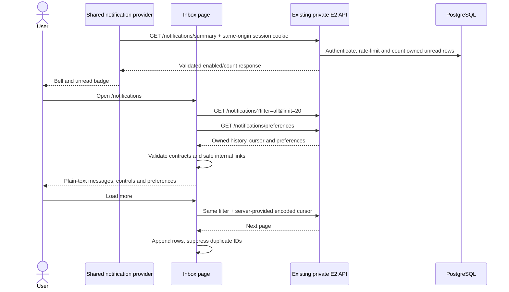
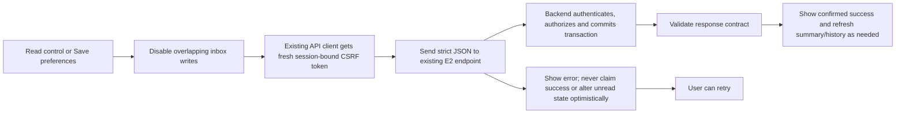

# Phase E4 — private notification bell, inbox and preferences

E4 adds the frontend for the genuine E3 notifications and private E2 APIs. It does
not generate events, infer market prices, enable native price alerts, send emails,
change the database or deploy anything. Notification rows still come only from
successful backend business operations. No credentials or paid services were added.

## User experience

- The navigation includes a bell with an unread badge after the server confirms a
  signed-in session. The visual badge caps at `99+`; its accessible name includes
  the full count. Guests see no private badge.
- `/notifications` provides All, Unread and Read filters, newest-first history,
  timestamps, safe account/watchlist links, read/unread controls, mark-all-as-read,
  refresh and cursor-based “Load more notifications.”
- Account/watchlist preference checkboxes have an explicit Save button. Security
  notifications remain mandatory. Preferences affect future optional events,
  not existing history, email delivery or native price alerts.
- Loading, empty, unavailable and request-failure states are different. An API
  failure is never displayed as zero notifications. Expired sessions clear private
  data and return to sign-in. Failed writes keep an error visible and can be retried.
- Panels, teal accents, typography, dark/light themes, wrapped navigation and
  responsive layouts reuse the existing design. Controls use native buttons,
  checkboxes and links with keyboard focus, readable statuses and live feedback.

## Files and responsibilities

| File                                                                | Purpose                                                                                                                         |
| ------------------------------------------------------------------- | ------------------------------------------------------------------------------------------------------------------------------- |
| `apps/web/src/features/notifications/api.ts`                        | Calls the six E2 endpoints, validates inputs/responses using E1/E2 contracts, bounds history queries and encodes cursors        |
| `apps/web/src/features/notifications/context.ts`                    | Defines the shared in-memory count/session state and hook                                                                       |
| `apps/web/src/features/notifications/NotificationProvider.tsx`      | Loads the summary without blocking public market routes, refreshes when appropriate and discards old requests/session state     |
| `apps/web/src/features/notifications/NotificationBell.tsx`          | Keyboard-accessible inbox link, decorative bell and readable count badge                                                        |
| `apps/web/src/features/notifications/NotificationItem.tsx`          | Renders plain-text content, timestamps, validated internal links and read controls                                              |
| `apps/web/src/pages/NotificationsPage.tsx`                          | Inbox filters, cursor pagination, loading/retry states, mutation feedback and preference controls                               |
| `apps/web/src/layouts/AppLayout.tsx`, `apps/web/src/app/router.tsx` | Installs the provider and bell and registers `/notifications`                                                                   |
| `apps/web/src/lib/api-client.ts`, `apps/web/src/lib/api-events.ts`  | Retains same-origin/no-store/CSRF behavior; adds read cancellation and successful-write/session-change signals                  |
| `apps/web/src/styles/index.css`                                     | Scoped notification styles and theme/mobile adjustments                                                                         |
| `apps/web/tests/notifications.test.tsx`                             | Contracts, request shapes, CSRF, safe links, text escaping, bell/accessibility and honest failure states                        |
| `scripts/test-notification-browser.mjs`                             | Real Chrome + built frontend + real local API/PostgreSQL end-to-end flows and visibility/contrast checks                        |
| `scripts/test-local-db.mjs`, root `package.json`                    | Opt-in browser command runs inside the existing isolated test cluster and stops it afterward                                    |
| `scripts/test-web.mjs`                                              | Includes notification tests in `npm test`                                                                                       |
| `scripts/test-market-browser.mjs`                                   | Existing market fixture recognizes the new private summary probe as an unauthenticated request; market assertions remain intact |

A **provider** shares small pieces of React state between the header bell and
inbox. This React provider is not a financial data provider. A **contract** validates
an API response before it becomes UI state; TypeScript alone cannot validate JSON
received over the network.

## Read flow



The API client uses relative `/api/v1` addresses, so the existing Vercel rewrite
continues to reach Render. No backend URL, provider key or credential is added to
the browser. Cursor tokens are passed to the server; the frontend does not decode,
edit or invent them. Changing filters or refreshing restarts at page one. A
successful read-status change also refreshes page one so filtered membership
cannot show an optimistic result that the server did not confirm.

## Write and preference flow



Request bodies remain small and explicit:

```json
{ "read": true }
```

is sent to `PATCH /api/v1/notifications/<uuid>/read`; `false` marks it unread.
`POST /api/v1/notifications/read-all` sends `{}`. The preferences PATCH sends only
`accountActivityEnabled` and `watchlistActivityEnabled`. The client cannot edit
security preferences, recipients, event keys, messages, timestamps or links.
Backend ownership, CSRF, origin checks, database locks and rate limits remain the
authority; disabling a UI button is only a usability feature, not authorization.

## Privacy and refresh rules

Notification counts, rows, preferences and cursors stay in React memory. They are
not placed in local storage, service workers, analytics or a public cache. Existing
theme storage contains only the theme setting.

The shared API client announces successful writes. Business actions can therefore
refresh the badge after E3 emits an event, without modifying each account or
watchlist form. Failed writes emit no success signal. Login, registration, logout,
password reset and session-revocation signals invalidate private UI state first.
A same-origin BroadcastChannel carries only the word `changed` across tabs; it
contains no user ID, count, message or credential. The other tab drops its old
state and loads its own current-session inbox.

The summary is checked on route navigation and after successful writes. A
60-second timer runs only for a known signed-in session in a visible tab. Returning
to a tab invalidates its private view and reloads it, including on browsers without
BroadcastChannel. This intentionally restarts inbox pagination and unsaved drafts
when returning from a hidden tab. Requests are cancelled or ignored after unmount,
filter changes, session invalidation or replacement, so a late response cannot
restore an earlier account's inbox.

If a summary request fails, the badge becomes unknown and the inbox offers retry;
it does not show an invented zero. There is no rapid retry loop. The existing API
rate limits still apply. A failed older-page request preserves previously loaded
rows and offers retry; the Refresh button can restart pagination if a cursor is
no longer usable. Security notifications cannot be opted out of or hidden by these
preferences. Legacy records retain E2's neutral disclosure and no action link.

React renders notification messages as text, never raw HTML. Response contracts
reject external/javascript links and links to mismatched subjects. Clicking a
notification's destination does not mark it read automatically; the explicit read
control makes that change clear and avoids a hidden write on navigation.

## Testing and reproducible commands

```bash
npm run db:validate
npm run lint
npm run typecheck
npm run format:check
npm test
NODE_ENV=production npm run build
MP_TEST_PG_BIN=/path/to/reviewed/postgres17/bin npm run test:notifications:browser
node scripts/test-market-browser.mjs
```

The production build must exist before browser tests. Compilation does not connect
to a database. The notification browser command requires reviewed local PostgreSQL
17 binaries and an existing Chrome binary (`CHROME_BIN` can override the default
`/usr/bin/google-chrome`). It installs no packages or system services.

The opt-in browser command creates a private password-protected temporary
PostgreSQL cluster, overrides all application database URLs with loopback
`marketpulse_test`, migrates only that isolated database, runs all database suites,
then starts the actual local API and serves the built frontend. Test registration
and CSRF-protected watchlist actions generate genuine local history; the harness
does not insert invented notification rows. Local error injection returns HTTP
failures to verify recovery, not fake successful activity. The API/browser fixtures
are local test accounts, never production records.

Screenshots and browser results go into a private `/tmp/marketpulse-notifications-browser-*`
directory. The test closes Chrome, deletes its fixture accounts, closes the local
API and stops PostgreSQL afterward. The market browser suite separately uses its
existing isolated widget shells; it does not scrape or extract provider data.

For manual testing on an isolated local application:

1. Start normally with `npm run dev`, register a test account and open the bell.
   Expect one account-created notification from E3.
2. Create and rename a watchlist, then return to the inbox. Expect genuine activity,
   an updated count and working account/watchlist links.
3. Try All/Unread/Read, Load more, individual read/unread and mark-all. Compare the
   bell and page count after each successful response.
4. Turn off watchlist notifications, save, and make a new list change. The business
   action still works but produces no optional notification. Reload the page and
   confirm the preference persists. Security notices remain enabled.
5. Sign out or switch accounts in another tab. The previous account's history and
   count must disappear. An expired session returns to sign-in.
6. Check desktop/tablet/mobile widths and both theme buttons. Tab to controls and
   activate links/buttons with the keyboard; all disclosures and controls should
   remain readable without horizontal page overflow.

## Deployment and rollback boundary

No deployment, production migration, production record change or environment
change is authorized or performed. Git automatic-deployment controls are unchanged.
A later approved rollout must verify the E1 migration and E2/E3 backend are deployed
before deploying this frontend. If the backend is unavailable or lacks these APIs,
the UI shows unavailable/error states rather than fake activity.

No E4 database migration is required. Roll back the frontend to the previous
approved build if necessary; retain all notification history, preferences and E1
schema. Existing backend APIs and genuine E3 events can continue independently.
Native prices, alerts, data licensing and TradingView displays are unchanged.

## E4 verification results

| Check                                        | Local result                                                                                                                                                              |
| -------------------------------------------- | ------------------------------------------------------------------------------------------------------------------------------------------------------------------------- |
| `npm test`                                   | 146 passing tests, including seven new frontend notification cases and all existing regressions                                                                           |
| Isolated PostgreSQL suites                   | 53 passing tests across six suites, preserving E1 migration, E2 API and E3 producer coverage                                                                              |
| Notification browser suite                   | 18 passing verification groups against the real local API/database; no uncaught browser exceptions                                                                        |
| Responsive/theme checks                      | 1440, 768, 390 and 320 pixel widths, both themes; no horizontal overflow; controls, links and security disclosure hit-tested visible; read-status contrast at least 4.5:1 |
| Existing market browser suite                | Seven verification groups pass; no uncaught exceptions or unexpected native market requests; provider shells remain isolated fixtures                                     |
| Lint and type checks                         | All pass; zero lint warnings                                                                                                                                              |
| Formatting and schema validation             | Pass; no schema or migration changes                                                                                                                                      |
| Production build and configuration preflight | Pass using dummy configuration, without database/provider connections or deployment                                                                                       |

The browser suite validates guest redirect, keyboard bell navigation, genuine
registration history, 24-event cursor pagination, older-page retry, individual
read/unread, all three filters, mark-all, disabled busy controls, persisted
preferences, suppression of future opted-out events, 503/429/summary/preferences
failures, retry after failed saves, cross-tab account replacement and real session
expiry. Results are compared with PostgreSQL, rather than merely checking DOM
presence. Screenshots were also visually inspected for desktop dark and mobile
light layouts.

During development, two new unit assertions initially expected asynchronous errors
from synchronous input validators; the tests were corrected. The first browser
helper reused a CSRF token after another request rotated the cookie, and the real
backend correctly returned 403. The helper now obtains fresh tokens, matching the
application client. No security check was weakened. Final test runs pass.

A final compatibility check verifies that browsers blocking BroadcastChannel do
not turn successful HTTP writes into false failures. Tab-visibility invalidation
remains the fallback when cross-tab messaging is unavailable or restricted.

These are local results. GitHub CI and deployed production notification behavior
remain unverified; no production deployment or data changes were performed. The
market suite does not claim to verify current third-party feeds, and notification
checks do not claim live SMTP delivery. The local API, Chrome and temporary database
are shut down after the browser run.
