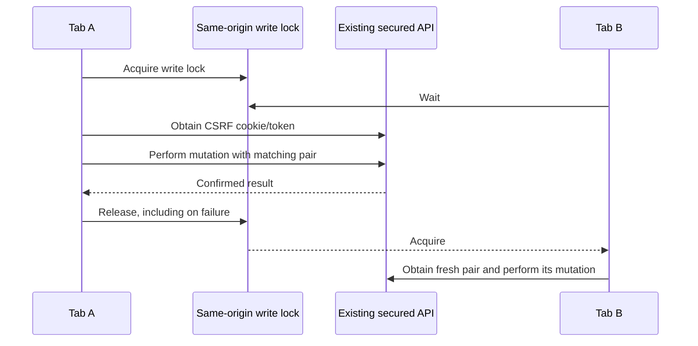

# Phase E5 — end-to-end verification and release preparation

E5 tests E1–E4 together, fixes reproduced notification/account-flow issues and
prepares a concrete release runbook. **Production remains unchanged.** No live
Neon query, backup/export, migration, Render/Vercel deployment, environment update
or production test-record change was performed. No paid service was added.

The application still uses genuine E3 account/watchlist activity, the private E2
APIs and E1 schema. Native price alerts remain disabled. Official TradingView
widgets are display-only; this phase does not extract their values or invent prices.

## Issues reproduced and corrected

### 1. Parallel writes could race their CSRF cookies

Every mutation first obtains a signed CSRF token and cookie. Two simultaneous
requests could issue different tokens before either write began. The second cookie
then replaced the first, so one valid user action received `403 Invalid CSRF token`.
The new regression test reproduced this failure before the fix.

The API client now serializes each token-fetch/write pair. A browser origin lock
coordinates cooperating application tabs; a per-tab promise queue also works when
Web Locks is unavailable. Reads bypass this queue. The server's origin, cookie,
HMAC/session binding, expiry and equality checks are **unchanged**.



Queued writes that observe a session-change signal are rejected before execution
with a refresh message. Cross-tab session signals reach both the UI and this guard.
Failed operations release the queue but are never automatically replayed: blindly
retrying a login, list creation or password reset could repeat a genuine operation.
No private data is included in lock names or cross-tab messages.

The [Web Locks specification](https://www.w3.org/TR/web-locks/) describes same-origin
coordination in secure contexts. Chrome's real cross-tab path was tested locally.
Browsers without Web Locks retain within-tab serialization; simultaneous independent
tabs/direct external callers can still receive a safe 403 and require a manual
retry. Server security is not weakened to hide that limitation.

### 2. A preferences form could overwrite another tab's unrelated edit

E2 supports partial patches correctly, but E4 sent both checkboxes each time.
For example, Tab A disabled account activity while Tab B disabled watchlist
activity; either form could accidentally re-enable the field it had not edited.
The real browser/PostgreSQL test reproduced the lost preference.

The form now compares its draft with the last confirmed preferences and sends
**only changed fields**. The existing backend transaction merges these fields.
Both independent edits therefore survive. Save is disabled when nothing changed;
a failed save retains the draft, and a successful response becomes the new baseline.
Security notifications remain mandatory and no security flag can be submitted.

```text
Saved: { accountActivityEnabled: true, watchlistActivityEnabled: true }
Tab A changes account activity -> PATCH { accountActivityEnabled: false }
Tab B changes watchlist activity -> PATCH { watchlistActivityEnabled: false }
Final server state: both false
```

### 3. Reopening an account link could retain an earlier success screen

Opening another verification/reset fragment on the same route can be a
same-document browser navigation. The original hook captured a token only at
initial mount, and the form retained its earlier success message. The expanded
verification replay test exposed this stale state.

The link hook now handles native hash changes and React Router navigations,
captures the incoming token and removes the fragment from the URL. An in-memory
revision remounts the form for each new incoming fragment, including a repeated
link. The initial form is retained to avoid discarding initial input/autofill.
Backend single-use token rules are unchanged: a replay now shows the genuine
invalid/expired error, rather than a stale success screen, and produces no event.

## Affected files

| File                                                                                 | Purpose                                                                                                                                                      |
| ------------------------------------------------------------------------------------ | ------------------------------------------------------------------------------------------------------------------------------------------------------------ |
| `apps/web/src/lib/api-client.ts`                                                     | Complete CSRF/write pair queue, same-origin browser lock, failure recovery and queued-session guard                                                          |
| `apps/web/src/features/notifications/NotificationProvider.tsx`                       | Forwards cross-tab session changes to the shared invalidation event                                                                                          |
| `apps/web/src/features/notifications/api.ts`                                         | Builds a patch containing only changed optional preferences                                                                                                  |
| `apps/web/src/pages/NotificationsPage.tsx`                                           | Tracks confirmed preference baseline, preserves failed-save drafts and disables unchanged Save                                                               |
| `apps/web/src/features/auth/use-link-token.ts`                                       | Captures subsequent fragments, scrubs tokens from the URL and tracks form revision                                                                           |
| `apps/web/src/pages/VerifyEmailPage.tsx`, `apps/web/src/pages/ResetPasswordPage.tsx` | Reset private form state when a new account link arrives                                                                                                     |
| `apps/web/tests/auth.test.tsx`                                                       | Reproduces CSRF race; tests queue release/no replay, browser lock and session invalidation                                                                   |
| `apps/web/tests/notifications.test.tsx`                                              | Tests preference diff semantics for independent and combined edits                                                                                           |
| `scripts/test-notification-browser.mjs`                                              | Adds all account and watchlist event workflows, genuine token links via local mail capture, replay checks and real concurrent-tab preference saves           |
| `apps/api/tests/integration/notification-release.test.ts`                            | Runs the real pinned Prisma CLI to upgrade legacy fixtures, repeat migration safely, check drift, validate release SQL and rehearse old-writer compatibility |
| `apps/api/package.json`                                                              | Registers release rehearsal in the existing database regression command and CI path                                                                          |
| `docs/releases/notifications-before.sql`, `docs/releases/notifications-after.sql`    | Read-only production inventory and structural verification scripts, validated locally                                                                        |
| `docs/releases/notifications-production.md`                                          | Approval-gated backup, migration, pinned deployment, smoke verification, failure handling and rollback instructions                                          |
| `docs/README.md`, E4 version note and this report                                    | Navigable verification evidence and implementation explanation                                                                                               |

No backend runtime authorization/producer logic, Prisma schema, migration SQL,
production build settings, provider configuration or deployment controls changed.
There are no new runtime dependencies or environment variables.

## What the integrated checks exercise

| Flow                                   | Evidence                                                                                                                                            |
| -------------------------------------- | --------------------------------------------------------------------------------------------------------------------------------------------------- |
| Registration and genuine initial event | Real browser, API, password hashing, session and database                                                                                           |
| Successful login and session rotation  | Browser UI plus notification rows; wrong credentials add no event                                                                                   |
| Explicit revocation and logout         | Real account controls; sessions revoked, security event recorded, private UI cleared                                                                |
| Email verification                     | Real API token created and delivered to an in-memory local transport; browser consumes link; replay produces no second event                        |
| Password reset                         | Real request/link/form; requesting alone emits nothing; completed reset revokes sessions; old password and reused token fail; new password signs in |
| All five watchlist event kinds         | Genuine list/membership operations from the browser to actual API; repeated adds/removes emit nothing; deleted subjects use safe fallback links     |
| Inbox and preferences                  | History filters/cursors, counts, read/unread, mark-all, saved/failed preferences, opt-out event suppression                                         |
| Cross-tab safety                       | Account replacement removes old history; concurrent optional preference edits preserve both fields; CSRF pair overlap is prevented                  |
| UI failures and layout                 | 503/429/summary/preferences failures, retries, expiry, busy controls, four widths and both themes, visibility/contrast checks                       |
| Privacy and security                   | Existing ownership/401/403/rate-limit, strict schema, safe-link, text-escaping and legacy disclosure tests                                          |
| Atomicity and deduplication            | Existing E1–E3 constraints, multi-connection concurrency, forced rollback and event-key tests                                                       |
| Migration/release compatibility        | Actual CLI: six old migrations → legacy fixture → E1 → rerun → no drift → old-style writes still succeed                                            |
| Market safeguards                      | Existing backend regressions plus market/browser fixture checks; no native price/alert enablement                                                   |

The browser suite uses actual business operations, not fabricated notification
rows. Local catalogue fixtures contain asset metadata, not invented market prices.
Account mail is captured **in memory inside the guarded local test harness**; no
external SMTP call, provider credential, paid mail plan or production email setting
is involved. This verifies the token/notification workflows, not live email delivery.

## Local commands

```bash
npm run db:validate
npm run lint
npm run typecheck
npm run format:check
npm test
NODE_ENV=production npm run build
MP_TEST_PG_BIN=/path/to/reviewed/postgres17/bin npm run test:notifications:browser
node scripts/test-market-browser.mjs
```

The rootless database runner forces local test URLs, requires PostgreSQL 17,
binds only loopback, uses a random private password and stops its cluster afterward.
It runs all six database suites before the actual API/browser tests. Release tests
create their own random schema in guarded `marketpulse_test`; generated CLI config
files are private and contain only temporary local credentials. They never inherit
a production target. Browser/API fixtures are removed and services stopped afterward.

The release rehearsal also executes both SQL check files against the appropriate
old/new local schema. Their transactions are read-only; missing structures produce
`problem` rows, which the rehearsal requires to be empty after E1. This is separate
from Prisma's structural diff, which does not model every custom SQL check.

## Production readiness and approval boundary

The [production runbook](releases/notifications-production.md) gives the precise
order: verify actual live baseline and free capacity, approve secure backup and
restore verification, apply only E1 if pending, verify the database, deploy the
pinned backend, verify health/security, deploy the same frontend and perform only
approved designated-account smoke actions. Application rollback retains every
notification/preference record and the additive schema; no database reset or
Git-history rewrite is required.

Production identity, migration history/drift, backup/restore readiness, platform
quotas, deployed TLS/proxy behavior, SMTP delivery and final hosted smoke checks
remain unverified in this local phase. They are explicit release gates, not inferred
from a passing local build. Do not treat the local test database as a backup of Neon.
No production action is authorized by these instructions. Wait for approval.

## Final E5 results

| Check                                            | Result                                                                                                                                      |
| ------------------------------------------------ | ------------------------------------------------------------------------------------------------------------------------------------------- |
| `npm test`                                       | 150 tests passed, zero failures/skips; includes the new CSRF queue and preference-diff regressions                                          |
| Full isolated database regression run            | 54 tests passed, zero failures/skips, across six suites                                                                                     |
| Real notification API/database/browser run       | 22 verification groups passed; zero uncaught browser exceptions                                                                             |
| Existing market browser suite                    | Seven verification groups passed; no unexpected native market requests or uncaught exceptions                                               |
| Migration rehearsal                              | Real Prisma CLI upgrade, preservation, idempotent rerun, no structural drift, read-only release SQL and old-writer compatibility all passed |
| Lint / type checks / formatting                  | Passed; zero lint warnings                                                                                                                  |
| Prisma schema validation                         | Passed; E1 migration/schema unchanged                                                                                                       |
| Production build / compiled production preflight | Passed with dummy configuration and no external service connections                                                                         |

The browser run verified 1440, 768, 390 and 320 pixel widths in both themes using
hit-tested control/link/disclosure visibility, horizontal-overflow checks and
read-status text contrast of at least 4.5:1. Tests include the formerly failing
concurrent preference writes and same-route verification/reset replays.

Before-fix tests intentionally reproduced the three issues described above.
During implementation, type/format checks also caught mechanical editing/type
errors; those were corrected before the final successful runs. No server security
checks or database constraints were relaxed to make tests pass. Local API, Chrome
and the temporary PostgreSQL cluster shut down cleanly afterward.

GitHub CI and production remain separate, unverified environments. Passing E5
means the reviewed implementation and local release rehearsal are ready for the
approval checkpoint; it does not assert that Neon is migrated, the production
backup is restorable, email delivery is configured, or the hosted release is live.
