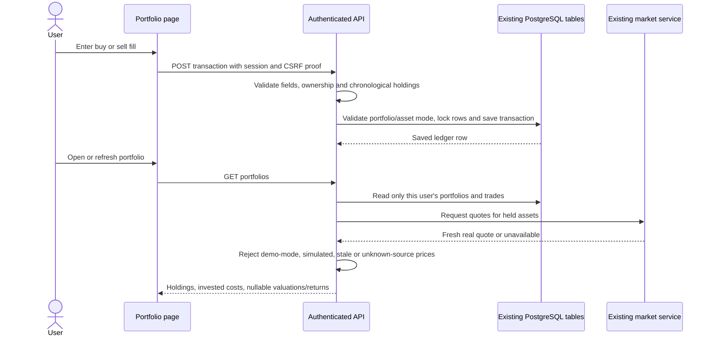

# Portfolio tracker

The private portfolio feature uses the existing `portfolios` and `transactions`
tables. It adds no database migration and does not alter existing records. A
portfolio belongs to one account; each trade points to a catalog asset and has a
buy/sell side, quantity, user-entered execution price, fee, and execution time.

## What users can do

- Create up to ten named USD portfolios.
- Record up to 500 buy/sell trades per portfolio and remove a mistaken trade.
- Review remaining quantity, fee-inclusive invested cost, and trade history.
- Delete an entire portfolio and its trades after an explicit confirmation.

The existing database stores a `mode` on portfolios and transactions. Real-mode
portfolios accept only assets eligible for real prices. Demo-only catalog assets
(the current stock entries) require a demo-mode portfolio. This preserves the
database's trigger and composite-key protections; the API reports a clear
validation conflict before attempting an invalid insert. A demo-mode portfolio
stores only the user's manually entered ledger entries. It never uses simulated
quotes and never calculates current market value or returns.

Every write requires an authenticated session, same-origin/CSRF checks, strict
shared Zod validation, an account-scoped rate limit, and a database transaction.
The database query scopes every read and write by the authenticated account.
Portfolio writes lock the account row so concurrent additions respect account
limits; trade edits lock the portfolio and replay history before accepting a sale.
The ledger rejects a sale that would make holdings negative at any point in
execution-time order. Deleting a buy is rejected if it would invalidate a later
sale.

## Accounting and data boundaries

Trades store the execution prices users enter. MarketPulse does not verify those
prices against an exchange, broker, or provider. Holdings are replayed in execution
order using the weighted-average cost method:

```text
buy spend = quantity × entered execution price + buy fee
remaining invested cost = weighted-average cost of units still held
realized return = sale proceeds − sale fee − average cost of units sold
unrealized return = current market value − remaining invested cost
total return = realized return + unrealized return
```

For real-mode portfolios, the API obtains any current quote through the existing
market service and accepts it for valuation only when the quote is fresh, in USD,
marked `REAL`, marked non-simulated, and from the currently approved CoinPaprika
provider. A simulated,
stale, missing, malformed, or future-dated quote is not used. In production the
native provider gate is closed, so current market value and return fields are
`null` and the interface explains why. Cost basis and manually entered transaction
history remain available. Demo-mode portfolios always return unavailable market
values, even if another genuine quote exists for that asset. The portfolio never
reads a TradingView widget.

Portfolio return is only published when every open position has a valid current
quote. This avoids presenting an incomplete portfolio total as though all assets
had been valued. The percentage uses all recorded buy spend (including buy fees)
as the denominator. Sale fees reduce realized return. Fees are recorded in USD.

## API

All routes require authentication. Responses are `Cache-Control: no-store`.
Mutations require the existing CSRF/origin protection and reject unknown body or
query fields.

| Method   | Path                                                 | Purpose                                                      |
| -------- | ---------------------------------------------------- | ------------------------------------------------------------ |
| `GET`    | `/api/v1/portfolios`                                 | List private portfolios, holdings, and trade history         |
| `POST`   | `/api/v1/portfolios`                                 | Create `{ "name": "Long-term", "mode": "REAL" }`             |
| `DELETE` | `/api/v1/portfolios/:id`                             | Delete an owned portfolio and its recorded trades            |
| `POST`   | `/api/v1/portfolios/:id/transactions`                | Add a buy/sell entry                                         |
| `DELETE` | `/api/v1/portfolios/:id/transactions/:transactionId` | Remove an owned trade if the remaining ledger is still valid |

Trade example:

```json
{
  "mode": "REAL",
  "assetId": "existing-catalog-asset-uuid",
  "side": "BUY",
  "quantity": "2.5",
  "unitPrice": "100.25",
  "fee": "1.00",
  "executedAt": "2026-11-28T10:30:00.000Z"
}
```

Prices and quantities are decimal strings (up to 18 fractional places) so the API
does not convert financial values to floating-point numbers. The API returns
holdings and user-entered trades regardless of market-data availability; quote,
market value, and return fields are nullable and include source/time when present.

## Data flow



## Current limitation

Production has no authorized native price feed, so recording and holdings work,
but market valuation and return calculations remain unavailable there. Never turn
on price calculations merely because a provider endpoint responds: first confirm
public display, caching, and automated calculation rights for the specific plan.
