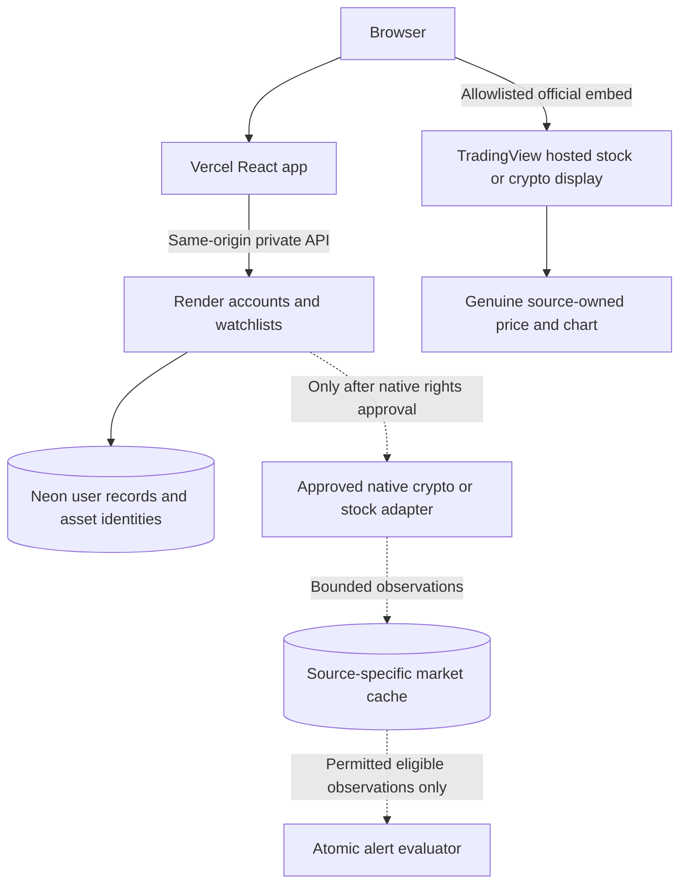
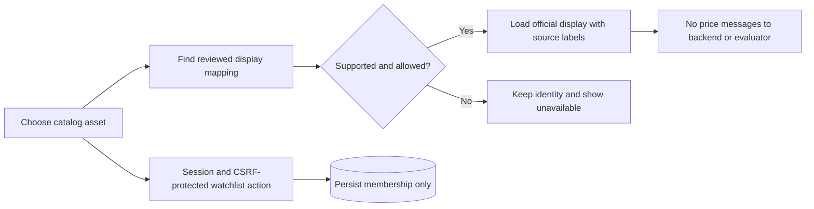

# A2 — free public market-data permission review

Reviewed: 2026-11-25. Scope: public-source research and documentation only.
The user's A2 instruction defines this step as permission research; it replaces
A1's proposed A2 baseline activity. No baseline execution, account creation,
provider contact, key registration, market API testing, code, database, or deployment
change is approved or performed here. See [ADR 0006](decisions/0006-a2-provider-permission-review.md).

## Recommendation in plain language

Prefer official TradingView embeds for genuine stock and crypto display in the
first zero-cost release, subject to the site terms and per-symbol verification
below. Keep our accounts and private watchlists in the existing application.
Keep native prices, native history, and alerts unavailable for any dataset whose
permissions are unresolved. This is a recommendation for later approval, not a
claim that widgets have been installed or the current feed has been cleared.

An embed is a provider-managed display window. We can place it on a page using the
official integration, but its pixels are not a price feed our server may extract.
A native API adapter is different: our server downloads observations, stores them,
and supplies our own charts or conditions. That requires additional permissions.

CoinMarketCap Basic is the strongest newly identified native-crypto candidate for
further clarification because its current pricing explicitly includes commercial
use. It is not yet cleared for MarketPulse's complete storage, history, and alert
requirements. Do not buy a plan, submit payment details, or open an account under A2.

No native stock source reviewed has been cleared for the complete public feature
set at zero cost. This does not prove a suitable written free grant cannot exist.

## Evidence labels

- **Verified statement (V):** directly stated in an accessible official source.
  It proves that statement, not every permission needed by our product.
- **Restricted (R):** the reviewed ordinary plan/terms limit the intended use.
  A separate express grant might change the result.
- **Unconfirmed (U):** evidence is missing, unreadable, conflicting, or requires
  account-specific verification. Treat the capability as unavailable for release.
- **Recommendation:** our engineering choice based on evidence; not a new license.

No provider has issued a MarketPulse-specific written grant during this review.
An officially advertised free tier does not prove that our account has that tier,
that all symbols work, or that a production release has been approved.

## Stock-source comparison

| Source and official evidence                                                                                                                 | Verified facts                                                                                                                               | Public display, caching, charts, alerts                                                                                                                                  | Decision                                                            |
| -------------------------------------------------------------------------------------------------------------------------------------------- | -------------------------------------------------------------------------------------------------------------------------------------------- | ------------------------------------------------------------------------------------------------------------------------------------------------------------------------ | ------------------------------------------------------------------- |
| [Twelve Data business pricing](https://twelvedata.com/pricing-business)                                                                      | V: Basic lists 8 credits/minute, 800/day and internal non-display usage; external display is separately offered                              | R/U: internal processing access is not public-display permission; no free MarketPulse retention/history/alert grant verified                                             | Do not integrate the ordinary free plan for the full public product |
| Alpha Vantage [support](https://www.alphavantage.co/support/) and [terms](https://www.alphavantage.co/terms_of_service/)                     | V: standard 25 requests/day; US real-time and fifteen-minute delayed access require other entitlements; default personal/noncommercial terms | R: the public service is not established as private individual use. U: a verified educational exception does not itself establish our public/alert rights                | Written no-cost clarification required                              |
| [Finnhub terms](https://finnhub.io/terms-of-service)                                                                                         | V: third-party sharing of data or derived results needs written approval; listed plans are personal unless stated otherwise                  | R: ordinary personal access is insufficient. U: current numeric free quota and candle entitlement not confirmed                                                          | No native selection                                                 |
| Massive [individual terms](https://massive.com/legal/individuals-terms-of-service) and [pricing](https://massive.com/pricing?product=stocks) | V: individual terms cover personal non-business use. U: dynamic pricing output did not establish the current free quota in this review       | R/U: no cleared public display, retention, or alert scope                                                                                                                | No native selection; do not reuse remembered limits                 |
| [Financial Modeling Prep pricing](https://site.financialmodelingprep.com/developer/docs/pricing)                                             | V: Basic lists 250 calls/day; public display/redistribution requires a specific licensing agreement                                          | R/U: API access and EOD history do not replace that agreement; retention and alerts remain unconfirmed                                                                   | Candidate only for an authorized no-cost permission request         |
| Yahoo, Stooq, and historical WIKI                                                                                                            | U: a suitable current free native grant for our complete use was not established                                                             | Do not infer rights from a downloadable file, library license, or undocumented endpoint. [WIKI](https://data.nasdaq.com/databases/WIKIP) is no longer actively supported | No scraping or outdated replacement feed                            |

The stock comparison is about the full intended public use. It does not assert
that these providers have no legally permitted personal or contracted uses.

## Crypto-source comparison

| Source and official evidence                                                                                                             | Verified facts                                                                                                                                                                      | Unresolved or restricted uses                                                                                                                      | Decision                                                                                    |
| ---------------------------------------------------------------------------------------------------------------------------------------- | ----------------------------------------------------------------------------------------------------------------------------------------------------------------------------------- | -------------------------------------------------------------------------------------------------------------------------------------------------- | ------------------------------------------------------------------------------------------- |
| CoinPaprika [API offering](https://coinpaprika.com/api) and [API terms](https://coinpaprika.com/terms-api)                               | V: free personal access; 20,000 calls/month per IP; public product guidance puts customer redistribution under separate rights; attribution required                                | R/U: the short API terms do not override the plan restrictions; public native distribution, retention, and alerts are not cleared here             | Existing adapter stays unchanged during A2; resolve before a future public-release decision |
| [CoinGecko licensing](https://support.coingecko.com/articles/1043089972-what-are-the-differences-between-commercial-and-custom-licenses) | V: Demo does not include commercial rights; display and reusable-data redistribution are distinguished                                                                              | R/U: no automatic free replacement; our noncommercial public API, retention, and alert use still need specific evidence                            | Do not substitute it based on older project documentation                                   |
| [CoinMarketCap pricing](https://coinmarketcap.com/api/pricing/)                                                                          | V: Basic is advertised free with commercial-use rights, 15,000 monthly credits and 50 requests/minute; integrated-product use differs from standalone redistribution                | U: controlling account terms, genuinely no-payment signup, retention/deletion, backend JSON boundaries, history entitlements, and alert processing | First native-crypto clarification candidate, not an accepted integration                    |
| CoinLore [API documentation](https://www.coinlore.com/cryptocurrency-data-api) and [terms](https://www.coinlore.com/terms-of-use)        | V: docs advertise keyless public API access, recommend roughly one request/second, and describe daily history; terms restrict copying/redistribution/commercial use without consent | U/R: general API availability is not a sufficient exception to the terms; cache and alert rights remain unconfirmed                                | Do not treat it as a cleared free public backend                                            |
| [Coinbase market-data terms](https://www.coinbase.com/legal/market_data)                                                                 | V: ordinary license limits use to the user/entity's own personal or research use and excludes applications for outside end users                                                    | R: public exchange endpoints are not a general redistribution grant                                                                                | No exchange-direct replacement under ordinary terms                                         |
| TradingView crypto widgets                                                                                                               | V: the [worldwide widget directory](https://www.tradingview.com/widget-docs/markets/worldwide/) includes real-time cryptocurrency displays from listed venues                       | U: each asset, venue, pair, geography, and supported widget must be checked. R: no extraction into our backend                                     | Recommended display path alongside stock widgets                                            |

CoinMarketCap's linked commercial-agreement URL currently returned a generic API
landing page during direct inspection: [agreement link](https://pro.coinmarketcap.com/user-agreement-commercial/).
An indexed older agreement excerpt mentions registration/payment and subscription
fees. It is not evidence that current Basic requires payment. The verified free
pricing claim and the inaccessible operative terms must be reconciled before
accepting an account agreement. Do not assert either that payment is required or
that the complete MarketPulse use has been licensed.

CoinLore's `/cryptocurrency-data-api/terms` address rendered the API description,
not a distinct rights agreement. The actual Terms of Use link above is the relevant
restriction reviewed here. This is why a promising search result was not accepted
as permission. No general free crypto API quota is unlimited by inference.

## TradingView: what official embedding does and does not establish

| Capability                | Evidence and conclusion                                                                                                                                                                                                                                                  |
| ------------------------- | ------------------------------------------------------------------------------------------------------------------------------------------------------------------------------------------------------------------------------------------------------------------------ |
| Website embedding         | V: official [free widget offering](https://www.tradingview.com/widget/) and [integration docs](https://www.tradingview.com/widget-docs/widgets/charts/advanced-chart/) provide the display mechanism. Recommendation: use that mechanism without modification/extraction |
| US stock coverage         | V: [North America directory](https://www.tradingview.com/widget-docs/markets/north-america/) lists NASDAQ/NYSE stock displays via Cboe One as delayed. U: all five exact symbols, widget types, delay duration, session coverage, and geography still need verification  |
| Crypto coverage           | V: worldwide directory lists crypto venue displays. U: aggregated USD and a venue's USD/USDT pair are not automatically equivalent                                                                                                                                       |
| Historical charts         | V: official chart widgets supply their own display. U: exact symbol/range availability is not established by a market directory                                                                                                                                          |
| Branding and attribution  | V: [policies, section 4](https://www.tradingview.com/policies/) require retaining attribution for externally used widgets. Do not remove it                                                                                                                              |
| Backend cache or export   | R: [data FAQ](https://www.tradingview.com/widget-docs/faq/data/) offers no general data API/export; widget values stay in the provider-managed display                                                                                                                   |
| Server-side alerts        | R: policies, section 3, prohibit non-display processing. Do not extract values or repurpose chart/webhook output for MarketPulse evaluation                                                                                                                              |
| Privacy                   | V: [general FAQ](https://www.tradingview.com/widget-docs/faq/general/) says widgets do not set cookies but describes processing page URL, symbol, widget type, and IP. Do not equate no cookies with no third-party processing                                           |
| Numeric request allowance | U: no fixed API quota or uptime promise for embeds was established; do not invent one. Lazy loading is an engineering measure, not a license condition                                                                                                                   |

Policies also restrict commercial and competing uses outside express permission.
The official embed offering supports the narrow display route; it is not a blanket
license to reproduce a market terminal or redistribute observations. Final site
use must remain noncommercial, use documented customization/branding, and clear
any unresolved conflict with applicable terms before production. If unclear,
obtain clarification only with the user's authorization, or remain unavailable.

Stock labels must follow the actual widget/source. The official directory does
not verify a universal fifteen-minute delay for all instruments. A crypto venue
pair must show the venue and quote currency; do not relabel a USDT price as an
aggregate USD quote or switch an existing alert's source silently.

## Capability decision matrix

V means evidence of the described limited capability; U means release gate; R
means excluded under the reviewed access path. No row is a production approval.

| Path                               | Free public display                                | Our native cache      | Native historical charts                                        | Our price alerts          |
| ---------------------------------- | -------------------------------------------------- | --------------------- | --------------------------------------------------------------- | ------------------------- |
| Official stock/crypto embed        | V for official offering; U per site/symbol         | R: no extraction      | R for our cache; V for provider-rendered charts where supported | R                         |
| CoinMarketCap Basic native crypto  | V advertised integrated use; U operative agreement | U                     | U endpoint/retention/account scope                              | U                         |
| CoinLore native crypto             | U conflicting scope                                | U                     | U despite documented endpoint                                   | U                         |
| Existing CoinPaprika native crypto | R/U public-use grant unresolved                    | U retention           | U public rights                                                 | U processing/public scope |
| Ordinary personal stock API plans  | R/U                                                | U for this public use | U for this public use                                           | U for this public use     |

## Recommended architecture and flow

This is a proposed implementation, not current runtime behavior. Solid edges show
the recommended separation; the dashed native branch remains conditional.

In the default display path, Neon stores which assets a user follows, not values
extracted from a widget. Our API continues to enforce the existing session,
Origin, CSRF, ownership, and no-store protections. There is no new cross-origin
browser API containing credentials and no reason to relax CORS.

Example: Apple can remain saved in a private list while an external chart is
blocked. The list still works; show an unavailable display, never a made-up price.
A native chart or alert becoming unavailable does not delete the user's target.

## What must be confirmed before implementation or release

1. Approve a precise implementation step; A2 is research only.
2. Review the official integration/site terms and each stock/crypto symbol.
3. Confirm actual source, quote currency, delay, historical ranges, and labels.
4. Review third-party network domains, privacy, accessibility, and failure handling.
5. Before native data work, close every applicable retention and processing gate.
6. Do not register accounts, submit payment methods, send permission requests,
   enable feeds, seed, migrate, or deploy without the corresponding approval.

The [implementation plan](free-data-implementation-plan.md) gives proposed files,
contracts, checks, and rollback boundaries. No completely free full-feature native
stock-and-crypto alert service has been verified by this research. The recommended
free display product is genuinely useful but has a smaller, explicit feature set.
