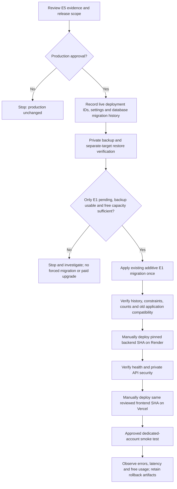

# Notifications E1–E5: production release and rollback runbook

**Status: preparation only. Production approval is required before backup/export,
production database access, migration, deployment or smoke-test record creation.**
No step below was executed against Neon, Render or Vercel during E5. No production
credential is stored in this document. Keep the existing free plans, URLs, secrets,
origin/proxy rules and market-data safeguards. No paid feature is required.

## Disabled-first rollout flag

Use the newer commit containing this flag, not `a3742d6` (which always enabled
notifications). `NOTIFICATIONS_ENABLED` is server-only and defaults to `false` in
all environments. Only the exact value `true` enables notification APIs and
producers; invalid values fail configuration validation. A restart is required.

For initial Render deployment, leave the variable unset or keep it `false`.
No environment change is needed when it is absent. Keep production changes and
deployment pending approval. With the flag off:

- Authentication, origin/CSRF checks, rate limits and normal account/watchlist
  operations remain active.
- Authenticated `GET /api/v1/notifications/summary` returns HTTP 200 with
  `{enabled:false, unreadCount:null}`; other notification endpoints return 503.
  Unauthenticated requests still return 401.
- All notification producers, including security notices, are paused before
  accessing notification tables. Existing history and preferences remain intact.
- Email and native price alerts remain disabled independently of this flag.

Enable later only with approval by setting `NOTIFICATIONS_ENABLED=true` and
restarting/deploying the approved backend. User preferences still apply once on;
mandatory security notices cannot be individually opted out of. Events skipped
while globally disabled are not backfilled. To pause again, set `false` and restart;
retain E1 and every existing record. Isolated integration tests explicitly opt in
so their enabled-path coverage remains meaningful.

## Release identity and order

Use one reviewed, immutable Git commit containing E1–E5 for both applications.
Record its full SHA (`git rev-parse HEAD`) in the release record after E5 is
committed. Do not deploy whichever commit happens to be latest later.



The schema comes first because E2/E3 use its new columns and preference table.
The backend comes next because E4 depends on those private APIs. E5 adds no
migration beyond `20261125000100_notification_foundation`.

## 1. Record baseline and confirm scope

Before approval, review local tests and these instructions only. After approval:

1. Record the **actual currently live** Render deploy ID/SHA and Vercel deployment
   ID/URL/SHA. Historical conversation values are not proof of current state.
2. Record the public frontend/API URLs and the previous known-good deployments.
   Keep automatic deploys disabled. The repository has
   `git.deploymentEnabled:false` and the Render template has
   `autoDeployTrigger:off`; actual Render dashboard state must also be confirmed.
3. Confirm production `APP_ORIGIN` stays
   `https://market-pulse-five-sand.vercel.app`, the existing trusted-proxy list
   stays intact, and Vercel's `/api/:path*` rewrite stays pointed at
   `https://market-pulse-r246.onrender.com/api/:path*`.
4. Preserve `CSRF_SECRET`, session/cookie configuration and database URLs. Do not
   rotate secrets, enable email, enable native data/alerts, change worker settings,
   import a new Blueprint or upgrade a plan as part of this release.
5. Check actual free storage, compute, transfer and build allowance. Stop if the
   release or a backup/restore target would require payment. Do not assume a new
   Neon branch, paid rollback feature or Render shell is available.
6. Agree on a quiet release window. E1 adds columns, checks and ordinary indexes
   inside one transaction; PostgreSQL can briefly block writes during DDL. It is
   additive, not a promise of zero locking or zero downtime.

Only one operator should run migrations. Do not run application startup migration
commands, `db:seed`, `prisma migrate dev`, `prisma db push`, `prisma migrate reset`,
manual table drops or automatic migration-repair commands on production.

## 2. Secure direct connection and backup gate

Use an approved private local terminal and the existing project checkout. Disable
shell tracing and never paste credentials into chat, Git, screenshots, command
arguments or public CI logs. Obtain the **direct/unpooled** URL from Neon securely;
keep its TLS requirements. The project reads `DIRECT_DATABASE_URL` for Prisma CLI
and retains `DATABASE_URL` for the application's existing runtime connection.
Neon's [Prisma guide](https://neon.com/docs/guides/prisma-migrations) recommends this
separation. Do not modify the deployed environment to run a local migration.

Install/verify pinned dependencies in a clean local shell **before** loading any
production credentials (`npm ci --include=dev`, then `npm run db:generate`).
Dependency install scripts must not inherit production secrets. The following is
a **future approved operator example**, not an instruction to run now. The hidden
prompt keeps the URL out of shell history:

```bash
set +x
read -r -s -p 'Approved Neon direct URL: ' DIRECT_DATABASE_URL
printf '\n'
export DIRECT_DATABASE_URL
```

Run `SHOW server_version` as part of the approved inventory, and use a trusted
`pg_dump` client compatible with that server major. The local test PostgreSQL 17
binaries are not proof that production uses 17. Do not install system packages or
change settings without approval.

Neon documents a direct-connection `pg_dump` custom-format backup and `pg_restore`
in its [backup guide](https://neon.com/docs/manage/backup-pg-dump). Create the backup
outside the Git checkout in an approved private directory, protect it with mode
0600, and encrypt/store it securely. It contains sensitive user and session data.
No backup was created during E5.

Example avoids a credential-bearing command argument; `MP_BACKUP_FILE` must be an
absolute path in that private directory, with sufficient free disk space:

```bash
(
set -e
umask 077
export MP_BACKUP_FILE=/absolute/private/path/marketpulse-before-notifications.dump
node --input-type=module <<'JS'
import { spawnSync } from 'node:child_process';
import { closeSync, openSync } from 'node:fs';
let url;
try { url = new URL(process.env.DIRECT_DATABASE_URL); }
catch { throw new Error('Invalid approved connection URL; stop release'); }
const sslmode = url.searchParams.get('sslmode') || 'require';
if (!['require', 'verify-ca', 'verify-full'].includes(sslmode))
  throw new Error('The backup connection must retain approved TLS protection');
if (!['postgres:', 'postgresql:'].includes(url.protocol) || url.hostname.includes('-pooler'))
  throw new Error('Use the approved direct PostgreSQL connection');
const env = {
  ...process.env,
  PGHOST: url.hostname,
  PGPORT: url.port || '5432',
  PGDATABASE: decodeURIComponent(url.pathname.slice(1)),
  PGUSER: decodeURIComponent(url.username),
  PGPASSWORD: decodeURIComponent(url.password),
  PGSSLMODE: sslmode,
  PGCHANNELBINDING: url.searchParams.get('channel_binding') || 'prefer',
  PGCONNECT_TIMEOUT: '30',
};
// Reserve a new private file; never overwrite an existing backup.
closeSync(openSync(process.env.MP_BACKUP_FILE, 'wx', 0o600));
const result = spawnSync('pg_dump', ['--format=custom', '--file', process.env.MP_BACKUP_FILE], {
  env, stdio: 'inherit',
});
if (result.error || result.status !== 0) throw new Error('Backup failed; stop release');
JS
pg_restore --list "$MP_BACKUP_FILE"
sha256sum "$MP_BACKUP_FILE"
)
```

The subshell stops at the first backup/listing failure. Do not continue the release
after a failed block. Do not share the archive or its listing publicly. Verify it can restore into a
**separate approved target**, never into the live database. A production-data copy
and its target require explicit approval and secure handling, even when the target
is local. Check a matching schema, expected counts and constraints after restore.
If a free safe target is unavailable, stop and request a decision; do not buy one.
E5's synthetic local upgrade rehearsal does not replace verification of the real
production backup. A backup taken while writes continue is a consistent point-in-time
copy, but cannot include future writes; record its timestamp and recovery limits.

## 3. Inventory and migration gate

At the pinned checkout:

```bash
git status --short
git rev-parse HEAD
npm run db:status
sha256sum apps/api/prisma/migrations/20261125000100_notification_foundation/migration.sql
```

Expected E1 SQL SHA-256:
`12221a4f3d36ec2d1467a112993a20563fea6dc070d5b444aec75bc6560d9158`.
Compare the SQL checksum with this reviewed artifact. Confirm the first six checked-in
migrations match production history, none is failed, and **only E1 is pending**.
`migrate deploy` applies every pending migration, so stop if other migrations are
pending or history/drift is unexpected. If all seven are already applied, do not
reapply E1 or reset its metadata; inspect the existing structure instead.

Execute [notifications-before.sql](notifications-before.sql) only in the approved
target. It is a read-only inventory of migration state and row counts and does not
print user content or credentials. Use the approved SQL client/session; the script
also reports database/schema/version to prevent a target mix-up. Expect the correct
application database/schema and the reviewed history. Keep results private.

## 4. Apply E1 once, then verify

Only after the target, history and backup gates pass:

```bash
npm run db:deploy
npm run db:status
npm exec --workspace @marketpulse/api -- prisma migrate diff --from-config-datasource --to-schema prisma/schema.prisma --exit-code
```

These commands use the repository's installed Prisma **7.10.1**; do not install
`prisma@latest` or use Prisma 8 migration commands. Prisma's
[v7 deploy reference](https://www.prisma.io/docs/cli/v7/migrate/deploy) confirms that
`migrate deploy` applies pending SQL without resetting data; it does not itself
check drift or generate clients. E1 explicitly wraps its DDL in `BEGIN/COMMIT`.

The diff is read-only: expect exit 0 and no structural difference; exit 2 means
drift, so stop before deploying. Custom SQL checks are verified separately below.

Execute [notifications-after.sql](notifications-after.sql). Every `problem` result
must be empty. Confirm:

- E1 is finished once in `_prisma_migrations`, with no failed migration.
- Both new enums, notification metadata, preference table, indexes and all four
  notification integrity checks exist; the after script checks columns/indexes/
  validated constraints, and `npm run db:status` plus the reviewed migration cover
  the full migration artifact.
- Existing IDs, messages/read state and core records remain unchanged. Without
  concurrent writes, before/after counts match. With live writes, investigate any
  differences against actual operations rather than assuming migration data loss.
- A newly applied E1 marks pre-existing notifications `LEGACY` with null event and
  subject metadata. It creates **zero** preference rows and invents no activity.
  If E1 was already live, genuine later typed rows/preferences may already exist.

Do not run seeds, generate welcome-message backfills or delete legacy history.
The old application may remain running during the additive upgrade; its writers
were verified locally against the new defaults. Do not enable E2/E3 before E1.

If migration fails, **stop before deploying application code**. Preserve a redacted
error and inspect actual schema/history. E1 DDL is transactional, but Prisma may
retain a failed migration record. Do not blindly retry, mark it applied or edit
already committed SQL. After separate review/approval verifies rollback and fixes
the cause, an operator may mark the failed E1 rolled back using the pinned
`prisma migrate resolve --rolled-back` command, then retry. Prisma documents that
metadata operation in its [v7 resolve reference](https://www.prisma.io/docs/cli/v7/migrate/resolve).
It is not an automatic recovery step and does not itself undo SQL.

## 5. Manually deploy backend, then frontend

1. In Render, use **Manual Deploy → Deploy a specific commit**, entering the full
   reviewed SHA. Keep current build/start commands and environment settings.
   [Render's deploy documentation](https://render.com/docs/deploys) describes this
   pinned-commit flow. Do not deploy a floating latest commit or enable Auto-Deploy.
2. Confirm the deployed SHA/build succeeded. Check `/api/v1/health/live` and make
   one `/api/v1/health/ready` request on the direct Render API. Expect 200; readiness
   performs a database connectivity check. Avoid continuous readiness polling.
3. Through the production frontend origin/rewrite, unauthenticated notification
   reads must return 401, cross-origin requests 403, and responses `no-store`.
   Health routes have their existing exceptions; do not relax origin/CSRF checks.
4. Use the existing Vercel project to create a deployment from the **same pinned
   SHA**, verify the source commit and existing build/output/rewrite configuration,
   then assign/promote it to the production domain only within the approval scope.
   Automatic Git deployments remain disabled. Vercel documents manual promotion
   in [Promoting Deployments](https://vercel.com/docs/deployments/promoting-a-deployment).
   Do not copy production credentials into a preview or broaden APP_ORIGIN for it.
5. Verify the production alias and deployed commit, then perform the approved smoke
   flow below. No new environment variable or browser-exposed API secret is needed.

### Concrete Vercel staged-release option

If the dashboard cannot create the pinned Git deployment while automatic deploys
are disabled, use an **already installed, reviewed Vercel CLI** and its existing
secure login. If it is missing, stop for approved tool setup; do not install a new
package silently or create another Vercel project. After backend verification and
within the production approval scope, make a source-only archive from the reviewed
commit, so ignored local `.env` files and database backups cannot be uploaded:

```bash
MP_RELEASE_SHA=$(git rev-parse HEAD)
MP_STAGE_DIR=$(mktemp -d /tmp/marketpulse-release.XXXXXX)
git archive --format=tar "$MP_RELEASE_SHA" | tar -x -C "$MP_STAGE_DIR"
unset DIRECT_DATABASE_URL
vercel link --cwd "$MP_STAGE_DIR"
vercel deploy --cwd "$MP_STAGE_DIR" --prod --skip-domain --meta "marketpulseReleaseSha=$MP_RELEASE_SHA"
```

In the link prompt, select the recorded existing team/project and verify its IDs;
do not create a project or accept mismatched settings. The archive contains only
Git-tracked source from that SHA. Verify its build configuration, production
environment, metadata SHA and successful deployment URL. Vercel's
[CLI reference](https://vercel.com/docs/cli/deploy) documents `--prod --skip-domain`
for a production build without assigning production domains, and `--meta` for
release metadata. This does not change the application's origin allowlist.

Do not expect authentication writes from the staging URL to pass the production
origin restriction. Do not broaden CORS/CSRF for that test. After reviewing the
build, assign it to the production domain only when that step is approved:

```bash
vercel promote APPROVED_STAGED_DEPLOYMENT_URL
```

Confirm the public production alias now targets that deployment and record its ID.
Keep the preceding eligible deployment for rollback. No command in this subsection
was executed during E5; even a staged production build requires release approval.

## 6. Approved smoke test and observation

A smoke test means a short check that the release's essential functions work.
Creating an account or changing a watchlist is a production record change: obtain
approval for a designated test account before performing these steps. Do not use
or edit real users' accounts as test fixtures and do not silently delete audit
history to clean up.

- Register/sign in with that designated account and check the genuine event, bell
  and count. Invalid credentials must not create a sign-in event.
- Create/rename a temporary approved list, add/remove a genuine catalog asset and
  delete the list. Verify its notifications and safe fallback links; duplicate or
  unchanged operations must add nothing.
- Test filters, pagination if enough genuine history exists, read/unread, mark-all
  and preferences. Never fabricate events merely to fill another page.
- Revoke an owned test session, check cross-tab clearing and sign back in. Use a
  second approved account only if account-isolation testing is authorized.
- Keep email disabled unless a separately approved working mail setup exists.
  Do not promise live password-reset/verification delivery based on the local
  capture tests; their existing APIs return unavailable when mail is disabled.
- Confirm production native price/history/alert features remain unavailable, with
  genuine official TradingView displays unchanged. Do not extract widget values.
- Check desktop/tablet/mobile and both themes; ensure links, counts, preferences,
  failures and disclosure text are visible. Check Vercel proxy/no-store responses,
  401/403/429 behavior and redacted server errors without deliberately exhausting
  a shared production quota.

Observe actual errors, database/build/free usage and response latency during the
agreed window. Notification polling is at most periodic visible authenticated-tab
checks plus action/navigation refreshes; no always-on worker or paid delivery
service was introduced. Free hosting can sleep or hit quotas; there is no delivery
SLA or real-time price-alert guarantee.

## 7. Rollback while preserving records

| Situation                           | Action                                                                                      |
| ----------------------------------- | ------------------------------------------------------------------------------------------- |
| Before migration, any gate fails    | Stop. Keep existing deployment and database unchanged                                       |
| Migration fails                     | Stop deployment; inspect schema/history; obtain approval for any repair                     |
| E1 succeeded, backend fails         | Restore the recorded known-good backend build; retain E1 and every record                   |
| Frontend fails with healthy backend | Restore previous frontend deployment; E2/E3 may continue recording genuine events           |
| Full application rollback           | Roll back frontend first, then backend; retain additive database schema/history/preferences |
| Suspected actual data corruption    | Stop and obtain a separate recovery plan; do not overwrite production from a dump           |

Render's [rollback guide](https://render.com/docs/rollbacks) describes selecting a
previous successful deployment artifact. If the required artifact is unavailable,
manual deployment of the recorded known-good commit is a separate build; check free
build allowance before doing so. Keep automatic deploys disabled.

Vercel's [Instant Rollback guide](https://vercel.com/docs/instant-rollback) states
that Hobby can roll back to the immediately previous production deployment; do not
assume arbitrary historical rollback is free or available. Record the eligible
previous deployment before releasing. If unavailable, stop and review a manual
known-good redeploy within free limits rather than upgrading the plan.

An application rollback **does not require a database down migration**. Do not drop
new columns/types/tables, reverse migration history, delete notices/preferences,
restore over newer user records or force-push Git. A backup restore would lose
writes made after that backup unless separately reconciled; it requires its own
approval, target and write-control plan. Preserve existing secrets, security rules,
asset IDs, user accounts and watchlists throughout rollback.

## Approval checkpoint

Review the E5 verification report and choose the precise production scope before
any action: target identity/inventory, secure backup and restore target, E1-only
migration if needed, pinned backend/frontend deployment, designated-account smoke
tests and the recorded rollback targets. None of these actions is authorized merely
because this runbook exists. Stop at an unexpected migration, failed backup, paid
requirement, missing credential, security regression or unapproved data change.
