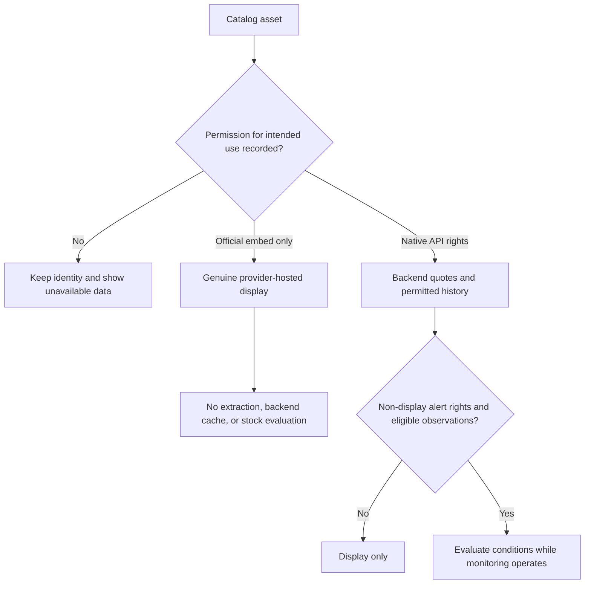

# MarketPulse public product scope

Decision date: 2026-11-25. Steps A1 and A2 are approved for documentation only.
The [A2 report](provider-permissions-a2.md) and
[implementation proposal](free-data-implementation-plan.md) extend this scope
without changing the running product.
[ADR 0005](decisions/0005-public-product-scope-and-data-rights.md) supersedes the
original demonstration scope. This document defines the intended public product;
it does not claim that the changes below are deployed.

## Purpose and cost boundary

MarketPulse will help people follow a small set of genuine market observations,
maintain private watchlists, and understand the source and age of their data.
The first release is a low-traffic, noncommercial service within free allowances.
Public access does not establish permission to redistribute a provider's data.

No paid plan, card-required trial, automatic overage, domain purchase, new service,
or expanded ingestion is authorized. If a feature cannot legally or reliably work
for free, explain its limitation and leave it unavailable. Do not invent a price.

Example: a saved Apple watchlist item remains useful when its price is unavailable.
Show “Price unavailable” and the reason; do not generate a plausible Apple price.

## Implemented behavior versus the intended release

| Area                            | Current implementation                                                                          | Intended public release                                                                                     |
| ------------------------------- | ----------------------------------------------------------------------------------------------- | ----------------------------------------------------------------------------------------------------------- |
| Catalog                         | Ten cryptocurrencies and five stock identities; production seed completion is not verified here | Same stable identities; verify the approved seed separately                                                 |
| Crypto                          | Genuine CoinPaprika adapter, plus a development/demo mode                                       | Public native data only after the exact display, storage, chart, and alert rights are confirmed             |
| Stocks                          | Prices and history are simulated; configuration and SQL restrict stocks to demo-only            | No simulated observations in public views; an approved official widget or explicit unavailability initially |
| Native stock feed               | No implemented real-stock adapter                                                               | Conditional on a documented no-cost permission covering the intended uses                                   |
| Watchlists                      | Private PostgreSQL-backed lists                                                                 | Retain ownership, stable asset IDs, and existing limits                                                     |
| Favorites                       | Stored in this browser                                                                          | Clearly distinguish browser favorites from account watchlists                                               |
| Accounts                        | Registration, login, opaque sessions, revocation, CSRF                                          | Preserve security; verify production recovery before public launch                                          |
| Recovery and verification email | Only local Mailpit delivery exists                                                              | Launch prerequisite for dependable password accounts, unless an approved alternative solves recovery        |
| Alerts                          | Genuine fresh CoinPaprika crypto events; stock targets cannot trigger                           | Only rights-cleared observations and explicit monitoring availability                                       |
| Notification inbox              | Table exists; complete inbox API/UI does not                                                    | Planned separately; event history is not a notification-delivery claim                                      |
| Email alerts                    | Not implemented                                                                                 | Optional later work, only with an approved free delivery route and quota                                    |
| Portfolios, trades, sockets     | No complete product implementation                                                              | Outside this release                                                                                        |

This status is based on source inspection, not a new production test. Existing
behavior remains unchanged by A1, including simulated stocks and blocked stock
alerts. Removing public simulation requires a later approved implementation step.

## Initial audience and assets

Keep the existing USD catalog:

- Crypto: BTC, ETH, SOL, XRP, ADA, DOGE, AVAX, LINK, LTC, DOT.
- US stocks: AAPL, MSFT, AMZN, GOOGL, NVDA.

Use stable asset UUIDs and provider mappings, not ticker text alone. For example,
`stock:NASDAQ:AAPL` identifies the existing catalog asset; a future provider's
symbol is a mapping, not a reason to recreate that asset.

Keep five watchlists per account, twenty items per list, and ten active alerts per
account unless a later approved step changes them. These application limits do
not grant provider rights or guarantee a number of public users.

## Two data paths

A widget is a small provider-hosted component embedded in the page. Its displayed
price does not become a value our server may copy. A native feed is data fetched
by our server, which needs its own permissions and limits.

Prefer investigating official free stock and crypto widgets first. This is a direction for
later review, not approval of a provider, widget implementation, or data ingestion.
A fully integrated stock feed remains conditional; no reviewed standard free plan
has yet been accepted for all required public display, caching, charts, and alerts.
See [provider findings](data-providers.md) and the
[rights acceptance checklist](market-data-rights.md).

## Required presentation

Every native observation must identify its source, observation time, and applicable
refresh/delay policy. Keep fetched time separate: downloading yesterday's close
now does not turn it into a current trade.

Use accurate labels:

- **Delayed:** the source documents a delay; state the actual applicable delay.
- **Last close:** a completed market session's closing observation.
- **Stale:** outside that dataset's permitted freshness window.
- **Unavailable:** no usable or permitted observation can be supplied.
- **Embedded display:** the external component owns the displayed data; native
  quote, chart, and alert capability may be absent.

A weekend closing price is not necessarily bad data, but it must remain labeled
as a last close. Do not fabricate missing chart points, infer a traded price from
a drawing, or use synthetic data to fill an outage. Synthetic test fixtures remain
allowed in isolated automated tests; they are never production observations.

## Alert promises

Above means greater than or equal to the target; below means less than or equal.
The next eligible observation after arming can satisfy a target already reached.
This is an observed target condition, not proof of every intraday crossing.

Preserve decimal comparisons, post-arm source/fetch times, one event per activation,
owner authorization, and atomic quote/event writes. An atomic write commits all
related records together or rolls all of them back.

A widget cannot drive MarketPulse alerts. An end-of-day feed could support only a
clearly labeled closing-price condition if its license allows it. A delayed feed
needs its own freshness/calendar rules. Existing crypto-specific code and SQL
constraints must be reviewed together before any stock evaluation is enabled.

Monitoring can stop while free hosts sleep or quotas are exhausted. Do not promise
immediate alerts, uninterrupted monitoring, reconstruction of missed crossings, or
email delivery before those capabilities exist and are verified.

## Release prerequisites

1. Record dataset-specific public-use rights and all retention/attribution duties.
2. Remove simulated observations from the public release through approved code work.
3. Verify catalog availability without replacing IDs or deleting user records.
4. Verify production login, recovery, ownership, session rotation, and CSRF.
5. Test source timestamps, unavailable states, quota handling, and monitoring gaps.
6. Verify keyboard, screen-reader, mobile, and third-party-display fallbacks.
7. Verify free hosting eligibility, account limits, backup, and restore procedures.
8. Deploy only reviewed changes; approve production database operations separately.

These are acceptance gates, not a claim that A1 completes them.

## Exclusions and next approval

No trade execution, simulated portfolio product, predictions, full-market search,
paid market feed, guaranteed timing, or unlimited-scale promise is included.
Do not migrate users or replace the working hosting stack as part of A1.

The user defined A2 as permission research; that documentation step supersedes the
previous proposal to execute baseline verification as A2. Baseline verification and
the next implementation step remain pending explicit approval. Consult
[ADR 0006](decisions/0006-a2-provider-permission-review.md). Neither A1 nor A2
authorizes application changes, a production data operation, or a deployment.
