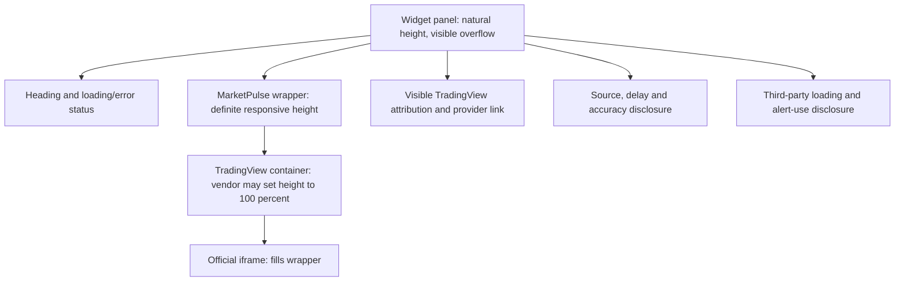

# TradingView layout and catalog-loading correction

This follow-up fixes the layout defect observed after deploying `eed0f15`.
Application changes are limited to the frontend. No database migration, seed,
production setting change, new provider, credential or paid service is required.

## Why the chart and footer were clipped

TradingView's official script changes `.tradingview-widget-container` to an inline
`height: 100%`. Previously that element was directly inside an automatically sized
`.market-panel` with `overflow: hidden`. Its percentage height no longer had a stable
parent height. The chart and footer could extend below the panel's visible bounds.
Production measurements showed an attribution starting below the panel's bottom:
it existed in the DOM but was invisible to users.

`TradingViewWidget.tsx` now places the vendor-controlled element inside a separate
`.market-widget-viewport` that MarketPulse sizes. The wrapper is 560px tall on
larger screens and 500px on mobile. The vendor's 100% height now resolves against
this explicit height. Attribution and both source/privacy disclosures are outside
the wrapper, so they add their own space to the panel. Only widget panels override
the shared panel's overflow to visible; market tables keep their existing styles.



The embedding host, instrument mappings, required attribution, dark/light theme
selection and security controls are unchanged. Scoped attribution colors retain
the original text/links while keeping link and trademark text readable in both
themes, even after vendor styles load. No widget prices are extracted,
cached, calculated or used for alerts.

## Catalog timeout investigation

The initial production visit did not populate the catalog within the browser
verification window, while later visits succeeded. The infrastructure cause was
not established: no Render/Neon logs or settings were changed or accessed.

Source inspection found two client-side behaviors that made slow recovery worse:
all API reads had a 10-second timeout, and polling waited at least a minute after
any failure. A slow but eventually successful metadata request could be cancelled,
followed by an unnecessarily long empty/error state.

`api.ts` now allows **catalog list/detail metadata** up to 45 seconds. Other request
timeouts remain 10 seconds. Cancellation on navigation/unmount still aborts the
request. Catalog network/time-out failures and server errors without Retry-After
report a useful retry message and a five-second retry minimum. HTTP 429 and supplied
Retry-After cooldowns keep their existing conservative handling; manual retries do
not bypass them. Invalid input, missing assets and authentication failures do not
receive the short transient-retry classification.

`poll-market.ts` distinguishes recovery from routine refreshing. Transient retries
wait 5, 10, 20, 40, then at most 60 seconds between failures. Success resets that
backoff and returns to normal refresh timing. Server cooldowns longer than a minute
are never shortened. Hidden tabs do not poll, requests do not overlap, and cleanup
aborts pending work. Loading text now describes market information rather than
implying that native cached prices are available.

The longer timeout does not guarantee that a sleeping service will respond within
45 seconds; users still get an honest error and retry path if it does not.

## Regression checks that test visibility

Run a **production** frontend build before the browser suite:

```bash
NODE_ENV=production npm run build
node scripts/test-market-browser.mjs
MARKET_BROWSER_LIVE_WIDGETS=1 node scripts/test-market-browser.mjs
```

The default suite uses a local catalog and an isolated embedding shell with no fake
prices. The shell deliberately applies the vendor's `height: 100%` override. Tests
cover overview, stock and crypto displays at desktop, tablet and mobile widths,
in both themes. They check:

- Explicit wrapper height and iframe bounds, without collapsed or overflowing frames.
- Heading, full iframe, attribution link and both disclosure paragraphs.
- Attribution text contrast of at least 4.5:1 in both themes.
- Rendered boxes inside the page viewport and panel, hidden/scrolling ancestor
  boundaries, visibility/opacity, and point hit-testing for covered content.
- Negative controls that deliberately clip the attribution or cover it with an
  overlay: DOM presence must not make those cases pass.
- A 12-second catalog response that succeeds once, beyond the old timeout.
- Automatic and manual recovery after a temporary 503, plus prevention of manual
  retries during a 429 cooldown.
- Blocked and silent widget scripts, retry behavior, theme changes and navigation.
- No simulated prices, internal diagnostics or native quote/history requests.

The visibility helper scrolls only the outer page. `scrollIntoView` is deliberately
avoided: it can programmatically scroll an `overflow: hidden` ancestor and expose
content that ordinary users cannot reach, masking this regression.

The optional real-widget run uses the same local catalog and official TradingView
embeds. It applies the same geometry/hit-testing checks to all three display types,
three viewports and both themes, and saves screenshots for visual review. It does
not connect to the production API or database. Cross-origin financial values are
not read by the test; a passing layout test does not certify price accuracy.

Unit regressions also check request timeouts, cancellation, Retry-After, bounded
backoff, recovery and reset. Existing authentication, watchlist, alert and production
native-data safeguards remain covered by the full suite.

## Rollout boundary

Commits may be pushed with the previously confirmed Render Auto-Deploy disabled
and Vercel Git deployments disabled. Deployment remains a separate approved action.
This frontend correction needs no production database work. Once deployment is
approved, verify attribution and disclosures visually on the deployed site, not
just with DOM queries, and check a slow catalog load and widget-host failure.

## Verification result

- PASS: all 129 unit/component/HTTP regression cases, including both new catalog
  timeout/backoff cases; no failures.
- PASS: lint, formatting, all workspace/API-tool type checks, full production build
  and the final frontend production build after the styling changes.
- PASS: isolated browser tests at 1280×900, 768×1024 and 390×844, including clipping
  and overlay negative controls, responsive heights, theme changes, delayed catalog,
  automatic/manual recovery, Retry-After enforcement and widget failure states.
- PASS: all 18 real-widget combinations (overview/Apple/Bitcoin × three viewports ×
  two themes), with bounds, hit-testing and at least 4.5:1 attribution text contrast.
  Screenshots were reviewed across desktop/tablet/mobile and both themes.
- No uncaught browser exceptions or native quote/history API requests occurred.
  Temporary screenshots were saved under `/tmp/marketpulse-browser-XmUf4G`.

No production API/database was used for these browser tests. The authenticated
production user lifecycle and database integration suites were not rerun for this
frontend-only correction; the earlier local PostgreSQL access limitation remains.
Every catalog symbol's live feed accuracy/entitlements are not certified by these
layout checks. Production deployment and post-deployment checks remain pending
separate approval. The original infrastructure delay remains unconfirmed; the
reproduced client timeout and retry behavior are corrected and covered by tests.
